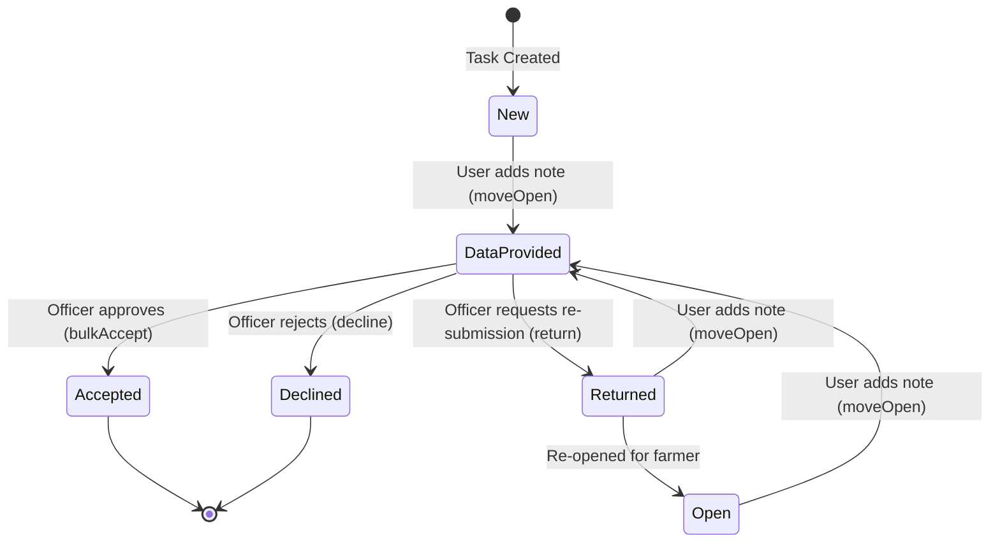

# Task & Photo Management System

The Task & Photo Management System serves as the operational core of the application. It is responsible for managing the end-to-end lifecycle of assignments ("Tasks") and their corresponding evidentiary "Photos." The system facilitates a workflow between farmers (who provide data) and officers/administrators (who verify data), encompassing task assignment, status transitions, photo verification, and the generation of standardized PDF reports containing geospatial metadata.

## System Architecture and Data Flow

The subsystem is implemented as a state-driven management layer using React and Inertia.js, communicating with a Laravel backend via specialized routes. The architecture follows a reactive pattern where user actions (status updates, assignments) trigger server-side state changes, which are then reflected across the Task List, Photo Gallery, and Map overlays.

### Core Workflow Logic

The system manages two primary lifecycles:

1.  **Task Lifecycle**: Governed by status transitions and verification flags.
2.  **Photo Lifecycle**: Governed by the association between an unassigned photo and a specific task.

### Data Flow: Photo Assignment
The process of linking evidence to an assignment follows this sequence:
1.  **Selection**: User selects one or more photos in `PhotoGallery.tsx`.
2.  **Task Discovery**: The system fetches unassigned tasks via `get-unassigned-task`.
3.  **Association**: The `assign-task` route is called with `photo_ids` and `task_id`.
4.  **Update**: The Photo Gallery view refreshes, moving the photos from the "Unassigned" state to the Task-specific view.

## Implementation Details

### 1. Task Management & Status Control
The system implements granular control over task states through several key components:

*   **Task Type Management (`TaskType/Index.tsx`)**: Handles the configuration of "Purposes" (the categories of tasks). It provides interfaces for deactivating or editing task types via `types.create`, `types.edit`, and `types.destroy`.
*   **Officer Dashboard (`Tasks/Index.tsx`)**: A high-density management interface for officers to monitor assignments.
    *   **Filtering**: Uses `applyFilters` to query the backend by status (e.g., `new`, `open`, `data provided`) and deadline.
    *   **Bulk Operations**: Implements `bulkAccept` to transition multiple tasks from `data provided` to `accepted` simultaneously.
*   **Task Detail & Transitions (`Tasks/Detail.tsx`)**: Provides the interface for individual task auditing.
    *   **Note-driven transitions**: Methods like `moveFromOpenTask` require a text note, ensuring an audit trail of why data was submitted or returned.
    *   **Verification**: Implements `acceptTask` and `declineTask`, which set the `flag_id` (1 for Accepted, 2 for Declined).

### 2. Photo Gallery & Evidence Management
The photo management subsystem handles both unassigned imagery and task-specific evidence.

*   **Gallery Interface (`Farmers/PhotoGallery.tsx`)**:
    *   **Unassigned State**: Photos without a `task_id` are displayed in a global gallery, allowing for bulk assignment to existing tasks via the `ChooseTaskPopup`.
    *   **Split View Logic**: Supports a dual-pane layout where the `LeftPane` (Gallery/List) and `RightPane` (Map) can be toggled. This is critical for spatial verification of photos.
*   **Spatial Filtering**: The `handleZoomFilter` function interacts with the map engine to filter the visible photo list based on the current map bounds or selected features (`leaves`).

### 3. PDF Generation & Metadata Extraction
The system automates report generation through `PdfPreview.tsx`. This component extracts high-precision GNSS metadata from photo objects:

*   **Geospatial Data**: Latitude, Longitude, Altitude, and Azimuth/Vertical angle.
*   **Accuracy Metrics**: GNSS accuracy (in meters) and NMEA distance.
*   **Device Telemetry**: Device manufacturer, model, platform, and OS version.
*   **Security/Integrity**: OSNMA validation status (Enabled/Disabled) and satellite validation counts.

The component uses `ClientPdfRenderer` to transform these data points into a structured document layout for official record-keeping.

## Current Behavior Summary

| Feature | Implementation Detail |
| :--- | :--- |
| **Task Statuses** | `new`, `open`, `data provided`, `returned`, `accepted`, `declined`. |
| **Verification** | Officers use `flag_id` (1/2) to mark tasks as Accepted or Declined. |
| **Photo Association** | Photos can be batch-assigned to unassigned tasks via a selection popup. |
| **Reporting** | PDF generation includes detailed GNSS and device telemetry. |
| **Navigation** | Split-pane view in `Farmers/Index.tsx` allows simultaneous list and map viewing. |

## Known Gaps

*   **Photo Upload Workflow**: The current specification covers management and assignment but does not detail the initial ingestion/upload process of raw photo data into the system.
*   **Error Recovery**: While basic alerts are present (e.g., `alert(errors[0])`), there is no robust localized error-handling framework for network failures during bulk operations.
*   **Offline Synchronization**: There is no documented logic for handling task updates or photo assignments when the farmer's device lacks connectivity, which is a high-risk requirement for field operations.

## Future Requirements

*   **Automated Verification**: Implementation of computer vision or metadata-based automated checks to flag "Declined" tasks without manual officer intervention.
*   **Advanced Reporting**: Expansion of the PDF engine to include multi-photo comparison and historical trend analysis (e.g., change in building height over time).
*   **Real-time Notifications**: Integration of WebSockets to notify farmers immediately when a task is "Returned" or "Declined."

## Related Specifications

*   [User & Agency Access Control (RBAC)](02_user___agency_access_control__rbac__.md)
*   [Building Attributes Engine (BuildingHeight)](03_building_attributes_engine__buildingheight__.md)
*   [Deck.gl Visualization Overlay](04_deck_gl_visualization_overlay_.md)
*   [Mapbox/MapLibre Tile Engine (PMTiles)](05_mapbox_maplibre_tile_engine__pmtiles__.md)
