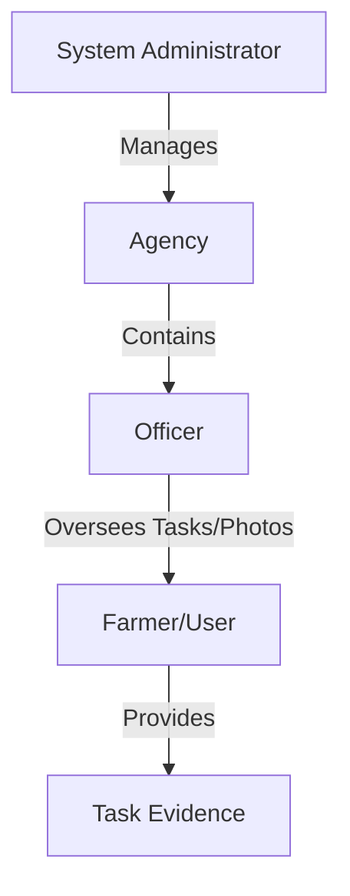

# User & Agency Access Control (RBAC)

Following the operational workflows defined in the [Task & Photo Management System](01_task___photo_und_photo_management_system_.md), the User & Agency Access Control (RBAC) subsystem provides the structural security layer. It implements a hierarchical organizational model where access to data and management capabilities is partitioned by Agencies, Officers, and Users (Farmers).

## System Architecture and Organizational Hierarchy

The system utilizes a multi-tenant architecture based on "Agencies." This hierarchy ensures that administrative actions are scoped to specific organizational units. The identity model is structured as follows:

### Access Scoping Logic

1.  **Global Administration**: Responsible for the lifecycle of Agencies and global User management.
2.  **Agency Management**: The ability to create, edit, or deactivate an entire Agency entity.
3.  **Officer Scoping**: Officers are bound to a specific `agencyId`. All officer management actions (invitation, creation, deletion) are contextually dependent on the active Agency.
4.  **User/Farmer Management**: A centralized registry of users, which includes metadata such as identification numbers and VAT, used for verifying the legitimacy of data providers.

## Implementation Details

The subsystem is implemented using React and Inertia.js, leveraging Laravel's routing system to enforce scope-based access via URL parameters (e.g., `agencyId`).

### 1. Agency Management Module
This module handles the top-level organizational entities.

*   **Agency Registry (`Agencies/Index.tsx`)**: Provides a high-level overview of all registered agencies.
    *   **Lifecycle Control**: Implements deactivation via `dashboard.agencies.destroy`.
    *   **Navigation**: Uses `handleRowClick` to route users to specific agency details via `dashboard.agencies.show`.
    *   **Routes**: Utilizes `dashboard.agencies.create` for new entity provisioning.

### 2. Officer Management Module (Agency-Scoped)
This module manages personnel assigned to a specific Agency. It is strictly scoped by the `agencyId` passed through the route.

*   **Officer Registry (`Officers/Index.tsx`)**: A management interface that is context-aware of its parent agency.
    *   **Contextual Routing**: Routes for creating or inviting officers (e.g., `dashboard.agencies.officers.create`) explicitly append the `agencyId` to ensure the officer is correctly associated with the target agency upon creation.
    *   **Scoped Deletion**: The `destroy` function executes `dashboard.agencies.officers.destroy` while passing the `agencyId` as a query parameter: `?agencyId=${agency.id}`.
    *   **Navigation**: Includes "Back" functionality to return to the parent Agency view (`dashboard.agencies.index`).

### 3. User/Farmer Management Module
This module manages individual users (Farmers) and provides an audit-ready view of their activity related to the [Task & Photo Management System](01_task___photo_management_system_.md).

*   **User Dashboard (`Users/Index.tsx`)**: A high-density data table for monitoring user activity.
    *   **Operational Metrics**: The table displays real-time aggregates per user, including `tasks_count`, `photos_count`, and `unassigned_photos_count`. This links user identity directly to the operational state of tasks.
    *   **Data Filtering & Sorting**: Implements server-side filtering via `applyFilters` (handling `search`, `sortColumn`, and `sortOrder`) through Inertia router requests.
    *   **Pagination**: Uses a custom `Pagination` component to handle large datasets of users.
*   **User Provisioning (`Users/Create.tsx` & `Users/Edit.tsx`)**:
    *   **Identity Attributes**: Manages critical identification metadata: `login`, `email`, `identification_number`, and `vat`.
    *   **State Management**: Uses the Inertia `useForm` hook to handle `post` (creation) and `patch` (updates) operations.

## Current Behavior Summary

| Feature | Implementation Detail |
| :--- | :--- |
| **Agency Scoping** | Officers are strictly tied to an `agencyId` during creation/deletion. |
| **User Metrics** | User list displays task and photo counts, linking RBAC to the Task System. |
| **CRUD Operations** | Full support for creating, editing, and deactivating Agencies, Officers, and Users. |
| **Search & Sort** | Server-side search and sorting implemented for the User management module. |
| **Identity Metadata** | Storage of `identification_number` and `vat` for regulatory compliance. |

## Known Gaps

*   **Permission Granularity**: The current implementation uses roles/agency membership but lacks a granular permission system (e.g., an Officer cannot be restricted from specific task types).
*   **Authentication Logic**: While the UI assumes an `auth.user` exists, the specific logic for verifying session-based permissions is not defined in this specification.
*   **Officer Invitation Flow**: The "Invite" mechanism (`dashboard.agencies.officers.invite`) is referenced but the underlying email/token generation process is undocumented.

## Future Requirements

*   **Granular RBAC**: Implementation of a permission-based system (e.g., `can_approve_tasks`, `can_manage_agencies`).
*   **Audit Logging**: A dedicated module to track changes made by Officers and Admins to Agency and User records.
*   **Self-Service Farmer Portal**: A simplified interface for Farmers to manage their own profile metadata without Admin intervention.

## Related Specifications

*   [Task & Photo Management System](01_task___photo_management_system_.md)
*   [Building Attributes Engine (BuildingHeight)](03_building_attributes_engine__buildingheight__.md)
*   [Deck.gl Visualization Overlay](04_deck_gl_visualization_overlay_.md)
*   [Mapbox/MapLibre Tile Engine (PMTiles)](05_mapbox_maplibre_tile_engine__pmtiles__.md)
