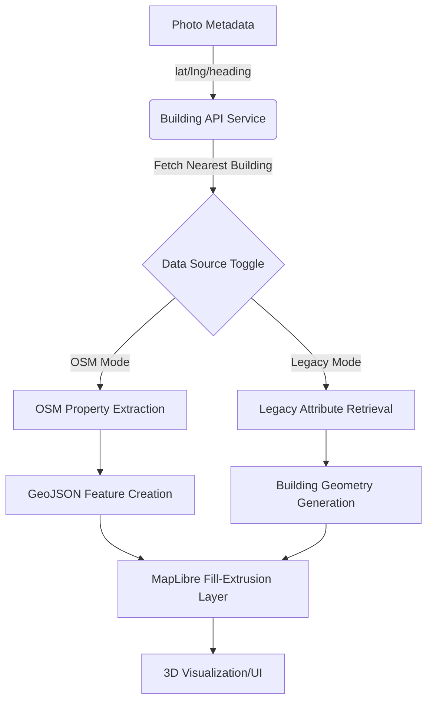

# Building Attributes Engine (BuildingHeight)

Following the security and organizational framework defined in [User & Agency Access Control (RBAC)](02_user___agency_access_control__rbac__.md), the Building Attributes Engine serves as the computational and visualization core of the system. It is responsible for transforming 2D geospatial metadata from captured photos into a 3D architectural context, enabling the extraction of physical properties such as absolute/relative building heights, roof structures, and volumetric data.

## System Purpose and Responsibility

The engine processes photographic evidence (GPS coordinates, altitude, heading) to identify and render nearby structural features. It acts as a bridge between raw GNSS telemetry and structured building datasets (both OpenStreetMap and proprietary legacy databases). Its primary respons'ability is to provide an interactive 3D environment where users can verify the physical dimensions of structures through spatial overlays and attribute inspection.

## System Architecture and Data Flow

The subsystem operates as a high-performance visualization pipeline using MapLibre GL for terrain and base layers, and Deck.gl for complex 3D overlays (scenegraphs and point clouds).

### Data Processing Pipeline

The engine follows a multi-stage flow to transform photo metadata into 3D geometry:



### Core Components and Dependencies

*   **Spatial Engine**: MapLibre GL for rendering terrain (via PMTiles), hillshading, and 2D/3D building extrusions.
*   **Overlay Engine**: Deck.gl for rendering 3D camera models (`ScenegraphLayer`), photo previews (`IconLayer`), and LiDAR data (`PointCloudLayer`).
*   **Geometry Engine**: `turf.js` and `@math.gl/core` for calculating land area, volume, and geographic offsets.
*   **Data Ingestion**: `@loaders.gl/las` for processing LAZ/LAS point cloud files.

*   **API Layer**: A specialized service layer (`fetch-building.ts`) that orchestrates concurrent requests to multiple endpoints (UPRN, Codepoint, Land Registry, etc.).

## Implementation Details

### 1. Dual-Mode Data Processing
The engine implements a branching logic to handle two distinct data schemas: OpenStreetMap (OSM) and Legacy datasets. This is controlled via the `showOsmData` state in `BuildingAttributesContent.tsx`.

*   **OSM Mode**: Utilizes properties like `height_m`, `roof_height_m`, and `building_levels` to construct a single extrusion layer.
*   **Legacy Mode**: Requires two distinct GeoJSON layers—a `buildings-layer` for the walls (from ground to roof base) and a `roofs-layer` (from roof base to maximum height).

### 2. Building Attribute Retrieval
The `BuildingDataGrid.tsx` component manages the retrieval of granular metadata based on the selected photo's location. The system uses an optimized fetching strategy:

*   **Direct Endpoint**: For OSM data, it queries `/comm_codepoint` using direct longitude and latitude parameters.
*   **Batch Retrieval**: For legacy data, `fetchAllBuildingData` in `fetch-building.ts` executes a complex `Promise.all` across multiple endpoints:
    *   `/comm_building_part_nearest`: Identifies the nearest structure.
    *   `/comm_shapes`: Retrieves building footprints.
    *   `/comm_codepoint`: Fetches address/postcode data.
    *   `/comm_uprn`: Fetches Unique Property Reference Numbers.

### 3. 3D Visualization Layers
The engine manages three distinct types of 3D overlays via Deck.gl:

*   **Camera Scenegraph (`ScenegraphLayer`)**: Renders a `.gltf` model representing the camera's position and orientation (pitch/bearing) at the exact GPS coordinate of the photo.
*   **Photo Previews (`IconLayer`)**: Renders a 2D image preview of the actual photo, offset slightly behind the camera position to provide visual context in 3D space.

*   **LiDAR Integration (`PointCloudLayer`)**: Uses `LASLoader` to ingest `.laz` files from the server, rendering high-density point clouds for terrain and structural verification.

### 4. Geometric Computation
The `geo-operations.ts` utility performs the physical modeling:

```typescript
// Example of volumetric calculation logic in computeGeoMatrics
export const computeGeoMatrics = (
  coordinates: any,
  floorHeight: number,
  floorNumber: number,
  lotCoverage: number
) => {
  const areaPolygon = polygon(coordinates);
  const landArea = round(area(areaPolygon));
  const buildingHeight = floorHeight * floorNumber; // Height derived from floors
  const buildingArea = round(landArea * (lotCoverage / 100));
  const volume = round(landArea * (lotCoverage / 100) * buildingHeight);
  // ... returns calculated metrics
};
```

## Current Behavior Summary

| Feature | Implementation Detail |
| :--- | :--- |
| **Data Sources** | Supports switching between OSM and Legacy attribute schemas. |
| **3D Buildings** | Uses MapLibre `fill-extrusion` for 3D structural rendering. |
| **Photo Orientation** | Visualizes camera heading/bearing using 3D `.gltf` models. |
| **Terrain Support** | Integrates PMTiles-based DEM for accurate altitude/elevation calculations. |
| **LiDAR Rendering** | Loads and renders `.laz` point clouds via `loaders.gl`. |
| **Attribute Grid** | Displays UPRN, Postcode, Height (Min/Max), and Material data. |

## Known Gaps

*   **Asynchronous State Sync**: The `BuildingDataGrid` relies on manual `useEffect` triggers for fetching, which can lead to race conditions if the user rapidly switches between photos.
*   **Error Handling in Batch Fetches**: In `fetchAllBuildingData`, if one endpoint (e.g., `/comm_nhle`) fails, the entire `Promise.all` block may reject, preventing other valid data from being displayed.
*   **Memory Management**: Large `.laz` files loaded via `PointCloudLayer` are not explicitly cleared from GPU memory when switching between different files, potentially leading to browser crashes on low-end devices.

## Future Requirements

*   **Automated Height Verification**: Implementation of a logic layer to compare the photographic altitude (from GNSS) against the building's known maximum height to flag discrepancies.
*   **Enhanced LiDAR Processing**: Integration of server-side point cloud decimation to allow smoother rendering of larger datasets on mobile devices.
*   **Unified Schema**: Transitioning all data sources toward a single, unified property schema to eliminate the branching logic in `BuildingDataGrid`.

## Related Specifications

*   [Task & Photo Management System](01_task___photo_management_system_.md)
*   [User & Agency Access Control (RBAC)](02_user___agency_access_control__rbac__.md)
*   [Deck.gl Visualization Overlay](04_deck_gl_visualization_overlay_.md)
*   [Mapbox/MapLibre Tile Engine (PMTiles)](05_mapbox_maplibre_tile_engine__pmtiles__.md)
