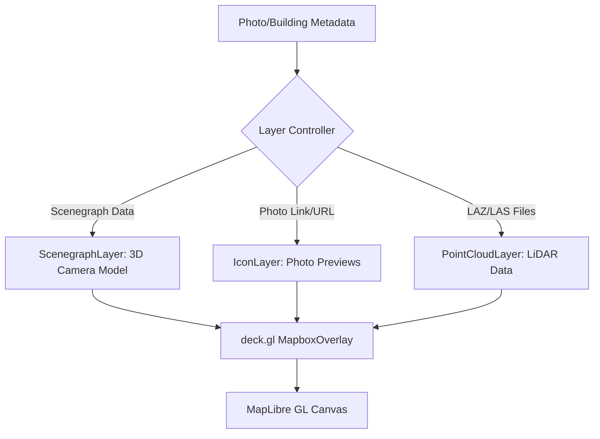

# Deck.gl Visualization Overlay

Following the computational logic of the [Building Attributes Engine (BuildingHeight)](03_building_attributes_engine__buildingheight__.md), the Deck.gl Visualization Overlay provides the high-performance rendering pipeline required to project complex 3D geometries onto a 2D/3D geospatial context. While MapLibre GL handles the base terrain and building extrusions, Deck.gl acts as the specialized layer for rendering non-standard primitives such as 3D camera models (scenegraphs), photographic previews, and high-density LiDAR point clouds.

## System Purpose and Responsibility

The subsystem is responsible for managing a multi-layered WebGL overlay that sits atop a MapLibray GL map instance. Its primary responsibilities include:
1.  **Scenegraph Rendering**: Projecting 3D `.gltf` models (e.g., cameras) at specific GPS coordinates with accurate orientation (pitch/bearing).
2.  **Dynamic Iconography**: Rendering photographic previews and markers that respond to camera movement and terrain elevation.
3.  **Point Cloud Visualization**: Ingesting and rendering massive `.laz` datasets using specialized loaders for LiDAR-based structural verification.
4.  **Spatial Contextualization**: Calculating 3D offsets (e.g., placing a photo preview slightly behind the camera's position) to provide depth in a 3D environment.

## System Architecture and Data Flow

The overlay operates as a `MapboxOverlay` within the MapLibre GL context, allowing Deck.gl layers to share the same coordinate system and camera projection as the base map.



### Core Components and Dependencies

*   **Rendering Engine**: `deck.gl` (v9.0.0+) for high-performance WebGL layer management.
*   **3D Mesh Rendering**: `@deck.gl/mesh-layers` (`ScenegraphLayer`) for `.gltf` model projection.
*   **Data Ingestion**: `@loaders.gl/core` and `@loaders.gl/las` for processing compressed LiDAR point clouds.
*   **Coordinate Transformation**: `maplibregl.addProtocol("pmtiles")` to ensure the overlay aligns perfectly with terrain-aware base maps.
*   **Geometry Utilities**: Custom logic in `deckgl-utils.ts` and `geo-operations.ts` for calculating 3D offsets and polygon extrusions.

## Implementation Details

### 1. Layer Orchestration (`BuildingAttributesContent.tsx`)
The subsystem manages several distinct overlay instances via the `MapboxOverlay` class. The logic is split between "Camera" overlays and "Building/LiDAR" overlays.

*   **Scenegraph & Icon Management**: The system creates a `ScenegraphLayer` to render a `.gltf` model representing the camera's position and orientation (using `photo_heading`). Simultaneously, an `IconLayer` renders the photo preview at a calculated offset behind the camera using `getOffsetPosition`.
*   **LiDAR Ingestion**: The `handleDrawLaz` function implements the pipeline for loading point clouds:
    1.  Fetches `.laz` files from the server via `LAZ_FILES_URL`.
    2.  Uses `LASLoader` to parse the binary data.
    3.  Applies `transformLazData` to align coordinates with the map projection.
    4.  Injects a `PointCloudLayer` into the active `MapboxOverlay`.

### 2. Layer Factory Logic (`deckgl-utils.ts`)
The subsystem uses a factory pattern to generate complex, multi-layered geometries for structural analysis. The `createBuilding` function demonstrates the construction of:
*   **GeoJsonLayer**: For ground-level footprints.
*   **PolygonLayer**: For extruded building stories using `extruded: true`.
*   **ScenegraphLayer**: To attach 3D camera models to specific data points.

### 3. Viewport Control (`deckgl-wrapper.tsx`)
The `DeckglWrapper` component manages the high-level interaction between the "Map" view and the "First Person" (immersive) view. It utilizes `MultiviewMapViewState` to synchronize the camera's longitude, latitude, pitch, and bearing across different rendering perspectives.

```typescript
// Example of 3D Offset Calculation in BuildingAttributesContent.tsx
const getOffsetPosition = (coordinates: [number, number, number], bearing: number, distance: number) => {
  const rad = (bearing * Math.PI) / 180;
  const offsetLat = distance * Math.cos(rad) / 111111; // Meters to degrees conversion
  const offsetLon = distance * Math.sin(rad) / (111111 * Math.cos(coordinates[1] * Math.PI / 180));
  return [
    coordinates[0] + offsetLon,
    coordinates[1] + offsetLat,
    coordinates[2] + 6 // Vertical offset to prevent Z-fighting with terrain
  ];
};
```

## Current Behavior Summary

| Feature | Implementation Detail |
| :--- | :--- |
| **3D Camera Rendering** | Uses `ScenegraphLayer` with `./marker.gltf`. |
| **Photo Previews** | `IconLayer` renders images at a calculated bearing offset. |
| **LiDAR Support** | Dynamic loading of `.laz` files via `@loaders.gl/las`. |
| **View Modes** | Supports `map`, `orthographic`, and `firstPerson` view states. |
| **Terrain Alignment** | Integrates with PMTiles-based elevation for accurate Z-axis placement. |

## Known Gaps

*   **GPU Memory Management**: Large `.laz` datasets loaded via `PointCloudLayer` are not explicitly disposed of, which can lead to memory pressure during repeated file swaps.
*   **Z-Fighting**: While a constant vertical offset (e.g., `+ 6` meters) is used in `getOffsetPosition`, extreme terrain gradients may still cause visual artifacts between the photo icon and the ground.
*   **Async Race Conditions**: Rapidly switching between "OSM" and "Legacy" data modes during an active `.laz` load can result in orphaned layers remaining on the map.

## Future Requirements

*   **LOD (Level of Detail) Management**: Implementation of point cloud decimation to allow smoother rendering of massive datasets on mobile hardware.
*   **Occlusion Culling**: Advanced logic to hide photo previews when they are obscured by building extrusions or terrain features.
*   **Unified Layer Controller**: A centralized state machine to manage the lifecycle (load/unload) of all Deck.gl layers, preventing memory leaks and ghost layers.

## Related Specifications

*   [Task & Photo Management System](01_task___photo_management_system_.md)
*   [User & Agency Access Control (RBAC)](02_user___agency_access_control__rbac__.md)
*   [Building Attributes Engine (BuildingHeight)](03_building_attributes_engine__buildingheight__.md)
*   [Mapbox/MapLibre Tile Engine (PMTiles)](05_mapbox_maplibre_tile_engine__pmtiles_.md)
