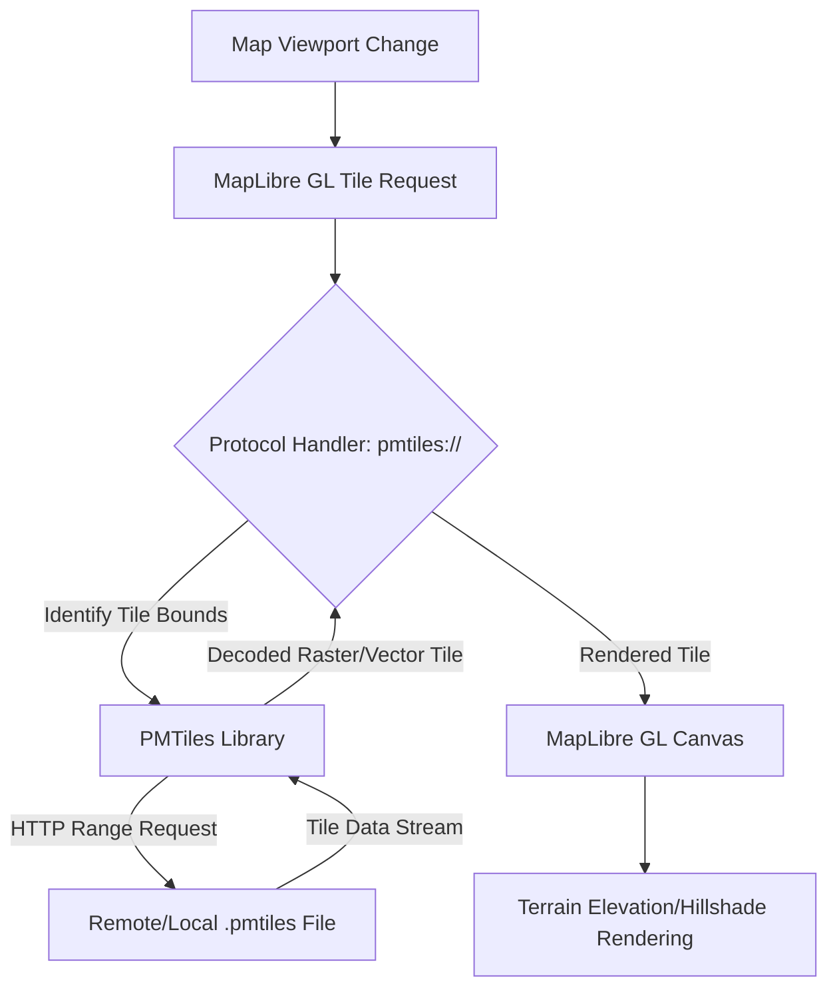

# Mapbox/MapLibre Tile Engine (PMTiles)

Building upon the high-performance rendering capabilities defined in [Deck.gl Visualization Overlay](04_deck_gl_visualization_overlay_.md), the Mapbox/MapLibre Tile Engine (PMTiles) subsystem provides the specialized data-loading infrastructure required to stream massive geospatial datasets. It implements a tile-based fetching mechanism using the PMTiles format, enabling the application to access terrain elevation (DEM) and hillshading data through efficient HTTP Range Requests without requiring a full download of the dataset.

## System Purpose and Responsibility

The primary responsibility of this subsystem is to manage the integration of the PMTiles protocol within the MapLibray GL environment. This allows for:
1.  **Efficient Data Streaming**: Utilizing the `pmtiles://` custom URI scheme to fetch only the specific tiles required for the current viewport and zoom level.
2.  **3D Terrain Rendering**: Providing the Digital Elevation Model (DEM) data necessary for MapLibre's `setTerrain` functionality.
3.  **Elevation-Aware Geometry**: Enabling the calculation of precise Z-axis coordinates (altitude) for 3D objects (photos, camera models, and buildings) by querying the terrain elevation at specific geographic coordinates.

## System Architecture and Data Flow

The subsystem functions as a protocol extension to the MapLibre GL networking layer. When the map engine requests a tile using a `pmtiles://` URL, the PMTiles Protocol handler intercepts the request and performs targeted byte-range fetches against the single `.pmtiles` container file.



### Core Components and Dependencies

*   **PMTiles Protocol Handler**: The `pmtiles.Protocol` class, which implements the logic for parsing the PMTiles header and managing tile indices.
*   **MapLibre GL Custom Protocol**: Integration via `maplibregl.addProtocol("pmtiles", protocol.tile)`, allowing the map engine to recognize the custom URI scheme.
*   **Raster-DEM Sources**: MapLibre `raster-dem` sources that consume PMTiles data for terrain displacement and hillshading.
*   **Dependencies**: 
    *   `pmtiles`: The core library for tile extraction.
    *   `mapbox-gl` / `maplibre-gl`: The underlying rendering engine.

## Implementation Details

### 1. Protocol Registration and Initialization
The protocol must be registered with the MapLibre global instance before any tile requests are initiated. This is implemented in both `BuildingAttributesContent.tsx` and `DeckglWrapper.tsx`.

**File: `PIC2BIM/resources/js/Pages/BuildingAttributes/BuildingAttributesContent.tsx`**
```typescript
const loadMapBox = () => {
  // Initialize the pmtiles protocol
  const protocol = new pmtiles.Protocol();
  maplibregl.addProtocol("pmtiles", protocol.tile);
  
  const tilesURL = "/output.pmtiles";

  // Add terrain source using the custom protocol scheme
  mapRef.current?.addSource('terrainSource', {
    type: "raster-dem",
    url: "pmtiles://" + tilesURL,
    tileSize: 256
  });
};
```

### 2. Terrain and Hillshade Configuration
Once the protocol is active, the subsystem configures `raster-dem` sources to enable 3D topography. This includes setting up a hillshade layer for visual depth.

**File: `PIC2BIM/resources/js/Pages/BuildingAttributes/BuildingAttributesContent.tsx`**
```typescript
// Setting up the terrain displacement engine
map.current.setTerrain({
  source: "terrainSource",
  exaggeration: 1 // Scale factor for vertical relief
});

// Adding a hillshade layer to visualize terrain contours
map.current.addLayer({
  id: 'hillshadeLayer',
  type: 'hillshade',
  source: 'terrainSource',
  paint: {
    'hillshade-shadow-color': '#000000',
    'hillshade-highlight-color': '#ffffff',
    'hillshade-accent-color': '#888888'
  }
});
```

### 3. Terrain-Aware Coordinate Calculation
A critical function of this subsystem is providing elevation data for the [Deck.gl Visualization Overlay](04_deck_gl_visualization_overlay_.md). The system uses `queryTerrainElevation` to adjust photo and camera positions relative to the terrain height.

**File: `PIC2BIM/resources/js/Pages/BuildingAttributes/BuildingAttributesContent.tsx`**
```typescript
const getElevation = (lngLat: { lng: number; lat: number }): number | null => {
  if (!map.current) return null;
  try {
    // Queries the loaded PMTiles terrain source for the Z-value at this coordinate
    return map.current.queryTerrainElevation(lngLat);
  } catch (e) {
    return null;
  }
};

// Usage in processedPhotoData:
const altitude = terrainEnabled 
  ? elevation + (Number(photo.altitude) - elevation) 
  : 0;
```

## Current Behavior Summary

| Feature | Implementation Detail |
| :--- | :--- |
| **Protocol Support** | Implements `pmtiles://` via `maplibregl.addProtocol`. |
| **Data Source** | Static integration with `/output.pmtiles`. |
| **Terrain Type** | Uses `raster-dem` for Digital Elevation Model (DEM) processing. |
| **Visual Effects** | Supports terrain exaggeration and hillshade layer rendering. |
| **Spatial Integration** | Provides elevation data via `queryTerrainElevation` for 3D object placement. |

## Known Gaps

*   **Hardcoded Tile Path**: The path to the `.pmtiles` file is hardcoded within the component, preventing dynamic switching of datasets without a code change.
*   **Single-Source Limitation**: The current implementation only supports one PMTiles source for both terrain and hillshading; it cannot handle multiple overlapping DEM layers from different PMTiles files.
*   **Protocol Cleanup**: While `removeProtocol` is called in some cleanup effects, the lifecycle of the protocol registration during hot-reloads or rapid component unmounting is not fully robust.

## Future Requirements

*   **Dynamic PMTiles Configuration**: Implementation of a UI controller to allow users to select different PMTiles files (e.g., different regions or time-series datasets) at runtime.
*   **Multi-Source Terrain Support**: Ability to layer multiple PMTiles sources for complex topographic analysis.
*   **Tile Cache Management**: Explicit management of the browser's cache and the `pmtiles` internal cache to optimize performance on low-bandwidth mobile connections.

## Related Specifications

*   [Task & Photo Management System](01_task___photo_management_system_.md)
*   [User & Agency Access Control (RBAC)](02_user___agency_access_control__rbac__.md)
*   [Building Attributes Engine (BuildingHeight)](03_building_attributes_engine__buildingheight__.md)
*   [Deck.gl Visualization Overlay](04_deck_gl_visualization_overlay_.md)
