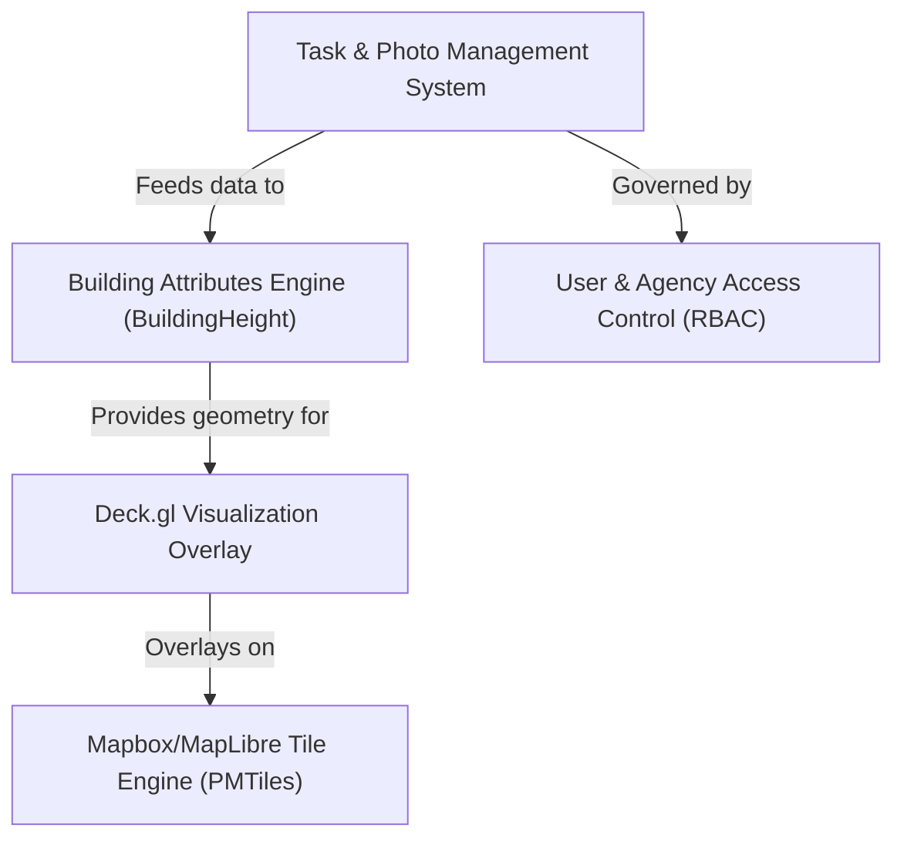

# combined-codebase Specification Index

The **PIC2BIM** project is a *specialized geospatial platform* designed to manage and visualize **3D building attributes**. It allows users to track the lifecycle of **tasks and photographic evidence** while utilizing advanced rendering technologies to transform raw GPS-tagged images into detailed *architectural models*, calculating complex metrics like height, volume, and land area.

**Source Repository:** [None](None)

## Specifications

1. [Task & Photo Management System
](01_task___photo_management_system_.md)
2. [User & Agency Access Control (RBAC)
](02_user___agency_access_control__rbac__.md)
3. [Building Attributes Engine (BuildingHeight)
](03_building_attributes_engine__buildingheight__.md)
4. [Deck.gl Visualization Overlay
](04_deck_gl_visualization_overlay_.md)
5. [Mapbox/MapLibre Tile Engine (PMTiles)
](05_mapbox_maplibre_tile_engine__pmtiles__.md)
