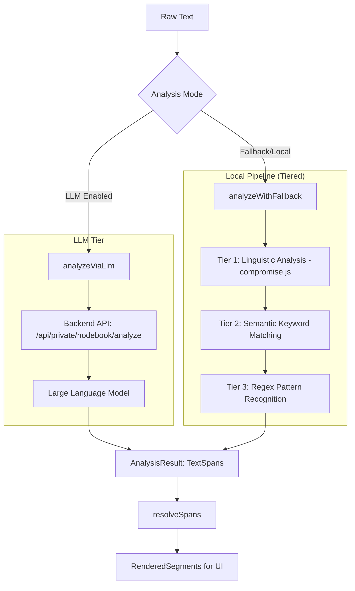

# Text Analysis Pipeline (NLP)

While [CNL Parsing & Operations](01_cnl_parsing___operations_.md) focuses on the structural extraction of explicit syntax, the **Text Analysis Pipeline (NLP)** provides a semantic layer. It scans raw text to identify latent entities, relationships, and linguistic features that are not explicitly defined by CNL syntax, enabling intelligent highlighting and potential graph augmentation.

## System Architecture & Data Flow

The subsystem operates as a multi-tiered analysis engine. Depending on the availability of backend services, it routes text through either a high-level LLM-based analyzer or a local fallback pipeline consisting of linguistic processing and pattern matching.

## Internal Implementation

The pipeline is implemented within `packages/nodebook-core/src/text-analyzer/`. It produces a collection of `TextSpan` objects, which are then resolved into non-overlapping segments for the user interface.

### 1. The LLM Tier (`llm-client.ts`)
When configured, the system uses `analyzeViaLlm` to perform deep semantic analysis. This function communicates with a backend endpoint (`POST /api/ . . . analyze`). It handles:
*   **Authentication**: Retrieval and injection of CSRF tokens via `fetchCsrfToken`.
*   **Categorization**: Passing a specific subset of `AnnotationCategory` to the model to constrain its focus.

### 2. The Fallback Pipeline (`fallback-pipeline.ts`)
The fallback mechanism ensures analysis continues even without an LLM connection, utilizing three distinct levels of granularity:

#### Tier 1: Linguistic Analysis (POS Tagging)
Using the `compromise.js` library, the system performs Part-of-Speech (POS) tagging to identify structural components of speech:
*   **Nodes**: Extracted from identified nouns.
*   **Relations**: Extracted from identified verbs.
*   **Adjectives/Adverbs**: Identified for stylistic annotation.

#### Tier 2: Semantic Keyword Matching (`category-rules.ts`)
The engine iterates through predefined sets of semantic markers to identify high-level logic:
*   **Quantifiers**: `all`, `many`, `some`.
*   **Modalities**: `must`, `should`, `can't`.
*   **Conditions**: `if`, `unless`, `provided that`.
*   **Process/IO**: Verbs like `transform` or keywords like `input`/`output`.

#### Tier 3: Pattern-Based Recognition (`category-rules.ts`)
The lowest tier uses Regular Expressions to find data patterns that are strictly formatted:
*   **Attributes**: Identifies numeric values paired with units (e.g., `10kg`, `25°C`).
*   **Operations**: Detects mathematical operators and functions (e.g., `sum of`, `log(x)`, `Δ`).

### 3. Span Resolution (`span-resolver.ts`)
Because multiple tiers might identify the same piece of text (e.g., a word being both a "Node" via POS tagging and a "Process" via keywords), the system implements `resolveSpans`. This algorithm:
1.  Collects all boundary points (start/end) from all detected spans.
2.  Sorts these boundaries to create discrete, non-overlapping intervals.
3.  Aggregates all overlapping categories into a single `RenderedSegment` for each interval.

## Data Structures & Types (`analyzer-types.ts`)

The core of the pipeline relies on several key interfaces:

*   **`AnnotationCategory`**: An enumeration defining the types of semantic data detectable (e.g., `Nodes`, `Relations`, `Quantifiers`, `Attributes`).
*   **`TextSpan`**: Represents a specific range within the text, including its category, confidence score, and suggested CNL syntax (e.g., `suggestedRelation`).
*   **`AnalysisResult`**: The final payload containing all detected spans and identified sentence boundaries.

## Implementation Constraints

*   **Concurrency & Loading**: The `compromise.js` module is loaded asynchronously via `loadCompromise` only when required, to minimize the initial footprint of the core engine.
*   **Categorization Limits**: To prevent UI performance degradation, the system enforces a `MAX_ACTIVE_CATEGORIES` limit during certain rendering operations.
*   **Regex Performance**: The pattern-matching engine uses global, case-insensitive regex execution; complexity is $O(N)$ relative to text length but can scale with the number of active patterns.

## Current Behavior vs. Known Gaps

| Feature | Status | Implementation Detail |
| :--- | :--- | :--- |
| **Linguistic Tagging** | Complete | Uses `compromise.js` for Nouns/Verbs/Adjectives. |
| **Keyword Matching** | Complete | Hardcoded sets in `category-rules.ts`. |
| **LLM Integration** | Complete | Client-side integration with backend API provided. |
| **Span Merging** | Complete | Overlapping spans are resolved into segments. |
| **Contextual Awareness** | Partial | Tier 1/2 lacks deep relationship context (e.g., subject-verb agreement). |
| **Error Reporting** | Minimal | Failures in `compromise.js` trigger a silent fallback to keyword-only mode. |

## Related Specifications

*   [CNL Parsing & Operations](01_cnl_parsing___operations_.md)
*   [Graph Construction (Operations to Graph)](03_graph_construction__operations_to_graph__.md)
*   [Schema & Type System](06_schema___type_system_.md)
