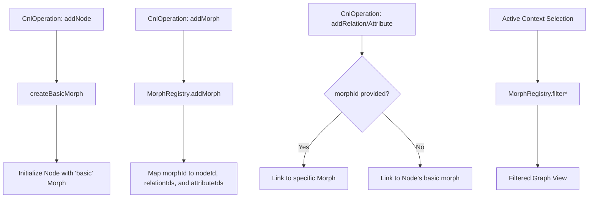

# Morphs & Polymorphism

While [Graph Construction (Operations to Graph)](03_graph_construction__operations_to_graph__.md) establishes the fundamental nodes and edges of the knowledge graph, the **Morphs & Polymorphism** subsystem enables a single node to exhibit different properties, relationships, and attributes depending on the active context. This allows the engine to represent complex entities that change their state or role within specific sub-graphs without requiring duplicate node definitions.

## System Overview

The polymorphism subsystem provides a mechanism for "contextual overrides." Every node in the graph is assigned a default, immutable `basic` morph. Subsequent `addMorph` operations allow for the definition of additional `MorphData` objects attached to the same `nodeId`. 

When a specific context (an "active morph") is selected, the system filters the global set of edges and attributes, rendering only those that are explicitly associated with that morph or its parent node's basic state. This allows for the implementation of multi-layered perspectives within a single unified graph structure.

## System Architecture & Data Flow

The subsystem relies on a centralized registry to manage the many-to-many relationships between morphs, nodes, relations, and attributes.

## Internal Implementation

The implementation is split between the transformation engine (creation) and a specialized registry (lookup and filtering).

### 1. Morph Generation (`operations-to-graph.ts`)

During the transformation of operations into the graph, the system ensures that every node has at least one structural anchor.

*   **`createBasicMorph(nodeId: string)`**: This function is invoked during **Pass 1** of the transformation engine for every `addNode` operation. It generates a unique ID (e.g., `human_morph_basic_1`) and initializes a morph with no additional relations or attributes. This "basic" morph represents the node's default, global state.
*   **Morph Augmentation**: During **Pass 2**, the engine processes `addMorph` operations. It retrieves the existing `CnlNode` from the `nodesMap` and appulates the new `MorphData` into the `node.morphs` array.

### 2. Linkage Logic (`operations-to-graph.ts`)

During **Pass 3**, the engine handles the polymorphic binding of edges and attributes:

*   **Relation/Attribute Binding**: When processing `addRelation` or `addAttribute`, the engine checks for a `morphId` in the operation payload.
    *   If a `morphId` is present, the relation/attribute is linked specifically to that morph's ID.
    *   If absent, the system defaults to linking the element to the node's primary `basic` morph.

### 3. The Morph Registry (`morph-registry.ts`)

The `MorphRegistry` class acts as the high-performance lookup engine for polymorphic queries. It maintains inverted indices to allow for rapid filtering of the graph based on active contexts.

*   **State Management**: The registry tracks:
    *   `nodeMorphs`: A mapping of `nodeId` $\to$ `string[]` (list of morph IDs).
    *   `relationMorphs`: A mapping of `relationId` $\to$ `string[]` (list of morph IDs containing this relation).
    *   `attributeMorphs`: A mapping of `attributeId` $\to$ `string[]` (list of morph IDs containing this attribute).

*   **Polymorphic Filtering**: The methods `filterRelationsForMorph` and `filterAttributesForMorph` implement the core polymorphic logic. Given a set of `activeMorphIds`, these functions:
    1.  Aggregate all `relationIds` or `attributeIds` associated with the active morphs.
    *   Iterate through the global collection of edges/attributes.
    *   Return only those elements whose IDs exist within the aggregated set.

## Data Structures

### MorphData Interface
The fundamental unit of polymorphism is the `MorphData` object:

| Property | Type | Description |
| :--- | :--- | :--- |
| `morphId` | `string` | Unique identifier for the morph context. |
| `nodeId` | `string` | The ID of the underlying node this morph belongs to. |
| `name` | `string` | The semantic name of the context (e.g., "active", "injured"). |
| `relationIds` | `string[]` | List of `CnlEdge` IDs that exist only in this morph. |
| `attributeIds` | `string[]` | List of `CnlAttribute` IDs that exist only in this morph. |

## Implementation Constraints

*   **Immutable Basic State**: The "basic" morph of a node cannot be deleted or modified once created in **Pass 1**, ensuring the node always has a fallback identity.
*   **Filtering Complexity**: The filtering operations in `MorphRegistry` are designed to avoid $O(N \cdot M)$ complexity by using `Set` lookups for aggregated morphology IDs, where $N$ is the number of elements and $M$ is the number of active morphs.
*   **Referential Integrity**: A morph cannot be added to a `nodeId` that has not been initialized in **Pass 1**.

## Current Behavior vs. Known Gaps

| Feature | Status | Implementation Detail |
| :--- | :--- | :--- |
| **Basic Morph Injection** | Complete | Every node is guaranteed a `basic` morph anchor via `createBasicMorph`. |
| **Contextual Attributes** | Complete | `addAttribute` can target specific `morphId`. |
| **Contextual Relations** | Complete | `addRelation` can target specific `morphId`. |
| **Multi-Morph Nodes** | Complete | A single node can host an arbitrary number of `MorphData` objects. |
| **Recursive Morphing** | Not Implemented | Morphs currently cannot inherit properties from other morphs (only from the base node). |
| **Morph-to-Morph Edges** | Not Implemented | Relations are strictly between nodes or specific morph-anchored nodes. |

## Related Specifications

*   [CNL Parsing & Operations](01_cnl_parsing___operations_.md)
*   [Text Analysis Pipeline (NLP)](02_text_analysis_pipeline__nlp__.md)
*   [Graph Construction (Operations to Graph)](03_graph_construction__operations_to_graph__.md)
*   [Mathematical Expression Evaluation](05_mathematical_expression_evaluation_.md)
*   [Schema & Type System](06_schema___type_system_.md)
*   [Inference Engine (Prolog & Transitive Closure)](07_inference_engine__prolog___transitive_closure__.md)
