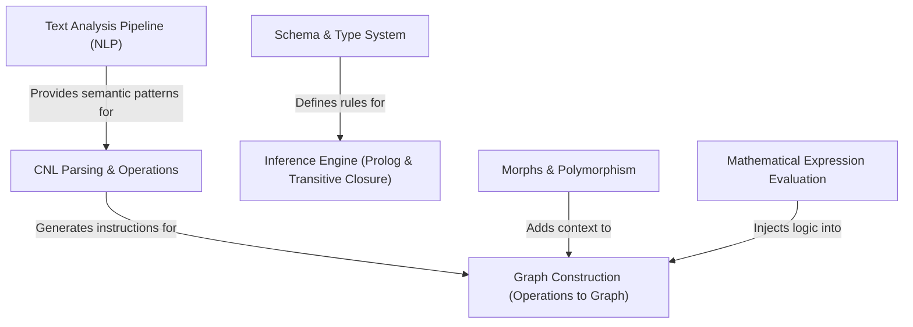

# hedgedoc-nb Specification Index

The `hedgedoc-nb` project is a sophisticated engine designed to transform **Controlled Natural Language (CNL)** into an interactive, interconnected **Knowledge Graph**. It utilizes *logic-based inference* to uncover hidden relationships, manages complex *data schemas*, and supports *polymorphic entities* through a unique "morph" system. The platform further extends its capabilities by integrating *advanced text analysis* and the ability to evaluate *mathematical expressions* directly within the graph's structure.

**Source Repository:** [None](None)

## Specifications

1. [CNL Parsing & Operations
](01_cnl_parsing___operations_.md)
2. [Text Analysis Pipeline (NLP)
](02_text_analysis_pipeline__nlp__.md)
3. [Graph Construction (Operations to Graph)
](03_graph_construction__operations_to_graph__.md)
4. [Morphs & Polymorphism
](04_morphs___polymorphism_.md)
5. [Mathematical Expression Evaluation
](05_mathematical_expression_evaluation_.md)
6. [Schema & Type System
](06_schema___type_system_.md)
7. [Inference Engine (Prolog & Transitive Closure)
](07_inference_engine__prolog___transitive_closure__.md)
