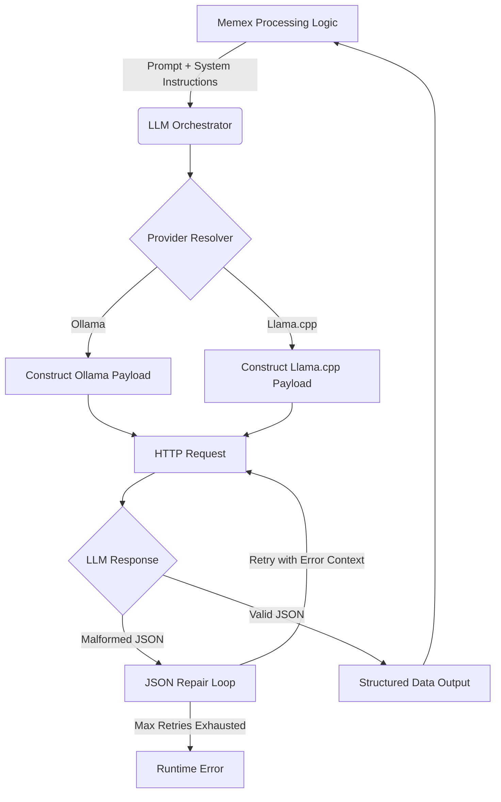

# LLM Orchestration & Chat Interface

The LLM Orchestration & Chat Interface is the abstraction layer of the Memex application that mediates between the high-level processing logic and the underlying Large Language Model (LLM) providers. It serves as a universal adapter, ensuring that the core application receives structured, predictable data regardless of whether the backend is an Ollama instance, a Llama.cpp server, or other compatible APIs.

The subsystem is responsible for:
*   **Provider Abstraction:** Standardizing requests across different API formats (e.g., Ollama's `/api/chat` vs. Llama.cpp's `/chat/completions`).
*   **Configuration Management:** Resolving model parameters (temperature, context window, model name) from a hierarchy of `model-settings.json` and environment variables.
*   **Prompt Construction:** Managing the injection of system instructions and user prompts into provider-specific message structures.

*   **Response Parsing & Self-Repair:** Extracting JSON payloads from raw model output and executing an automated, multi-attempt repair loop when the LLM violates the expected structural "contract."

## Architecture & Data Flow

The subsystem operates as a synchronous request-response engine. It does not merely pass strings; it manages the state of the "contract" between the prompt requirements and the JSON output.

### Implementation Constraints
*   **Timeout Management:** All requests are bound by `TIMEOUT_SECONDS` (default 600s) to prevent hanging the processing queue.
*   **Context Window Enforcement:** The orchestrator respects `numCtx` settings to ensure prompts do not exceed the provider's physical memory limits.
*   **Format Constraint:** For Ollama, the orchestrator explicitly requests `"format": "json"` to leverage native constrained decoding where available.

## Internal Implementation

### Configuration & Provider Resolution
The subsystem uses `load_model_settings()` (found in `memex/process_queue_once.py`) to establish the runtime environment. It implements a priority-based lookup:
1.  `MEMEX_MODEL_SETTINGS_PATH` (`model-settings.json`) values.
2.  Environment variables (e.g., `MEMEX_LLM_BACKEND`, `MEMEX_TEMPERATURE`).
3.  Hardcoded defaults (e.g., `gemma4:26b`, `temperature: 0.35`).

### The Chat Engine (`llm_chat`)
The core logic resides in the `llm_chat` function. It performs two distinct types of orchestration:

1.  **Standard Chat Completion:** For Ollama and standard Llama.cpp endpoints, it constructs a list of message objects with `role` and `content`.
2.  **Template Fallback (Llama.cpp specific):** The orchestrator implements a sophisticated recovery mechanism for Llama.cpp. If the `/chat/completable` endpoint returns an error indicating a failure to match the expected template (specifically the "peg-gemma4" format), the orchestrator automatically switches to a two-step process:
    *   Calls `/apply-template` to manually transform messages into a raw prompt string.
    *   Calls the `/completion` endpoint using that raw string.

### JSON Orchestration & Contract Repair
A critical responsibility of this subsystem is maintaining the integrity of the Memex "contract." When the LLM returns a response that fails deterministic validation (e.g., in `normalize_wiki_mutations`), the orchestrator initiates `normalize_wiki_mutations_with_repair`.

The repair loop follows this logic:
1.  **Detection:** The validator identifies a `ValueError` (e.g., missing field, invalid `pageType`).
2.  **Logging:** The "bad" JSON is saved to a local directory for debugging.
3.  **Recursive Repair:** The orchestrator sends a new, specialized prompt back to the LLM containing:
    *   The exact error message from the Python validator.
    *   The malformed JSON payload.
    *   Strict instructions to return a valid object without markdown fences.
4.  **Termination:** The loop attempts this up to 3 times before raising a `RuntimeError`.

## Current vs. Future Requirements

### CURRENT Behavior
*   **Supported Backends:** Ollama and Llama.cpp.
*   **Payloads:** Supports JSON-mode for Ollama and standard completion/chat for Llama.cpp.
*   **Sanitization:** Basic removal of embedded data images from Docling-generated JSON to prevent context overflow.
*   **Validation:** Strict enforcement of `pageType` and `wiki_pages` count (max 12).

### KNOWN GAPS
*   **Streaming Support:** The current orchestration implementation is purely synchronous; it waits for the full response before processing, which prevents real-time UI updates during long generations.
*   **Multi-Model Routing:** There is no logic to route different tasks (e.g., summarization vs. association) to different specialized models automatically.

### FUTURE REQUIREMENTS
*   **Semantic Caching:** Implementation of a cache layer that recognizes semantically similar prompts to avoid redundant LLM calls.
*   **OpenAI Compatibility:** Expansion of the provider abstraction to support standard OpenAI-compatible SDKs for remote inference providers.

## Related Specifications
*   [The Memex Trail System](02_the_memex_trail_system_.md)
*   [Knowledge Graph Maintenance (Trails & Associations)](03_knowledge_graph_maintenance__trails___associations__.md)
*   [Memex Processing Pipeline](04_memex_processing_pipeline_.md)
