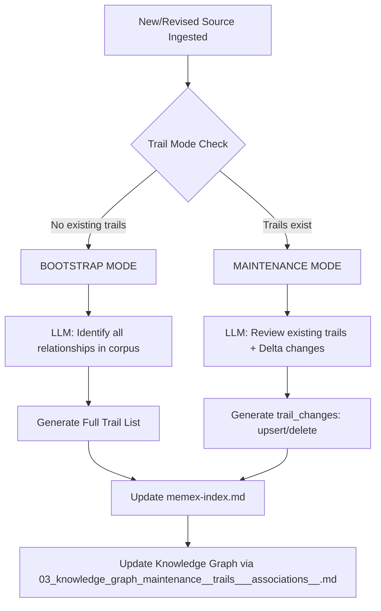

# The Memex Trail System

While [LLM Orchestration & Chat Interface](01_llm_orchestration___chat_interface_.md) provides the raw communicative capability, the **Memex Trail System** provides the structural intelligence. It is responsible for the semantic organization of disparate documents into "Trails"—thematic pathways that allow users to traverse the knowledge base through conceptual relationships rather than simple chronological or alphabetical lists.

The subsystem manages two distinct operational modes: **Bootstrap** (initial creation of a trail network) and **Maintenance** (incremental updates to an existing network). It ensures that as new documents are ingested via the [Memex Processing Pipeline](04_memex_processing_pipeline_.md), the thematic structure evolves without losing established connections.

## Architecture & Data Flow

The Trail System acts as a logic layer within the processing pipeline. It does not store data itself but dictates how the `memex-index.md` (the primary navigation hub) is mutated.



### Implementation Constraints
*   **Membership Minimum:** Every trail must contain at least two valid document IDs.
*   **Relationship Integrity:** Trails cannot be based solely on chronology or shared metadata (e.g., "All files from August"). They must represent a conceptual traversal (e.g., "Local Artisans and their Workshops").
*   **Identifier Constraint:** All trail members are referenced using numeric `DOCUMENT ID` integers, never by string aliases.
*   **Atomicity of Upsert:** In Maintenance mode, an `upsert` operation must return the *complete* resulting state of the trail (name, reason, confidence, and all members), not a partial diff.

## Internal Implementation

The core logic is implemented within `memex/process_queue_once.py`. The system determines its operational mode by inspecting the `## Trails` section of the current `memex-index.md`.

### 1. Operational Modes

#### Bootstrap Mode
Triggered when `existing_trail_count == 0`. In this mode, the LLM is presented with a "Source Memory" containing summaries of all known documents. The goal is to reconstruct a baseline trail catalogue from scratch.

#### Maintenance Mode
Triggered when trails already exist. To optimize context window usage and prevent "hallucinated" deletions, the system uses a **Cumulative Trail Delta**. It calculates `batch_trail_permuted_delta` (the difference between a frozen batch index and the live index) and provides this to the LLM as an instruction for what has changed since the last processing run.

### 2. The Mutation Contract (`trail_changes`)
In Maintenance mode, the LLM does not return the entire trail list. Instead, it returns a `trail_changes` array containing specific operations:

*   **`op: "upsert"`**: Used to create a new trail or update an existing one (e.g., adding a new member or refining the "reason").
*   **`op: "delete"`**: Used to decommission a trail that is no longer conceptually valid.

### 3. Data Structure and Storage
Trails are persisted in `memex-index.md` using Markdown headers. The structure within the index follows this pattern:

```markdown
### [Trail Name]

[The conceptual reason for the relationship]

Confidence: `[0.0 - 1.0]`

- [Document Title 1](url_to_alias)
- [Document Title 2](url_to_alias)
```

## Code Implementation Details

### Trail Change Parsing
The following logic in `memex/process_ual_once.py` demonstrates how the system processes the LLM's instructions to mutate the existing trail registry:

```python
# Logic for processing 'upsert' and 'delete' operations
for change in trail_changes:
    op = str(change.get("op", "")).strip().lower()
    name = str(change.get("name", "")).strip()
    key = re.sub(r"\s+", " ", name).strip().casefold()

    if op == "delete":
        if key in trail_by_name:
            trail_by_name.pop(key)
            deletes += 1
        continue

    if op == "upsert":
        # Extract and validate members
        raw_members = change.get("members", [])
        members = [int(x) for x in raw_members if isinstance(x, int) and x in valid_ids]
        
        if len(members) >= 2:
            trail_by_name[key] = {
                "name": name,
                "reason": str(change.get("reason", "")).strip(),
                "confidence": change.get("confidence", 0),
                "members": members,
            }
            upserts += 1
```

### Membership and Edge Generation
After the trails are updated, the system generates a `nodeBook` graph representation. It builds an adjacency list where edges represent the "traversal" through a trail:

```python
# Generating traversal edges for the Knowledge Graph
for a, b in zip(trail["members"], trail["members"][1:]):
    # relation is derived from the sanitized trail name
    relation = re.sub(r'[^a-z0-9]+', '_', trail_name.lower()).strip('_')
    edges[a].append((relation, b))
```

## Current vs. Future Requirements

### CURRENT Behavior
*   **Mode Switching:** Supports both Bootstrap and Maintenance logic.
*   **Delta Awareness:** Uses `batch_trail_delta` to inform the LLM of recent changes.
*   **Validation:** Enforces minimum membership (2) and valid ID lookups.
*   **Persistence:** Directly manages the Markdown structure of `memex-index.md`.

### KNOMWN GAPS
*   **Conflict Resolution:** If two different trails suggest conflicting member orders, the system currently relies on the LLM's internal reasoning rather than a deterministic tie-breaker.
*   **Large Scale Deletion:** In extremely large corpora, the `trail_changes` payload could grow significantly, potentially hitting context limits during "Maintenance" mode.

### FUTURE REQUIREMENTS
*   **Automated Trail Pruning:** Implementing a secondary pass to identify and delete "weak" trails (low confidence) without waiting for an LLM review.
*   **Trail Visualization:** Integration with the `nodeBook` syntax to provide interactive, clickable trail traversals in the UI.

## Related Specifications
*   [LLM Orchestration & Chat Interface](01_llm_orchestration___chat_interface_.md)
*   [Knowledge Graph Maintenance (Trails & Associations)](03_knowledge_graph_maintenance__trails___associations__.md)
*   [Memex Processing Pipeline](04_memex_processing_pipeline_.md)
