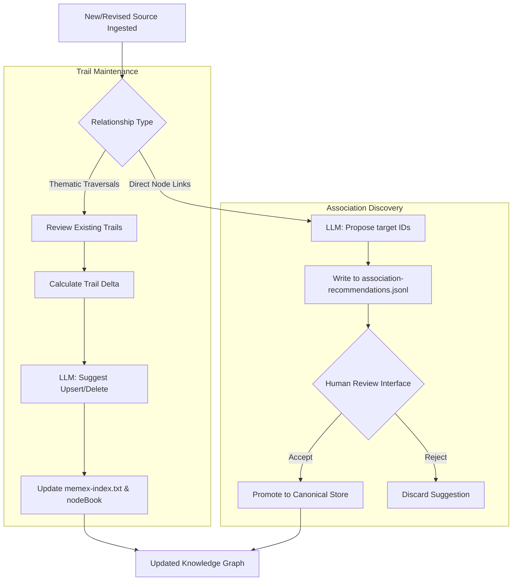

# Knowledge Graph Maintenance (Trails & Associations)

While [The Memex Trail System](02_the_memex_trail_system_.md) defines the logic for thematic grouping, the **Knowledge Graph Maintenance** subsystem provides the operational mechanism for managing the connective tissue of the entire knowledge base. It is responsible for both the high-level "traversals" (Trails) and the granular, direct links between specific nodes (Associations).

This subsystem manages the lifecycle of relationships: from initial LLM-driven discovery to human-validated canonicalization. It ensures that as new documents enter the [Memex Processing Pipeline](04_memex_processing_pipeline_.md), the global topology—the way information is interconnected—evolves without creating redundant or disconnected clusters.

## Architecture & Data Flow

The subsystem operates on two distinct relational planes: **Path-based** (Trails) and **Edge-based** (Associations). 



### Implementation Constraints
*   **Trail Minimums:** Every trail must contain at least two valid `DOCUMENT ID` integers.
*   **Association Verification:** There is no automated verifier for associations; the system relies entirely on a "Human-in-the-loop" model. An association only enters the canonical store upon explicit user acceptance via the frontend.
*   **Data Integrity:** In Maintenance mode, trail mutations must be returned as complete state `upserts` to prevent partial or corrupted lineage.
*   **Bi-directionality:** Associations are treated as undirected edges; the system uses a sorted `pairKey` (alphabetical sorting of source and target) to ensure `A -> B` and `B -> A` are treated as the same relationship.

## Internal Implementation

### 1. Trail Mutation Logic
The implementation within `memex/process_queue_once.py` distinguishes between **Bootstrap** (creating a network from scratch) and **Maintenance** (updating an existing network).

#### Maintenance Mode & Delta Awareness
To prevent context window overflow, the system does not present the entire trail history to the LLM. Instead, it uses a `cumulative_batch_trail_delta`. This compares a "Frozen Batch Index" (a stable baseline) against the "Live Index." The LLM is only instructed to provide `trail_changes` for trails that have actually changed since the batch began.

```python
# Logic for processing 'upsert' and 'delete' operations in memex/process_queue_once.py
for change in trail_changes:
    op = str(change.get("op", "")).strip().lower()
    name = str(change.get("name", "")).strip()
    key = re.sub(r"\s+", " ", name).strip().casefold()

    if op == "delete":
        if key in trail_by_name:
            trail_by_name.pop(key) # Remove obsolete trail
        continue

    if op == "upsert":
        # Validates and updates the trail with new members or reasons
        members = [int(x) for x in change.get("members", []) if isinstance(x, int)]
        if len(members) >= 2:
            trail_by_name[key] = { ... } # Update registry
```

#### Graph Edge Generation
Once trails are updated, the system generates traversal edges for the `nodeBook` (the graph visualization layer). It transforms the trail name into a relationship slug to create navigable paths:
`[Document A] --<relationship_slug>-- [Document B]`

### 2. Association Recommendation Pipeline
The association subsystem is split between the LLM-driven **Discovery** phase and the Frontend-driven **Promotion** phase.

#### Discovery (LLM)
During source processing, the LLM identifies direct links between the `NEW_SOURCE` and other documents in the current batch. These are written to a `.jsonl` file (`ASSOCIATION_PATH`) as `pending` recommendations.

#### Promotion (Frontend API)
The Next.js Route Handler (`frontend/src/app/memex-association-recommendations/route.ts`) manages the transition of associations from "Pending" to "Canonical."

*   **`acceptRecommendation`**: When a user accepts a suggestion, the system:
    1.  Checks if a `user`-created edge already exists for that pair (to preserve human intent).
    2.  Generates a `pairKey` using `[source, target].sort().join('\u0000')`.
    3.  Updates the `memex-associations.json` canonical store with the new `llm`-created edge.

```typescript
// Logic for promoting recommendations in route.ts
const pairKey = (source: string, target: string): string =>
  [source.trim(), target.trim()].sort().join('\u0000')

const acceptRecommendation = async (recommendation: AssociationRecommendation) => {
  const store = await readCanonicalStore()
  const key = pair_key(recommendation.source, recommendation.target)
  
  // Ensure we don't overwrite a manual user edge with an LLM suggestion
  const userEdge = pairIndexes.find(({ association }) => association.createdBy === 'user')
  if (userEdge) return 'user-edge-preserved'

  // Add the canonical link to the JSON store
  store.associations.push(canonical);
  await writeCanonicalStore(store)
}
```

## Current vs. Future Requirements

### CURRENT Behavior
*   **Trail Modes:** Supports full reconstruction (Bootstrap) and incremental updates (Maintenance).
*   **Asynchronous Review:** Associations are proposed in the background and surfaced in a dedicated "Association Review" UI for human validation.
*   **Deduplication:** Uses sorted pair keys to prevent duplicate bidirectional edges in the association store.
*   **Graph Generation:** Automatically generates `nodeBook` syntax for traversable trails based on trail names.

### KNOWN GAPS
*   **Verification Gap:** There is no secondary LLM pass or deterministic logic to verify if an "accepted" association is actually accurate; the system relies entirely on human oversight.
*   **Scaling Deletions:** In very large corpora, a massive influx of `delete` operations in a single batch could theoretically impact processing time.

### FUTURE REQUIREMENTS
*   **Automated Pruning:** Implementation of a secondary "Janitor" pass to automatically archive or delete trails with low confidence scores without human intervention.
*   **Visual Traversal UI:** Integration of interactive, clickable trail paths within the `nodeBook` view to allow users to "walk" through conceptual histories.

## Related Specifications
*   [LLM Orchestration & Chat Interface](01_llm_orchestration___chat_interface_.md)
*   [The Memex Trail System](02_the_memex_trail_system_.md)
*   [Memex Processing Pipeline](04_memex_processing_pipeline_.md)
