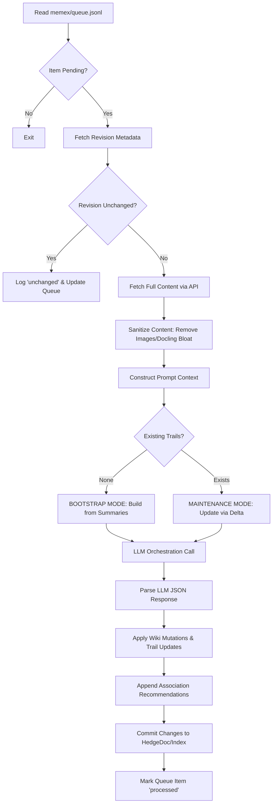

# Memex Processing Pipeline

While [Knowledge Graph Maintenance (Trails & Associations)](03_knowledge_graph_maintenance__trails___associations__.md) defines how relationships are structured and promoted, the **Memex Processing Pipeline** is the execution engine that drives the entire ingestion lifecycle. It manages the transition of a raw HedgeDoc document from a pending state in `memex/queue.jsonl` to a fully indexed, interconnected node within the knowledge graph.

The subsystem is responsible for:
*   **Queue Orchestration:** Monitoring and processing items from the `queue.int` file.
*   **Revision Validation:** Determining if a queued document requires re-processing by comparing current HedgeDoc revisions against the last known processed UUID.
*   **Content Ingestion & Sanitization:** Fetching raw Markdown or complex JSON (e.g., Docling outputs) and stripping problematic structures like base64-encoded images to prevent context window overflow.
*   **Context Construction:** Building a high-density prompt by aggregating summaries of previously indexed documents alongside the full content of the new/revised source.
*   **Logic Coordination:** Triggering the [LLM Orchestration & Chat Interface](01_llm_orchestration___chat_interface_.md) to execute either "Bootstrap" or "Maintenance" logic as defined by [The Memex Trail System](02_the_memex_trail_system_.md).

## Architecture & Data Flow

The pipeline operates as a sequential, state-driven loop. It is triggered by the presence of a `pending` entry in the processing queue.

### Implementation Constraints
*   **Revision Authority:** The system uses the HedgeDoc revision UUID as the primary cache key. If the `latest_revision` matches the `processed_revision`, all LLM processing is bypassed to conserve tokens and compute.
*   **Context Window Management:** To stay within `numCtx` limits, the pipeline implements a "Summary-Only" strategy for historical documents. Only the current source gets full content; older sources are represented by compact summaries.
*   **Sanitization Thresholds:** The pipeline enforces strict limits on derived wiki page types (`source-summary`, `entity`, `topic`, `comparison`, `synthesis`) and maximum character counts per page to prevent downstream parsing failures.

## Internal Implementation

The core logic is contained within `memex/process_queue_once.py`.

### 1. Revision Check & Early Exit
Before any heavy lifting, the pipeline performs a lightweight check via `api_get(f"{queued_alias}/revisions")`. If the latest UUID matches the one stored in the queue for that alias, the process terminates after updating the queue status to `processed` with the reason `unchanged-revision`.

### 2. Content Sanitization (`sanitize_llm_sourse`)
The pipeline handles two types of input: standard Markdown and Docling-generated JSON. The `sanitize_llm_source` function performs recursive cleaning:
*   **Markdown:** Removes `` patterns using regex.
*   **Docling JSON:** If a `DoclingDocument` schema is detected, the function parses the JSON and recursively removes any keys or values containing base64-encoded images or internal `$ref` pointers to large image objects (`#/pictures/...`). This ensures the LLM only sees semantic text.

### 3. Prompt Construction & Mode Selection
The pipeline dynamically switches between two distinct prompting strategies:

#### Bootstrap Mode
Triggered when `existing_trail_count == 0`. The prompt is constructed using `bootstrap_docs`, which are lightweight strings containing only the ID, Title, and Summary of all known documents. This allows the LLM to "discover" the first set of relationships from a sparse corpus.

#### Maintenance Mode
Triggered when trails already exist. The pipeline builds `prompt_docs` by:
1.  Including the full content of the **new/revised** source.
2.  Iterating through the `index_sources` (historical documents) and appending their summaries.
3.  Enforcing a `MAX_PROMPT_DOC_CHARS` limit to ensure the total payload does not exceed the LLM's physical context window.

### 4. Mutation Application & Commit
The pipeline parses the structured JSON output from [LLM Orchestration & Chat Interface](01_llm_orchestration___chat_interface_.md) and executes several side effects:
*   **Wiki Updates:** Calls `commit_wiki_mutations` to push new or revised derived pages (entities, topics, etc.) to the HedgeDoc API.
*   **Trail Updates:** Implements the `upsert`/`delete` logic to mutate `memex-index.md`.
le
*   **Association Discovery:** Calls `append_association_recommendations` to write new potential links to `association-recommendations.jsonl`.

## Current vs. Future Requirements

### CURRENT Behavior
*   **Revision Awareness:** Skips processing if the document content hasn't changed.
*   **Docling Support:** Specifically handles and shrinks large JSON document structures.
*   **Contextual Summarization:** Automatically uses compact summaries for historical nodes to maximize context efficiency.
*   **Atomic Commits:** Uses a "Lint-before-Commit" pattern (via `lint_memex.py`) to ensure that malformed LLM outputs do not corrupt the global index or `nodeBook`.

### KNOMWN GAPS
*   **Single-Threaded Processing:** The pipeline processes one queue item at a time, which may create bottlenecks during large batch ingests.
*   **No Auto-Verification:** Association recommendations are written to a `.jsonl` file and rely entirely on human review; there is no secondary LLM pass to verify the validity of suggested links.

### FUTURE REQUIREMENTS
*   **Parallel Ingestion:** Implementation of a multi-worker queue processor to handle multiple HedgeDoc updates simultaneously.
*   **Automated Association Promotion:** A "Confidence Threshold" mechanism that automatically promotes high-confidence associations (e.g., $>0.95$) to the canonical store without human intervention.

## Related Specifications
*   [LLM Orchestration & Chat Interface](01_llm_orchestration___chat_interface_.md)
*   [The Memex Trail System](02_the_memex_trail_system_.md)
*   [Knowledge Graph Maintenance (Trails & Associations)](03_knowledge_graph_maintenance__trails___associations__.md)
*   [Docling Content Sanitization](06_docling_content_sanitization_.md)
