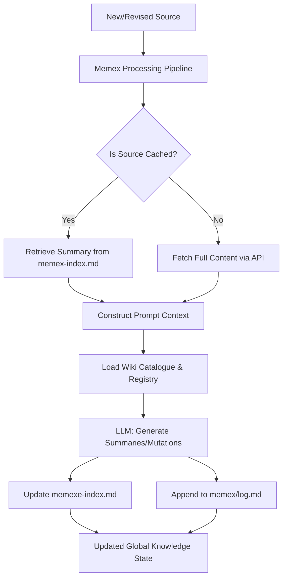

# Document Indexing and Summarization

While [Memex Processing Pipeline](04_memex_processing_pipeline_.md) manages the execution of document ingestion, the **Document Indexing and Summarization** subsystem provides the application's long-term semantic memory. It is responsible for maintaining a searchable, human-readable directory of all processed sources within `memex/index.md` and an operational history in `memex/log.md`.

The primary purpose of this subsystem is to implement a "Summary-Only" retrieval strategy. By extracting metadata (titles, aliases, revisions) and generating compact summaries, the system allows the [LLM Orchestration & Chat Interface](01_llm_orchestration___chat_interface_.md) to maintain awareness of a massive corpus without exceeding the physical context window limits of the underlying LLM. This creates an expandable "encyclopedia" where each entry provides enough context for the LLM to decide if deep retrieval (full content fetch) is necessary.

## Architecture & Data Flow

The subsystem acts as the state-provider for the pipeline. It transforms raw, unstructured document data into a structured, hierarchical registry that is then injected into the LLM's prompt context.



### Implementation Constraints
*   **The Summary-Only Strategy:** To prevent context overflow, only the currently processed source is provided with "Full Content." All previously indexed sources are represented via their "Index Summary" (Title + Summary).
*   **Context Window Bounding:** The amount of metadata retrieved from the wiki catalogue is strictly bounded by `WIKI_CONTEXT_MAX_PAGES` (default 12) and `WIKI_CONTEXT_MAX_CHARS` (default 24,000) to ensure prompt stability.
*   **Sanitization Requirement:** All incoming content must be stripped of high-entropy/high-token noise, specifically base64-encoded images and Docling structural bloat, before being added to the index.

## Internal Implementation

The subsystem's logic is integrated into `memex/process_queue_once.py`. It manages three distinct data layers: the **Source Index**, the **Wiki Catalogue**, and the **Operational Log**.

### 1. Source Index Parsing
When a new source enters the pipeline, the system parses the existing `memex/index.md` to build a list of `docs`. This allows the LLM to see "known" documents as context for the "new" document.

```python
# Logic for building the historical document registry from the index
for line in source_section.splitlines():
    if not line.startswith("- [") or "](" not/ in line:
        continue

    try:
        # Extract Title, URL (Alias), and Summary from Markdown list format
        title = line[3:line.index("]")]
        url, summary = line.split(") — ", 1)
        alias = url.rsplit("/n/", 1)[1].split("?", 1)[0]

        # Add to the 'docs' list used for prompt construction
        docs.append({
            "id": len(docs) + 1,
            "alias": alias,
            "title": title.strip(),
            "summary": summary.strip(),
            "cached": True  # Indicates we are using Summary-Only mode
        })
    except ValueError:
        continue
```

### 2. The Wiki Catalogue (`load_wiki_context`)
This function builds the "World State" for the LLM. It queries the `memex-wiki-maintain` endpoint to retrieve all derived pages (entities, topics, etc.) and organizes them into a structured string. This allows the LLM to understand how the new source relates to existing *derived* knowledge, not just raw sources.

The function implements a priority-based registry:
1.  **Primary Registry:** A dictionary keyed by `(pageType, title)`.
2.  **Priority Injection:** The `source-summary` for the currently queued alias is moved to the front of the context to ensure it is processed with highest importance.

### 3. Content Sanitization (`sanitize_llm_source`)
To prevent the LLM from "hallucinating" based on broken image strings or getting lost in JSON metadata, the system performs recursive cleaning.

*   **Markdown Mode:** Uses regex to replace `` with `[MARKDOWN_IMAGE_REMOVED]`.
*   **Docling Mode:** If a `DoclingDocument` schema is detected, it recursively traverses the JSON tree to prune `pictures` keys and `$ref` pointers that point to large embedded image objects.

## Current vs. Future Requirements

### CURRENT Behavior
*   **Summary-Only Retrieval:** Effectively manages context by only providing full text for the active node.
*   **Metadata Extraction:** Automatically extracts aliases and titles from HedgeDoc frontmatter or Markdown headers.
*   **Hybrid Sanitization:** Supports both standard Markdown and complex Docling JSON inputs.
*   **Operational Logging:** Maintains a chronological record of all ingestions in `memex/log.md`.

### KNOWN GAPS
*   **Summary Drift:** There is no mechanism to automatically "refresh" the summaries of historical documents unless that document is re-queued for processing.
*   **Index Fragmentation:** If `memex/index.md` becomes extremely large, the parsing of the entire file in every pipeline run may introduce latency.

### FUTURE REQUIREMENTS
*   **Semantic Summarization Pass:** A background task to periodically re-summarize older documents using a more powerful model to improve retrieval quality.
*   **Hierarchical Indexing:** Implementation of a multi-tier index (e.g., "Regional" or "Thematic" sub-indices) to allow the system to scale to tens of thousands of documents without parsing a single monolithic file.

## Related Specifications
*   [LLM Orchestration & Chat Interface](01_llm_orchestration___chat_interface_.md)
*   [The Memex Trail System](02_the_memex_trail_system_.md)
*   [Knowledge Graph Maintenance (Trails & Associations)](03_knowledge_graph_maintenance__trails___associations__.md)
*   [Memex Processing Pipeline](04_memex_processing_pipeline_.md)
*   [Docling Content Sanitization](06_docling_content_sanitization_.md)
