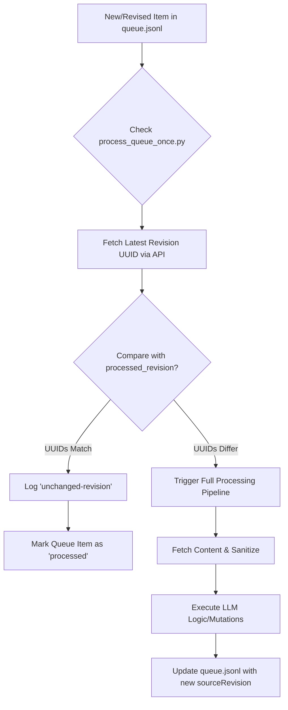

# Revision & Version Management

While [Docling Content Sanitization](06_docling_content_sanitization_.md) ensures that incoming data streams are stripped of high-entropy noise, the **Revision & Version Management** subsystem provides the fundamental mechanism for change detection and compute optimization. It is responsible for tracking the unique identity of every document state through UUIDs (specifically UUIDv7), allowing the [Memex Processing Pipeline](04_memex_processing_pipeline_.md) to distinguish between a new content update and a redundant re-indexing request.

The primary purpose of this subsystem is to act as a cache invalidation layer. By treating the revision UUID as the authoritative cache key, the system ensures that expensive LLM operations—such as those defined in [LLM Orchestration & Chat Interface](01_llM_orchestration___chat_interface_.md)—are only triggered when the underlying document content has actually evolved.

## Architecture & Data Flow

The subsystem operates across two layers: the **Persistence Layer** (HedgeDoc Backend) and the **Orchestration Layer** (Memex Pipeline). 



### Implementation Constraints
*   **UUID Authority:** The system uses `uuidv7` for all revision entries, ensuring time-ordered, unique identifiers that are globally sortable and collision-resistant.
*   **Cache Key Integrity:** The processing pipeline relies on the `sourceRevision` field in `queue.jsonl` being an exact match to the `latest_revision` UUID from the HedgeDoc database.
*   **Non-Destructive Comparison:** The comparison logic must never assume a document is "new" if its UUID matches the last processed instance, even if metadata (like tags) has been updated in the database but not the content.

## Internal Implementation

### 1. Backend Persistence (`revisions.service.ts`)
The revision lifecycle is managed by the `RevisionsService` within the HedgeDoc backend. This service handles the creation, retrieval, and purging of versioned snapshots.

*   **Revision Creation:** The `innerCreateRevision` function implements a "diff-on-write" pattern. It compares `newContent` against the `latestRevision`. If no difference is detected, it terminates early to prevent unnecessary database bloat. If changes exist, it generates a `patch` using `createPatch` and persists a new entry with a unique `uuidv7`.
*   **Metadata Retrieval:** The `getAllRevisionMetadataDto` function allows the Memex pipeline to inspect the entire history of a note, retrieving timestamps, authors, and tags without fetching the full content payload.
*   **Purge Logic:** To prevent unbounded database growth, `purgeRevisions` can be invoked to collapse history, retaining only the latest version while updating the primary revision's `patch` to represent the diff from an empty state.

### 2. Pipeline-Side Change Detection (`process_queue_once.py`)
The [Memex Processing Pipeline](04_memex_processing_pipeline_.md) implements the "Smart Sync" logic. It performs a lightweight pre-flight check before any LLM or sanitization tasks are initiated.

```python
# Logic for detecting if a document requires re-processing
revisions = json.loads(api_get(f"{queued_alias}/revisions"))
latest_revision = max(revisions, key=lambda x: x["createdAt"])["uuid"]
previous_revision = processed_revision(queued_alias)

# The fundamental cache invalidation check
if (
    previous_revision == latest_revision
    and pending.get("queueReason") not in {"orphan-repair", "snapshot-process"}
):
    # Skip all heavy processing; the content is identical to what was last indexed
    now = datetime.now(timezone.utc).isoformat()
    for row in rows:
        if row.get("alias") == queued_alias:
            row["status"] = "processed"
            row["sourceRevision"] = latest_revision
            row["ignoredReason"] = "unchanged-revision"
    # Update the queue and exit
    QUEUE.write_text("".join(json.dumps(x) + "\n" for x in rows))
    raise SystemExit(f"Unchanged HedgeDoc ignored: {queued_alias}")
```

The `processed_revision(alias)` function scans the existing `queue.jsonl` to find the most recent successful execution of a document, retrieving its `sourceRevision`. If this matches the current `latest_revision` from the API, the pipeline enters an early-exit state.

## Current vs. Future Requirements

### CURRENT Behavior
*   **UUID-based Invalidation:** Uses unique revision UUIDs to detect content changes.
*   **Early Exit Mechanism:** Prevents downstream execution of [Docling Content Sanitization](06_docling_content_sanitization_.md) and [LLM Orchestration & Chat Interface](01_llm_orchestration___chat_interface_.md) for unchanged files.
*   **Versioning Support:** Backend supports full revision history, including `patch` generation and metadata tracking.
*   **Audit Logging:** Records "unchanged" events in `memex/log.md` to provide visibility into skipped tasks.

### KNOMWN GAPS
*   **Metadata-Only Changes:** If a user updates the frontmatter (e.g., tags or description) but not the main content, the system may treat the revision as "changed" because the UUID has updated, even if the semantic content is identical. 
*   **Manual Override Absence:** There is no mechanism to force a re-index of a doc if the UUID hasn't changed (e.g., if the index/graph becomes corrupted).

### FUTURE REQUIREMENTS
*   **Content Hashing:** Implementation of a secondary SHA-256 hash check on the raw content body within `process_queue_one.py` to verify that a new UUID actually corresponds to a semantic change.
*   **Forced Re-indexing Flag:** Addition of a `force_reindex` flag in the `queue.jsonl` payload to bypass the UUID comparison logic for troubleshooting purposes.

## Related Specifications
*   [LLM Orchestration & Chat Interface](01_llm_orchestration___chat_interface_.md)
*   [Memex Processing Pipeline](04_memex_processing_pipeline_.md)
*   [Docling Content Sanitization](06_docling_content_sanitization_.md)
