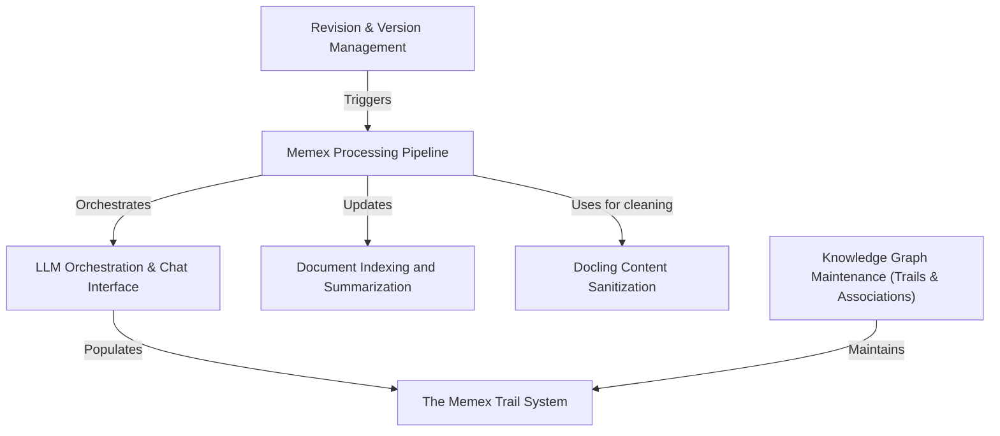

# hedgedoc Specification Index

**Memex** acts as an *automated intelligent librarian* for the HedgeDoc platform. It utilizes a core **processing pipeline** to ingest documents, cleans complex data via specialized **sanitization**, and leverages **LLMs** to build a sophisticated **knowledge graph** of thematic **trails** and direct **associations**, all while ensuring processing efficiency through a smart **revision management** system.

**Source Repository:** [None](None)

## Specifications

1. [LLM Orchestration & Chat Interface
](01_llm_orchestration___chat_interface_.md)
2. [The Memex Trail System
](02_the_memex_trail_system_.md)
3. [Knowledge Graph Maintenance (Trails & Associations)
](03_knowledge_graph_maintenance__trails___associations__.md)
4. [Memex Processing Pipeline
](04_memex_processing_pipeline_.md)
5. [Document Indexing and Summarization
](05_document_indexing_and_summarization_.md)
6. [Docling Content Sanitization
](06_docling_content_sanitization_.md)
7. [Revision & Version Management
](07_revision___version_management_.md)
