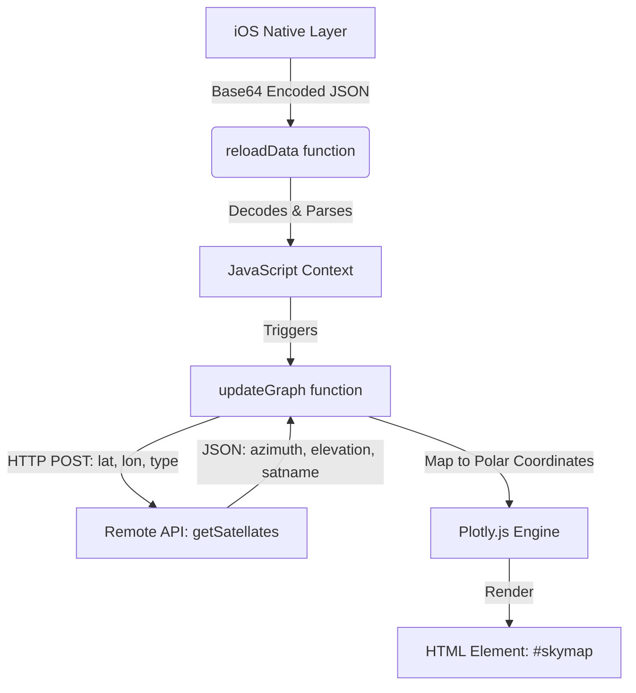

# SkyView Plotting Engine

The SkyView Plotting Engine is a specialized visualization subsystem responsible for rendering GNSS (Global Navigation Satellite System) satellite positions in a 2D polar coordinate projection. Its primary responsibility is to transform raw orbital positional data—specifically azimuth and elevation—into a graphical "Skyplot" that represents the satellite's position in the user's local sky relative to the zenith.

## Architecture and Data Flow

The engine operates as a client-side rendering component within a web view. It relies on an external data source to provide real-time or near-real-time satellite ephemeris/positional data.

### Data Flow Diagram



### Component Interfaces

1.  **External Data Interface (HTTP/REST):**
    *   **Endpoint:** `http://18.119.99.44/getSatellites`
    *   **Method:** `POST`
    *   **Payload:** `{ lat: Float, lon: Float, type: String }`
    *   **Response Format:** JSON object where keys are satellite identifiers (`satname`) and values contain `azimuth` and `elevation`.

2.  **Native-to-Web Interface:**
    *   **Function:** `reloadData(sBinaryParam)`
    *   **Input:** A Base64 encoded string containing a JSON payload passed from the iOS native environment.

## Implementation Details

### Coordinate Mapping
The engine utilizes a polar coordinate system provided by the Plotly `scatterpolargl` trace type. 

*   **Radial Axis ($r$):** Represents **Elevation**. The range is constrained between `[90, 0]`, where 90 degrees represents the zenith (directly overhead).
*   **Angular Axis ($\theta$):** Represents **Azimuth**. The axis is configured with a clockwise rotation and specific directional ticks: `["N","NE","E", "SE", "S", "SW","W","NW"]`.

### Core Logic Implementation

The implementation resides in `EGNSS4ALL/SkyView/orbit.js`.

#### Data Processing Loop
Within the `updateGraph` function, the engine iterates through the `remoteJsonData` object to construct an array of Plotly traces. Each satellite is treated as a discrete marker:

```javascript
// Internal mapping logic in orbit.js
for (let satname in remoteJsonData) {
    let satObj = remoteJsonData[satname];
    let dataObj = {
        type: "scatterpolargl",
        mode: "markers+text",
        r: [parseFloat(satObj.elevation).toFixed(1)], // Radial mapping
        theta: [parseFloat(satObj.azimuth).toFixed(1)], // Angular mapping
        name: satname,
        // ... marker and text configuration
    };
    dataArray.push(dataObj);
}
```

#### Constellation Configuration
The engine applies specific metadata based on the `constType` parameter provided during the update request:

| Constellation Type | Prefix/Identifier Logic |
| :--- | :--- |
| **GPS** | `svidPrefix = "G"` |
| **GLONASS** | Internal tracking via `constNumber` |
| **BEIDOU** | `svidPrefix = "C"` |
| **GALILEO** | `svidPrefix = "E"` |

## Current Behavior and Constraints

*   **Rendering Mode:** Uses `scatterpolargl` for optimized WebGL-based rendering of markers.
*   **Static Plotting:** The current implementation utilizes `staticPlot: true` in the Plotly configuration to disable interactive mode-bar elements, focusing on a fixed radar-like display.
*   **Dependency:** Requires `axios` for asynchronous HTTP requests and `Plotly.js` for the rendering engine.
*   **Input Dependency:** Relies on the [Native-to-Web Data Bridge](03_native_to_web_data_bridge_.md) to ingest encoded data from the iOS host application.

## Known Gaps

*   **Hardcoded Endpoints:** The API endpoint URL is hardcoded within `orbit.js`.
*   **Tight Coupling:** The constellation-specific logic (prefixes and numbers) is embedded directly within the data fetching function rather than being driven by a configuration provider.
*   **Error Handling:** Error handling is limited to a generic browser `alert()` upon request failure.

## Future Requirements

*   **Dynamic Configuration:** Move endpoint URLs and constellation metadata into [Application Configuration](05_application_configuration_.md).
*   **Decoupled Logic:** Separate the data retrieval (Axios) from the coordinate transformation logic to allow for testing with local datasets.
*   **Enhanced Interactivity:** Implement capability to toggle visibility of specific constellations via the UI.

## Related Specifications

*   [GNSS Constellation Logic](02_gnss_constellation_logic_.md)
*   [Native-to-Web Data Bridge](03_native_to_web_data_bridge_.md)
*   [Remote Data Synchronization](04_remote_data_synchronization_.md)
*   [Application Configuration](05_application_configuration_.md)
