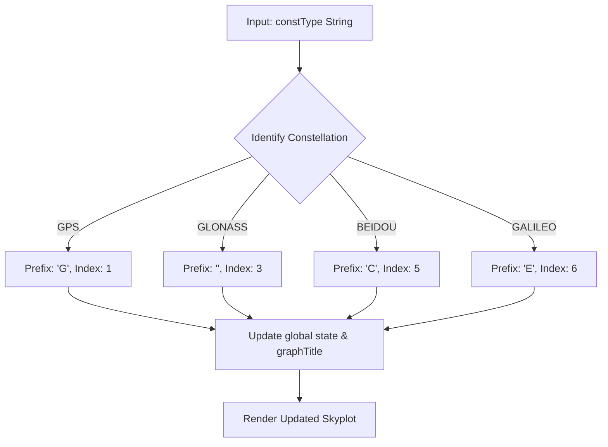

# GNSS Constellation Logic

While the [SkyView Plotting Engine](01_skyview_plotting_engine_.md) manages the visual projection of orbital data, the **GNSS Constellation Logic** subsystem is responsible for the identification and configuration of satellite constellations. It translates high-level constellation identifiers into specific system parameters, such as Satellite Vehicle ID (SVID) prefixes and internal constellation indices.

## Purpose and Responsibility

The primary responsibility of this subsystem is to manage the metadata associated with different Global Navigation Satellite Systems (GNSS). This includes:
*   **Identifier Mapping:** Associating string-based constellation names (e.g., "GPS") with their respective alphanumeric prefixes (e.g., "G").
*   **Index Management:** Maintaining internal numerical identifiers (`constNumber`) used for system-level tracking.
*   **UI Contextualization:** Updating the graphical interface title to reflect the currently active constellation.

## Architecture and Logic Flow

The logic is currently implemented as a conditional mapping layer within the `updateGraph` function in `EGNSS4ALL/SkyView/orbit.js`. It acts as a configuration middleware that intercepts the `constType` parameter before the rendering engine updates the display.

### Logic Transformation Flow



## Implementation Details

The implementation resides in `EARGSS4ALL/SkyView/orbit.js`. The logic utilizes a series of conditional branches to update three global variables: `constNumber`, `svidPrefix`, and `graphTitle`.

### Configuration Mapping Table

The current implementation follows this deterministic mapping:

| Input `constType` | `svidPrefix` | `constNumber` |
| :--- | :--- | :--- |
| `"GPS"` | `"G"` | `1` |
| `"GLONASS"` | `""` (None) | `3` |
| `"BEIDOU"` | `"C"` | `5` |
| `"GALILEO"` | `"E"` | `6` |

### Internal State Update

The logic is encapsulated within the `updateGraph` function. When a new constellation type is requested, the following logic is executed:

```javascript
// EGNSS4ALL/SkyView/orbit.js

// Logic for updating constellation-specific metadata
graphTitle = constType;

if (constType == "GPS") {
    constNumber = 1;
    svidPrefix = "G";
} else if (constType == "GLONASS") {
    constNumber = 3;
} else if (constType == "BEIDOU") {
    svidPrefix = "C";
    constNumber = 5;
} else if (constType == "GALILEO") {
    constNumber = 6;
    svidPrefix = "E";
}

layout.title.text = graphTitle;
```

## Current Behavior and Constraints

*   **Hardcoded Mapping:** The relationship between constellation names, prefixes, and numbers is hardcoded within the `updateGraph` function logic.
*   **Limited Scope:** The system currently only recognizes four specific constellations: GPS, GLONASS, BEIDOU, and GALILEO.
*   **Global State Dependency:** The logic relies on modifying global variables (`svidPrefix`, `constNumber`) which are shared with the rendering loop.

## Known Gaps

*   **Incomplete Constellation Set:** While comments in the source code suggest support for other systems (IRNSS, QZSS, SBAS), the functional logic does not yet implement them.
*   **Lack of Extensibility:** Adding a new constellation requires modifying the core execution flow of `updateGraph` rather than updating a configuration object.
*   **String Dependency:** The logic is highly dependent on exact string matches for `constType`, making it sensitive to casing or naming discrepancies from the [Native-to-Web Data Bridge](03_native_to_web_data_bridge_.md).

## Future Requirements

*   **Configuration Decoupling:** Migrate all mapping logic and identifiers into a centralized configuration provider as defined in [Application Configuration](05_application_configuration_.md).
*   **Dynamic Registry:** Implement a registry-based approach where new constellations can be registered without altering the `updateGraph` function.
*   **Standardized Identifiers:** Utilize standardized integer constants (as seen in the native iOS layer) to drive the logic instead of string comparisons.

## Related Specifications

*   [SkyView Plotting Engine](01_skyview_plotting_engine_.md)
*   [Native-to-Web Data Bridge](03_native_to_web_data_bridge_.md)
*   [Remote Data Synchronization](04_remote_data_synchronization_.md)
*   [Application Configuration](05_application_configuration_.md)
