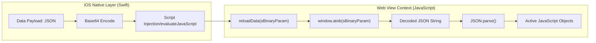

# Native-to-Web Data Bridge

While [GNSS Constellation Logic](02_gnss_constellation_logic_.md) manages the identification of satellite systems, the **Native-to-Web Data Bridge** provides the essential communication layer required to transport operational data from the iOS native environment into the JavaScript context.

## Purpose and Responsibility

The primary responsibility of this subsystem is to facilitate the reliable transfer of complex, structured data payloads from the Swift-based host application to the web-based [SkyView Plotting Engine](01_skyview_plotting_engine_.md). 

To prevent data corruption or character encoding issues during the transit between the Native (iOS) and Web (WebKit/JavaScript) layers, the bridge utilizes Base64 encoding. This ensures that special characters and complex JSON hierarchies are preserved as a single, continuous string during the injection process.

## Architecture and Data Flow

The bridge operates as an entry point within the JavaScript global scope, specifically designed to be invoked by the iOS `WKWebView` message handler or script injection mechanism.

### Data Flow Diagram



### Interface Definition

The bridge exposes a single global function to the native environment:

* **Function Name:** `reloadData`
* **Parameter:** `sBinaryParam` (String)
    * **Format:** A Base64 encoded string representing a serialized JSON object.
* **Return Value:** `Boolean` (Indicates successful processing).

## Implementation Details

The implementation is located within the global scope of `EGNSS4ALL/SkyView/orbit.js`.

### Decoding Logic

The function performs two sequential transformations to revert the encoded payload into a usable JavaScript object:

1.  **Base64 Decoding:** Utilizes the standard Web API `window.atob()` to decode the Base64 string back into a UTF-8 string.
2.  **JSON Deserialization:** Utilizes `JSON.parse()` to transform the decoded string into a traversable JavaScript object (dictionary).

```javascript
// EGNSS4ALL/SkyView/orbit.js

/**
 * Entry point for native data injection.
 * @param {string} sBinaryParam - Base64 encoded JSON payload from iOS.
 * @returns {boolean}
 */
function reloadData(sBinarylyParam) {
    // Step 1: Decode the Base64 string to a plain text string
    var sDecodedParam = window.atob(sBinaryParam);
    
    // Step 2: Parse the decoded string into a JSON object
    var oData = JSON.parse(sDecodedParam);
    
    // The resulting 'oData' is now available for use by the plotting engine
    return true;
}
```

## Current Behavior and Constraints

*   **Encoding Standard:** Strictly relies on Base64 encoding for all incoming payloads.
*   **Single-Directional:** The current implementation only handles data flow from Native to Web.
*   **Dependency:** Relies on the presence of the `atob` function in the WebKit JavaScript engine.
*   **Data Structure:** Assumes the decoded payload is a valid, parsable JSON object.

## Known Gaps

*   **Lack of Error Handling:** The function does not implement `try-catch` blocks. If the native layer passes an invalid Base64 string or malformed JSON, the JavaScript execution will terminate with a runtime error.
*   **No Schema Validation:** There is no verification step to ensure the incoming `oData` contains the required keys (e.g., `lat`, `lon`, or satellite arrays) before processing.
*   **Payload Size Constraints:** Large payloads may encounter performance bottlenecks during the `atob` decoding process in the WebKit thread.

## Future Requirements

*   **Robust Error Handling:** Implement error trapping to catch and log decoding/parsing failures without crashing the rendering loop.
*   **Type Validation:** Integrate a validation layer to verify the structural integrity of the incoming JSON against expected schemas.
*   **Bidirectional Communication:** Develop a corresponding mechanism for sending user interactions (e.g., UI toggles) from JavaScript back to the iOS Native layer.
*   **Configuration Integration:** Link payload processing logic with [Application Configuration](05_application_configuration_.md) to handle varying data formats dynamically.

## Related Specifications

*   [SkyView Plotting Engine](01_skyview_plotting_engine_.md)
*   [GNSS Constellation Logic](02_gnss_constellation_logic_.md)
*   [Remote Data Synchronization](04_remote_data_synchronization_.md)
*   [Application Configuration](05_application_configuration_.md)
