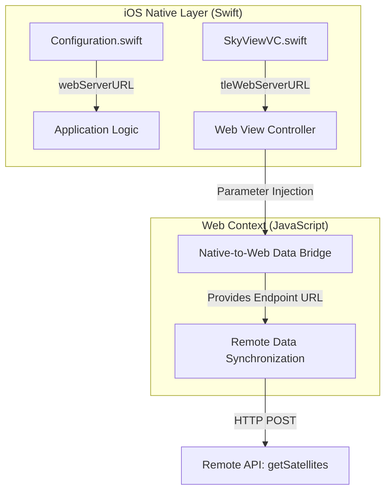

# Application Configuration

While [Remote Data Synchronization](04_remote_data_synchronization_.md) manages the asynchronous retrieval of satellite data, the **Application Configuration** subsystem provides the fundamental network parameters required to establish connections between the mobile client and backend services.

## Purpose and Responsibility

The primary responsibility of this subsystem is to define and store the essential network endpoints (web server URLs) used by the application. These configuration parameters act as the connection strings for both the service providing satellite orbital data and the service providing Two-Line Element (TLE) data. Without the correct definition of these addresses, the [Remote Data Synchronization](04_remote_data_synchronization_.md) module cannot route requests to the appropriate satellite data providers.

## Architecture and Data Flow

The configuration is currently implemented within the iOS native layer using Swift. These values are intended to be consumed by the application logic and passed into the web context via the [Native-to-Web Data Bridge](03_native_to_web_data_bridge_.md) or used directly in controller-level network requests.

### Configuration Flow Diagram



## Implementation Details

The configuration is currently distributed across two primary Swift files within the Xcode project. The implementation relies on static string constants that must be manually updated during the build process.

### Configuration Constants

#### 1. Global Service Endpoints
In `Configuration.swift`, the base URL for the primary web service is defined. This URL serves as the foundation for all satellite-related API requests.

```swift
// File: Configuration.swift

struct Configuration {
    // Replace with actual egnss4all webservice URL
    static let webServerURL = "<your webservce url>"
}
```

#### 2. TLE Service Endpoints
In `SkyViewVC.swift`, the specific endpoint for retrieving TLE (Two-Line Element) data is defined within the View Controller context.

```swift
// File: SkyViewVC.swift

class SkyViewVC: UIViewController {
    // Replace with actual egnss4all tle webservice URL
    let tleWebServerURL = "<your tle webserver url>"
    
    // ... implementation of WebView and Bridge logic
}
```

## Current Behavior and Constraints

* **Compile-Time Configuration:** The endpoints are hardcoded as string literals within the Swift source code. Any change to the backend infrastructure requires a modification of the source code and a full recompilation of the application.
* **Manual Setup Requirement:** As noted in the project `README.md`, developers must manually replace placeholder strings (`<your webserver url>`) before the application can successfully communicate with any remote service.
* **Lack of Environment Abstraction:** There is currently no mechanism to distinguish between different deployment environments (e.g., Development, Staging, Production) within the codebase.

## Known Gaps

* **Discrepancy in Configuration Locality:** While `Configuration.swift` exists in the native layer, the [Remote Data Synchronization](04_remote_data_synchronization_.md) module still contains a hardcoded IP address (`http://18.119.99.44/getSatellites`) within its JavaScript implementation (`orbit.js`). This creates a "split-brain" configuration where the native layer and web layer are not synchronized.
* **No Runtime Reconfiguration:** The application cannot update its endpoints dynamically (e.g., via a remote config fetch) without an app update.
* **Single Point of Failure:** There is no support for redundant or failover endpoints should the primary `webServerURL` become unavailable.

## Future Requirements

* **Unified Configuration Provider:** Implement a centralized configuration provider that synchronizes endpoints between the Swift native layer and the JavaScript execution context.
* **Dynamic Environment Switching:** Introduce an abstraction layer (such as `.xcconfig` files) to allow switching between different API environments during the build process without manual code edits.
* **Remote Configuration Support:** Implement the ability to fetch updated endpoint configurations from a remote source at runtime, enabling backend infrastructure migrations without requiring user-side application updates.

## Related Specifications

* [SkyView Plotting Engine](01_skyview_plotting_engine_.md)
* [GNSS Constellation Logic](02_gnss_constellation_logic_.md)
* [Native-to-Web Data Bridge](03_native_to_web_data_bridge_.md)
* [Remote Data Synchronization](04_remote_data_synchronization_.md)
