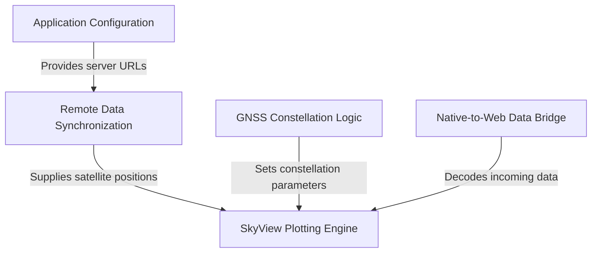

# PIC2BIM-IOS Specification Index

The **EGNSS4ALL** application is a specialized *satellite visualization tool* designed to display the real-time positions of various **GNSS constellations** (such as GPS, Galileo, and GLONASS). It uses an interactive **skyplot interface** to render satellite locations based on their *azimuth and elevation*, effectively acting like a digital radar screen for tracking satellites in the sky.

**Source Repository:** [None](None)

## Specifications

1. [SkyView Plotting Engine
](01_skyview_plotting_engine_.md)
2. [GNSS Constellation Logic
](02_gnss_constellation_logic_.md)
3. [Native-to-Web Data Bridge
](03_native_to_web_data_bridge_.md)
4. [Remote Data Synchronization
](04_remote_data_synchronization_.md)
5. [Application Configuration
](05_application_configuration_.md)
