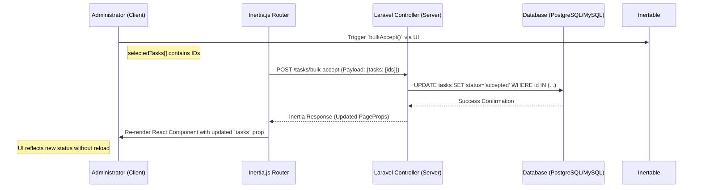

# Unified Task & User Management (Inertia.js)

## Purpose and Responsibility
The Unified Task & User Management subsystem acts as the administrative core of the PIC2BIM application. It is responsible for managing the lifecycle of organizational entities, including "Officers" and "Farmers," task types (purposes), and the operational status of assigned tasks. 

This subsystem implements a centralized workflow engine that allows administrators to assign users to agencies, manage task categories, update task statuses (e.g., from 'New' to 'Accepted'), and perform bulk operations on task sets without full-page reloads. It serves as the state-transition layer for all administrative actions within the platform.

## Architecture and Data Flow

The subsystem utilizes a Single Page Application (SPA) architecture powered by **Inertia.js**. This approach eliminates the need for a separate REST/GraphQL API layer for internal state transitions, instead using server-side routing to drive client-side state updates via XHR.

### System Components
*   **Frontend Layer:** React-based components utilizing TypeScript for type safety. Key UI primitives include `Table`, `Pagination`, and `FilterBar`.
*   **Communication Bridge:** Inertia.js `router` handles all asynchronous requests, maintaining the application's state by re-injecting updated `PageProps` from the server.
*   **State Management:** Server-driven. The client does not maintain a local global state for data; instead, it relies on the `usePage` hook to consume props provided by the Laravel backend controller during each request cycle.

### Data Flow Diagram: Task Status Transition
The following diagram illustrates the flow of a bulk task acceptance operation:

### Dependencies and Interfaces
*   **Core Dependencies:** `@inertiajs/react`, `lucide-react` (icons), `@fortawesome/react-fontawesome`.
*   **Internal Interfaces:** 
    *   `PageProps`: The global object containing `auth.user`, `tasks`, `users`, and pagination metadata.
    *   `PaginatedDataExtended<T>`: A standardized structure for handling paginated lists with extra metadata.
*   **External Constraints:** All state-changing operations (Delete, Assign, Bulk Accept) require an active session managed by `AuthenticatedLayout`.

## Technical Implementation Details

### Task Type Management
Located in `resources/js/Pages/TaskType/Index.tsx`, this module manages the definitions of "Purposes" or task categories. 
*   **Deactivation Logic:** The `destroy` function executes a `router.delete` request to the `types.destroy` route, triggering an immediate UI update via Inertia.

### Task Workflow Engine
The core logic for managing work progress is implemented in `resources/js/Pages/Tasks/Index.tsx`. 
*   **Dynamic Filtering:** The system implements a multi-select status filter. The `handleSelectedStatus` function manages the local `selectedStatus` state and triggers an Inertia GET request using `URLSearchParams` to update the backend query.
*   **Bulk Operations:** The `bulkAccept` function transmits an array of selected task IDs to the `tasks.bulkAccept` endpoint. 
*   **Sorting and Search:** Implementation utilizes the `applyFilters` pattern, where search queries (`search`) and sort parameters (`sortColumn`, `sortOrder`) are passed as query strings to the server-side controller.

### User Lifecycle & Agency Assignment
User management is split into two primary views:
1.  **Active User Management (`resources/js/Pages/Users/Index.tsx`):** Handles the administration of existing Officers, displaying metrics such as `tasks_count`, `photos_count`, and `unassigned_photos_count`.
2.  **Unassigned User Management (`resources/js/Pages/Users/Unassigned.tsx`):** Facilitates the onboarding of users into a specific agency via the `assign(id)` function, which calls the `users.assign` route.

## Current Behavior
*   **State Persistence:** Page state (search, sort, filters) is persisted through URL query parameters, allowing for deep-linking and browser back-button compatibility.
*   **UI Feedback:** Basic user feedback is provided via native `confirm()` dialogs for destructive actions and `alert()` for error handling during bulk operations.
*   **Data Rendering:** Highly optimized `Table` component renders rows based on the `PaginatedData` structure, supporting per-column sorting and custom cell rendering (e.g., status badges).

## Known Gaps
*   **Error Handling:** Error notifications are currently limited to basic browser `alert()` calls; a dedicated toast notification system is required for non-blocking feedback.
*   **Optimistic UI:** The current implementation waits for server confirmation before updating the UI (Standard Inertia behavior). Implementing optimistic updates would improve perceived latency for high-frequency actions like checkbox toggling.

## Future Requirements
*   **Integration with Attribute Extraction:** As task statuses move to "Data provided," the system must interface with [Building Attribute Extraction (EXIF)](02_building_attribute_extraction__exif__.md) to automate the transition from "Open" to "Verified."
*   **Real-time Updates:** Transitioning from polling/manual reloads to [Progressive Data Streaming (SSE)](06_progressive_data_streaming__sse__.md) for live task updates when multiple officers are working simultaneously.

## Related Specifications
*   [Building Attribute Extraction (EXIF)](02_building_attribute_extraction__exif__.md)
*   [Progressive Data Streaming (SSE)](06_progressive_data_streaming__sse__.md)
