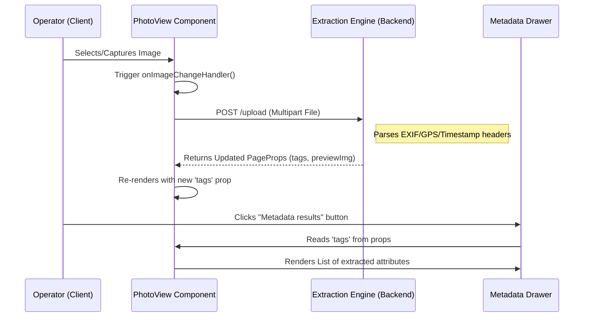

# Building Attribute Extraction (EXIF)

Following the administrative framework established in [Unified Task & User Management (Inertia.js)](01_unified_task___user_management__inertia_js__.md), the Building Attribute Extraction (EXIF) subsystem provides the specialized pipeline for processing image-based data to extract embedded spatial and temporal metadata.

## Purpose and Responsibility

The Building Attribute Extraction subsystem is responsible for parsing the header information of uploaded image files to retrieve "invisible" metadata. Its primary responsibility is to automate the extraction of GPS coordinates, altitude, and timestamps. This eliminates manual data entry errors and provides a verifiable audit trail for the location and timing of building inspections or captures. 

Based on the current implementation, this subsystem provides the user interface for triggering image uploads/captures and the visualization layer for displaying the resulting extracted metadata tags to the user.

## Architecture and Data Flow

The subsystem operates as a processing pipeline where the client-side UI acts as the ingestion point, and the backend (or an integrated service) performs the heavy lifting of binary parsing.

### System Components
* **Ingestion Layer:** A React-based interface utilizing HTML5 `input` elements with `capture` attributes for mobile camera integration.
* **Metadata Parser (Backend):** A specialized service (implied) that reads the EXIF/IPTC/XMP headers of the uploaded binary files.
* **Visualization Layer:** A Material UI-driven component tree that renders extracted metadata in a side drawer (`Drawer`) and provides image previews.

### Data Flow Diagram: Metadata Extraction & Visualization
The following diagram illustrates the flow from file selection to the display of extracted attributes.



### Dependencies and Interfaces
* **Core Dependencies:** `@mui/material`, `@mui/icons-material`, `react`.
* **Internal Interfaces:**
    * `PhotoViewProps`: Defines the structure for metadata rendering, specifically the `tags` object.
    * `Tag`: A structural type representing an individual extracted attribute description.
* **Data Structure:** 
    * `tags: Record<string, Tag[] | Tag>`: A dictionary where keys represent the EXIF tag name (e.g., "GPS Latitude") and values contain the extracted descriptions.

## Technical Implementation Details

### Image Ingestion Logic
Located in `resources/js/Pages/BuildingHeight/views/photo-view.tsx`, the component manages file input via a visually hidden input element to maintain a clean UI while enabling native device camera access.

* **Capture Mechanism:** The `VisuallyHiddenInput` uses `type="file"` with `accept="image/*"` and `capture`. The latter allows mobile browsers to bypass the file picker and open the camera directly.
* **Event Handling:** The `onImageChangeHandler` function intercepts the `ChangeEvent`, extracts the `File` object from `e.target.files[0]`, and propagates it to the parent component via the `onImageChange` callback.

### Metadata Visualization Layer
The rendering of extracted data is optimized for performance and clarity using React hooks.

* **Memoized Tag Rendering:** To prevent unnecessary re-computations during component re-renders, the `tagLists` constant is wrapped in a `useMemo` hook. It iterates over the `tags` prop to transform the `Record<string, Tag[] | Tag>` structure into a renderable list of `ListItem` components.
* **Dynamic Drawer Logic:** The `Extracted Metadata` drawer is controlled by the `extractedDrawerOpen` boolean prop. It utilizes the `List` and `ListItemText` components from Material UI to present metadata in a standardized `primary` (value) and `secondary` (key) format.

```typescript
// Implementation snippet: Memoized tag list generation
const tagLists = useMemo(() => {
  if (!tags) return null;
  return Object.keys(tags).map((keyName: any, i: any) => (
    <ListItem key={i}>
      <ListItemText
        primary={
          Array.isArray(tags[keyName])
            ? (tags[keyName] as Tag[])
                .map((item: any) => item.description)
                .join(", ")
            : (tags[keyName] as Tag)?.description || "-"
        }
        secondary={keyName}
      />
    </ListItem>
  ));
}, [tags]);
```

## Current Behavior
* **File Input:** Supports both manual file selection from storage and direct camera capture on compatible mobile devices.
* **Image Previewing:** Once a file is selected, the `ImageSrc` component updates its `backgroundImage` to provide an immediate visual confirmation of the uploaded asset.
* **Metadata Display:** Extracted attributes are displayed in a side drawer when the "Metadata results" button is clicked (active only if `tags` are present).

## Known Gaps
* **Client-side Validation:** There is currently no client-side check for file size or MIME type before the upload attempt is initiated.
* **Extraction Feedback:** The UI does not provide a loading state specifically for the "parsing" phase; it relies on the parent component's `isMetadataResultsTriggered` prop to signal completion.

## Future Requirements
* **Automated Verification:** Integration with [Unified Task & User Management (Inertia.js)](01_unified_task___user_management__inertia_js__.md) to automatically transition task statuses to "Verified" if the extracted GPS coordinates match the assigned task coordinates.
* **Error Handling for Corrupted Headers:** Implementation of a specialized error boundary to handle images with stripped or corrupted EXIF data.

## Related Specifications
* [Unified Task & User Management (Inertia.js)](01_unified_task___user_management__inertia_js__.md)
* [Multi-View Map Orchestration](03_multi_view_map_orchestration_.md)
* [Spatial Data Filtering & Processing](07_spatial_data_filtering___processing_.md)
