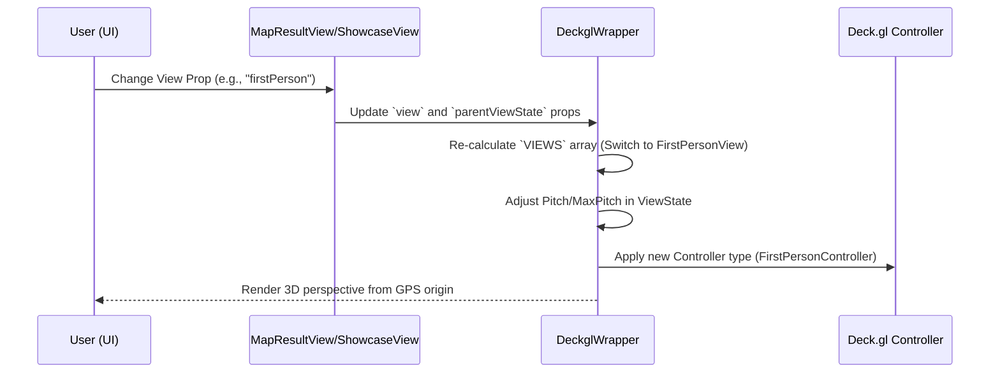

# Multi-View Map Orchestration

Following the data extraction pipeline established in [Building Attribute Extraction (EXIF)](02_building_attribute_extraction__exif__.md), the Multi-View Map Orchestration subsystem provides the high-performance rendering engine required to visualize 3D spatial assets across varying camera perspectives.

## Purpose and Responsibility

The Multi-View Map Orchestration subsystem is responsible for managing the transition between different camera projection modes within a single unified WebGL context. It implements three distinct viewing modes:
1.  **First Person:** A driver's eye view utilizing `FirstPersonController`, where the camera position is derived from GPS coordinates and heading/bearing data.
2.  **Map:** A standard 3D perspective top-down view using `MapController` with a specific pitch (e.g., 45°) to allow for terrain visualization.
3.  **Orthographic:** A flat, non-perspective engineering view where the camera pitch is locked at 0°, effectively removing parallax distortion for technical inspection.

The subsystem orchestrates the rendering of various data layers, including GeoJSON building geometries, LAS point clouds (via `@loaders.gl/las`), and photo icons (via `IconLayer`), ensuring that all layers remain spatially synchronized when switching between views.

## Architecture and Data Flow

The subsystem is built on a rendering pipeline utilizing **Deck.gl** as the primary orchestration layer and **MapLibre GL** for the basemap and terrain implementation.

### System Components
*   **Rendering Engine (`DeckglWrapper`):** The core component that manages the `views` array, switching between `MapView` and `FirstPersonView`. It handles lighting effects, widget injection (Zoom, Compass), and the integration of the PMTiles protocol for terrain.
*   **View Orchestrator (`MapResultView` & `MapShowcaseView`):** These components manage the high-level business logic of which layers are active. They compute camera offsets, building metrics, and layer compositions based on incoming spatial data.
*   **State Manager (`MultiviewMapViewState`):** A unified state structure that maintains distinct properties for both `mapView` and `firstPersonView`, ensuring that longitudinal and latitudinal coordinates are synchronized during transitions.

### Data Flow Diagram: View Transition
The following diagram illustrates the logic flow when a user switches from "Map" to "First Person" mode.



### Dependencies and Interfaces
*   **Core Dependencies:** `@deck.gl/core`, `@deck.gl/react`, `maplibre-gl`, `pmtiles`, `@loaders.gl/las`.
*   **Internal Interfaces:**
    *   `MultiviewMapViewState`: Defines the dual-state structure:
        ```typescript
        export interface MultiviewMapViewState {
          mapView: Record<string, any>;      // Coordinates for top-down view
          firstPersonView: Record<string, any>; // Coordinates + Position/Bearing for 1st person
        }
        ```
    *   `DeckglWrapperProps`: Interface for passing layers and hover handlers to the engine.

## Technical Implementation Details

### View State Synchronization
The most critical logic resides in `onViewStateChangeHandler` within `DeckglWrapper.tsx`. This function ensures that when a user pans or zooms in "Map" mode, the "First Person" camera's longitude and latitude are updated accordingly, preventing spatial drift between modes.

```typescript
const onViewStateChangeHandler = (parameters: ViewStateChangeParameters) => {
  const { viewState: deckViewState } = parameters;

  let newViewState;
  if (view === "map" || view === "orthographic") {
    // Syncing Map coordinates to FirstPersonView origin
    newViewState = {
      mapView: { ...deckViewState, maxPitch: view === "orthographic" ? 6                : 85 },
      firstPersonView: {
        ...viewState.firstPersonView,
        longitude: deckViewState.longitude,
        latitude: deckViewState.latitude,
      },
    };
  } else {
    // Syncing FirstPerson coordinates to Map origin
    newViewState = {
      mapView: { ...viewState.mapView, longitude: deckViewState.longitude, latitude: deckViewState.latitude },
      firstPersonView: deckViewState,
    };
  } 
  setViewState(newViewState);
};
```

### Layer Orchestration and Loading
The subsystem dynamically constructs the `layers` array based on the active view and available data:
*   **Point Cloud Integration:** In `MapResultView.tsx`, when a `.laz` file is provided, the system uses `load(url, LASLoader)` to fetch binary spatial data and injects a `PointCloudLayer`. The `pointSize` is dynamically adjusted based on the current view (`view === "firstPerson" ? 50 : 1`) to ensure visibility.
*   **Building Geometry:** Using `createBuilding(geojson, cameraGPSData)`, the engine generates 3D extrusion layers that represent building volumes derived from processed spatial data.
*   **Photo Gallery:** `MapShowcaseView.tsx` utilizes an `IconLayer` to render `Exif` metadata-derived points as clickable icons on the map.

### Terrain and Tiling Integration
The engine integrates with [PMTiles Tiling Protocol](04_pmtiles_tiling_protocol_.md) via MapLibre's custom protocol implementation. This allows for high-resolution terrain rendering (raster-dem) using the `pmtiles://` URI scheme, enabling realistic shadows and elevation masking.

```typescript
// Implementation of PMTiles protocol in DeckglWrapper
const onLoad = () => {
  const protocol = new Protocol();
  maplibregl.addProtocol('pmtiles', protocol.tile);
  const map = mapRef.current.getMap();
  
  map.addSource('terrainSource', {
    type: "raster-dem",
    url: "pmtiles://" + PMTILES_URL, // Integration with PMTiles
    tileSize: 256,
  });
};
```

## Current Behavior
*   **Perspective Switching:** Seamlessly switches between `MapController` and `FirstPersonController`.
*   **Dynamic Scaling:** Point cloud point sizes scale up in First Person mode to maintain visual presence.
*   **Terrain Rendering:** Implements hillshade and terrain exaggeration via PMTiles sources.
*   **Metadata Tooltips:** Provides interactive `BuildingTooltip` and `ShowcaseTooltip` components that respond to `onHover` events on specific layers.

## Known Gaps
*   **Layer Concatenation:** In `MapShowcaseView`, there is an identified need to explicitly concatenate building layers with showcase layers to ensure unified rendering of all scene elements.
*   **Loading States for Large Assets:** While a `Backdrop` with `CircularProgress` exists for gallery loading, the system lacks granular loading indicators for individual large LAS point cloud chunks during stream processing.

## Future Requirements
*   **Advanced Layer Management:** Integration with [Deck.gl Overlay Management](05_deck_gl_overlay_management_.md) to handle complex visibility toggles for different building attributes.
*   **Optimized Tiling:** Deep integration with [PMTiles Tiling Protocol](04_pmtiles_tiling_protocol_.md) to implement more efficient terrain/dem fetching logic.

## Related Specifications
*   [Building Attribute Extraction (EXIF)](02_building_attribute_extraction__exif__.md)
*   [PMTiles Tiling Protocol](04_pmtiles_tiling_protocol_.md)
*   [Deck.gl Overlay Management](05_deck_gl_overlay_management_.md)
*   [Spatial Data Filtering & Processing](07_spatial_data_filtering___processing_.md)
