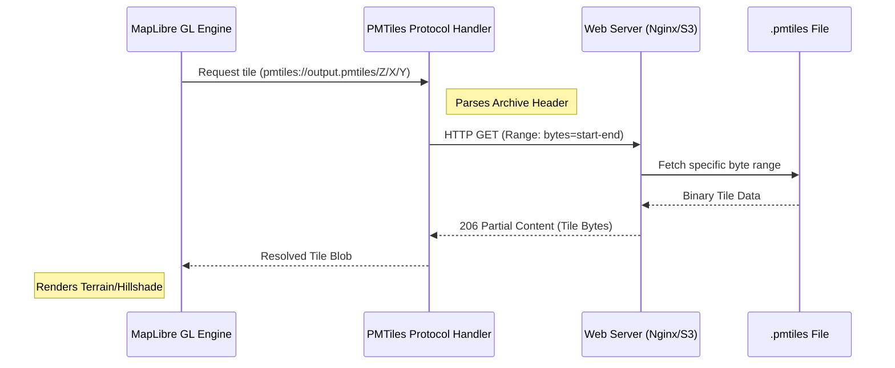

# PMTiles Tiling Protocol

Following the 3D rendering capabilities established in [Multi-View Map Orchestration](03_multi_view_map_orchestration_.md), the PMTiles Tiling Protocol subsystem provides the mechanism for efficient, large-scale spatial data retrieval using a single-file archive format.

## Purpose and Responsibility

The PMTiles Tiling Protocol subsystem is responsible for managing high-density terrain and elevation data without the overhead of thousands of individual HTTP requests. It implements the client-side logic required to parse a `.pmtiles` archive and intercept MapLibre GL tile requests, translating them into specific HTTP Range Requests. 

In the current implementation, this subsystem is specifically utilized to serve `raster-dem` (Digital Elevation Model) and `hillshade` data, enabling 3D terrain displacement and realistic shadowing within the WebGL context of [Multi-View Map Orchestration](03_multi_view_map_orchestration_.md).

## Architecture and Data Flow

The subsystem acts as a middleware layer between the MapLibre GL rendering engine and the remote file server. It implements a custom URI scheme (`pmtiles://`) that redirects standard tile requests to the PMTiles protocol handler.

### System Components
* **Protocol Interceptor:** An implementation of the `pmtiles.Protocol` class that hooks into `maplibregl.addProtocol`. It intercepts any request prefixed with `pmtiles://`.
* **Tile Resolver:** The logic within the protocol handler that parses the PMTiles header to locate specific tile offsets and lengths within the binary blob.
* **Data Consumer (MapLibre GL):** The rendering engine that requests tiles for `raster-dem` and `hillshade` layers using standard Z/X/Y coordinates.

### Data Flow Diagram: Tile Retrieval via Range Requests
The following diagram illustrates how a single request for a terrain tile is transformed into a targeted byte-range fetch.



### Dependencies and Interfaces
* **Core Dependencies:** `pmtiles` (v4.1.0), `maplibre-gl` (v5.0.0).
* **Internal Interfaces:**
    * `protocol.tile`: The function signature used to register the custom protocol handler in MapLibre GL.
    * `PMTILES_URL`: A constant string pointing to the archive location (`/output.pmtiles`).
* **External Constraints:** Requires a web server capable of handling `Range` headers and returning `206 Partial Content` responses.

## Technical Implementation Details

### Protocol Registration and Initialization
The protocol is initialized within the `onLoad` lifecycle hook of the `DeckglWrapper` component, ensuring that the protocol handler is active before any tile sources are declared.

**File:** `resources/js/Pages/BuildingAttributes/components/deckgl-servlet.tsx` (referenced via `DeckglWrapper`)

```typescript
// Implementation of PMTiles protocol registration
const onLoad = () => {
  const protocol = new Protocol(); // From pmtiles library
  maplibregl.addProtocol('pmtiles', protocol.tile);
  
  const map = mapRef.current.getMap();

  // Registering the terrain source using the custom scheme
  map.addSource('terrainSource', {
    type: "raster-dem",
    url: "pmtiles://" + PMTILES_URL,
    tileSize: 256,
  });
};
```

### Terrain and Hillshade Integration
The subsystem provides the data necessary for two specific MapLibre layers: `terrainSource` (for elevation displacement) and `hillshadeSource` (for visual shading).

* **Raster-DEM Source:** Configured with `type: "raster-dem"`. This allows the engine to use the fetched pixel values as vertical offsets for geometry.
* **Hillshade Layer:** Utilizes the same PMTiles source to calculate lighting based on the terrain's slope and aspect, enhancing the 3D effect of the buildings rendered in [Multi-View Map Orchestration](03_multi_view_map_orchestration_.md).

## Current Behavior
* **Single File Access:** All terrain elevation data is fetched from a single `/output.pmtiles` archive via HTTP Range requests.
* **Protocol Interception:** The `pmtiles://` URI scheme is successfully intercepted and resolved by the `protocol.tile` handler.
* **Terrain Displacement:** Successfully provides the `raster-dem` data required for MapLibre's `setTerrain` function, enabling 3D terrain exaggeration.

## Known Gaps
* **Static URL Configuration:** The `PMTILES_URL` is currently hardcoded to a single file path, preventing dynamic switching between different geographic regions or datasets.
* **Lack of Error Boundary for Corrupted Headers:** If the `.pmtiles` header is unreadable, the protocol handler fails silently within the MapLibre lifecycle, providing no feedback to the user.

## Future Requirements
* **Dynamic Source Management:** Integration with [Deck.gl Overlay Management](05_deck_gl_overlay_management_.md) to allow users to load different `.pmtiles` archives based on the selected task or region.
* **Vector Tile Support:** Extending the protocol implementation to support PMTiles-encoded vector layers (e.g., for high-resolution road networks) in addition to the current raster-dem capability.

## Related Specifications
* [Multi-View Map Orchestration](03_multi_view_map_orchestration_.md)
* [Deck.gl Overlay Management](05_deck_gl_overlay_management_.md)
* [Spatial Data Filtering & Processing](07_spatial_data_filtering___processing_.md)
