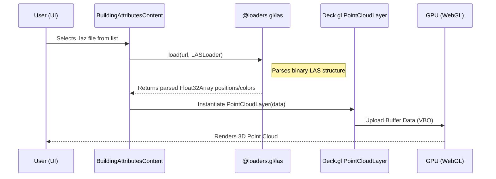

# Deck.gl Overlay Management

Building upon the terrain-driven foundation provided by the [PMTiles Tiling Protocol](04_pmtiles_tiling/protocol_.md), the Deck.gl Overlay Management subsystem provides a high-performance WebGL rendering pipeline. It is designed to handle complex, high-density 3D assets that exceed the rendering capabilities of the standard MapLibre GL engine, specifically 3D models (scenegraphs), large-scale point clouds, and dynamic icon overlays.

## Purpose and Responsibility

The Deck.gl Overlay Management subsystem is responsible for managing the lifecycle, instantiation, and spatial synchronization of specialized WebGL layers. While the base map handles standard vector tiles and terrain, this subsystem manages:
1.  **3D Scenegraphs:** Rendering GLTF models (e.g., `.gltf` camera representations) to visualize orientation and position in 3D space using `ScenegraphLayer`.
2.  **Point Cloud Visualization:** Efficiently rendering massive spatial datasets from LAS/LAZ files using `PointCloudLayer` and `@loaders.gl/las`.
3.  **Dynamic Icon Overlays:** Managing high-frequency updates for photo markers, thumbnails, and waypoints via `IconLayer`.
4.  **Complex Geometry Extrusions:** Rendering 3D building volumes (walls and roofs) that require precise extrusion parameters (height, base altitude) using `PolygonLayer` or `GeoJsonLayer`.

## Architecture and Data Flow

The subsystem operates as an overlay layer sitting atop the MapLibre GL context. It utilizes the `MapboxOverlay` pattern to ensure that all Deck.gl layers are perfectly synchronized with the camera's movement, zoom, and pitch within the primary map engine.

### System Components
* **Layer Orchestrator (`DeckglWrapper`):** The core WebGL container. It manages the `views` array (switching between `MapView` and `FirstPersonView`) and orchestrates the `MapboxOverlay` which injects Deck.gl layers into the MapLibre GL context.
* **Asset Loader (`handleDrawLaz`):** A specialized pipeline that utilizes `@loaders.gl/core` to fetch, parse, and transform binary `.laz` data into renderable `PointCloudLayer` datasets.
* **Geometry Factory (`deckgl-utils.ts`):** A utility module responsible for the programmatic construction of 3D layers (e.g., `PolygonLayer` for building extrusions) based on incoming GeoJSON properties.
* **State Controller (`BuildingAttributesContent`):** Manages the active visibility and data sources for all overlays, including toggling between "Legacy" and "OSM" building datasets.

### Data Flow Diagram: Point Cloud Loading
The following diagram illustrates the flow of binary spatial data from a remote source to a rendered WebGL layer.



### Dependencies and Interfaces
* **Core Dependencies:** `@deck.gl/core`, `@deck.gl/layers`, `@deck.gl/mesh-layers`, `@loaders.gl/las`, `maplibre-gl`.
* **Internal Interfaces:**
    * `MultiviewMapViewState`: The unified state structure (defined in [Multi-View Map Orchestration](03_multi_view_map_orchestration_.md)) used to sync camera coordinates across layers.
    * `Layer[]`: The primary array of active WebGL layers passed to the `DeckGL` component.

## Technical Implementation Details

### 3D Scenegraph and Orientation
The subsystem uses the `ScenegraphLayer` to render a 3D model representing the camera's perspective. This is critical for the "First Person" view mode.

**File:** `resources/js/Pages/BuildingAttributes/components/deckgl-wrapper.tsx`

```typescript
const cameraLayer = new window.deck.ScenegraphLayer({
  id: 'deckgl-exif3d-camera-layer',
  data,
  scenegraph: "./marker.gltf", // Path to 3D model
  getPosition: (d: any) => d.coordinates,
  getOrientation: (d: any) => [0, -d.bearing, 90], // Rotates model based on photo heading
  getScale: [0.2, 0.2, 0.2],
  pickable: true
});
```

### LAZ Point Cloud Pipeline
The subsystem implements a heavy-duty loading mechanism for LiDAR data. It uses `LASLoader` to transform compressed binary data into WebGL-compatible buffers.

**File:** `resources/js/Pages/BuildingAttributesContent.tsx`

```typescript
const handleDrawLaz = useCallback(async (flattenZ: boolean = false) => {
  // Fetching the binary stream from Nginx/S3
  const url = `${LAZ_FILES_LIST_URL}${selectedLaz}`;
  const data: any = await load(url, LASLoader); // Using @loaders.gl
  
  transformLazData(data, flattenZ); // Projecting coordinates to WebGL space

  const layer = new window.deck.PointCloudLayer({
    id: "laz-pointcloud",
    data,
    getPosition: (d: any) => d.position,
    getColor: (d: any) => d.color || [0, 0, 255],
    pointSize: view === "firstPerson" ? 50 : 1 // Dynamic scaling for visibility
  });
  // ... injection into MapboxOverlay
}, [selectedLaz, view]);
```

### Building Extrusion Logic
The `PolygonLayer` is used to create 3D volumetric representations of buildings. The system calculates the "base" (ground level) and "height" (roof level) from extracted metadata or OSM properties.

**File:** `resources/js/Pages/BuildingHeight/utils/deckgl-utils.ts`

```typescript
export const createBuilding = (building: any, cameraGPSData: any): Layer[] => {
  const storey = new PolygonLayer({
    id: "geojson-storey-building",
    data: polygonData,
    extruded: true, // Enables 3D height
    getPolygon: (d) => d.contour,
    getElevation: buildingHeight, // Absolute max height
    getFillColor: [249, 180, 45, 255],
    wireframe: true
  });
  // ... returns array of layers
};
```

## Current Behavior
* **Layer Synchronization:** Uses `MapboxOverlay` to ensure Deck.gl layers move in perfect lockstep with the MapLibre GL base map.
* **Multi-Source Support:** Capable of switching between "Legacy" (manually processed) and "OSM" (OpenStreetMap) building geometries.
* **Dynamic Scaling:** Point cloud point sizes automatically scale up when transitioning to `FirstPersonView` to maintain visual presence in 3D space.
* **Perspective Integration:** Handles the transformation of camera bearing into 3D model orientation via `getOrientation`.

## Known Gaps
* **Manual LAZ Management:** The user must manually trigger the loading of `.laz` files; there is no automated spatial-proximity loading for point clouds.
* **Hardcoded Asset Paths:** The path to the Scenegraph GLTF (`./marker.gltf`) is hardcoded, preventing dynamic model swapping for different camera types.
* **Memory Management:** While layers are removed on component unmount, there is no explicit logic to purge large `PointCloudLayer` buffers from GPU memory when a user switches away from a specific LAZ file.

## Future Requirements
* **Spatial-Driven Loading:** Integration with [Spatial Data Filtering & Processing](07_spatial_data_filtering___processing_.md) to automatically instantiate point cloud layers when the viewport intersects with a known `.laz` bounding box.
* **Layer Visibility API:** Implementation of a standardized UI for toggling specific high-density layers (e.g., "Show LiDAR", "Show 3D Camera Models") based on user preference.

## Related Specifications
* [Multi-View Map Orchestration](03_multi_view_map_orchestration_.md)
* [PMTiles Tiling Protocol](04_pmtiles_tiling_protocol_.md)
* [Spatial Data Filtering & Processing](07_spatial_data_filtering___processing_.md)
