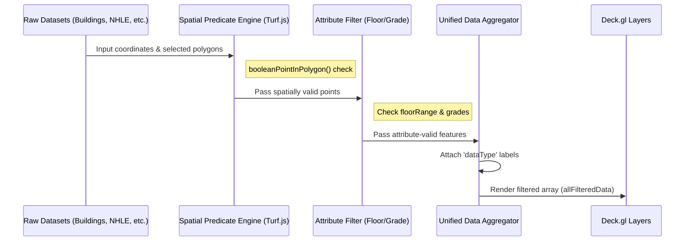

# Spatial Data Filtering & Processing

Following the high-performance rendering capabilities established in [Deck.gl Overlay Management](05_deck_gl_overlay_management_.md), the Spatial Data Filtering & Processing subsystem provides a client-side logic engine for managing and refining massive collections of geographic points (centroids) based on user-defined spatial boundaries and attribute properties.

## Purpose and Responsibility

The Spatial Data Filtering & Processing subsystem is responsible for the real-time reduction of large datasets within the browser. It implements a multi-layered filtering pipeline that allows users to isolate specific features—such as buildings, NHLE sites, or photo locations—by interacting with geographic polygons (shapes) or by adjusting attribute ranges (e.g., floor counts or grades).

The subsystem's primary responsibility is to transform raw, high-density datasets into a refined, renderable subset that corresponds to the user's current viewport and selection criteria, thereby optimizing the rendering load for [Deck.gl Overlay Management](05_deck_gl_overlay_management_.md) layers.

## Architecture and Data Flow

The subsystem operates as a reactive processing pipeline built on **React Hooks** and **Turf.js**. It utilizes `useMemo` to ensure that complex spatial predicates are only re-calculated when the underlying data or filter parameters change, preventing computational bottlenecks during UI re-renders.

### System Components
* **Spatial Predicate Engine:** A logic layer utilizing `@turf/boolean-point-in-polygon` to perform point-in-polygon intersection tests between feature coordinates and selected boundary geometries.
* **Attribute Filter Logic:** A secondary processing layer that applies scalar filters, such as numeric ranges for building heights (floors) or string matching for NHLE grades.
* **Unified Data Aggregator:** A transformation layer that flattens heterogeneous data types (Buildings, Sites, Photos, etc.) into a single, standardized array of renderable objects, each decorated with a `dataType` property for unified rendering and legend management.
* **Geometry Analytics Engine:** A utility module (`geo-operations.ts`) that performs volumetric and area calculations based on polygon geometries using `@turf/turf`.

### Data Flow Diagram: Filtering Pipeline
The following diagram illustrates the transformation of raw datasets into a filtered, renderable collection.



### Dependencies and Interfaces
* **Core Dependencies:** `@turf/turf`, `@math.gl/core`, `react`.
* **Internal Interfaces:**
    * `UseDataFiltersProps`: The primary input configuration, including raw data arrays, shape geometries (`BuiltupAreaGeoJson`), and active filter states (e.g., `floorRange`, `selectedGrades`).
    * `BuildingCentroidState`, `PhotoCentroidState`, etc.: Standardized structures for geographic point features containing `coordinates` and `properties`.

## Technical Implementation Details

### Spatial Predicate Logic
The core of the spatial filtering capability is implemented in `resources/js/Pages/DataMap/hooks/useDataFilters.ts`. The subsystem generates a memoized predicate function, `filterBySelectedShapes`, which determines if a point's coordinates fall within any of the user-selected polygons.

```typescript
// Implementation of spatial boundary filtering
const filterBySelectedShapes = useMemo(() => {
  if (!shapes?.data?.features) return () => true;
  
  const selectedPolygons = shapes.data.features.filter(shape => 
    selectedShapeIds.includes(shape.id as string)
  );
  const hasSelectedShapes = selectedPolygons.length > 0;
  
  if (!hasSelectedShapes) return () => true;
  
  return (coordinates: [number, number]) => {
    const point = turf.point(coordinates);
    return selectedPolygons.some(polygon => {
      try {
        // Performs the heavy-lifting Point-in-Polygon math
        return booleanPointInPolygon(point, polygon as any);
      } catch (e) {
        return false;
      }
    });
  };
}, [shapes?.data?.features, selectedShapeIds]);
```

### Attribute-Based Refinement
Once spatial validity is established, the system applies property-based filters. For example, in `filteredBuildingCentroids`, the engine inspects the `properties` object of each feature to enforce a `floorRange` constraint:

```typescript
// Implementation of attribute range filtering
const filteredBuildingCentroids = useMemo(() => {
  return buildingCentroidsData.filter(d => {
    if (!filterBySelectedShapes(d.coordinates)) return false;

    // Extracting floor count from various possible property keys
    const floors = d.properties?.numberoffloors || d.properties?.floors || 0;
    return floors >= floorRange.min && floors <= floorRange.max;
  });
}, [buildingCentroidsData, floorRange, filterBySelectedShapes]);
```

### Geometric Analytics
The subsystem includes a utility module, `resources/js/Pages/BuildingHeight/utils/geo-operations.ts`, which uses Turf.js to derive building metrics from polygon geometries. This is used to calculate the volume and footprint area of buildings during the modeling phase.

```typescript
// Implementation of volumetric calculations
export const computeGeoMatrics = (
  coordinates: any,
  floorHeight: number,
  floorNumber: number,
  lotCoverage: number
) => {
  const areaPolygon = polygon(coordinates);
  const landArea = round(area(areaPolygon));
  const buildingHeight = floorHeight * floorNumber;
  // Calculates volume based on lot coverage and height
  const volume = round(landArea * (lotCoverage / 100) * buildingHeight);
  
  return { landArea, volume, buildingHeight };
};
```

## Current Behavior
* **Multi-Criteria Filtering:** Supports simultaneous spatial (polygon), attribute (floors/grades), and categorical (data type toggles) filtering.
* **Heterogeneous Data Handling:** Manively manages disparate datasets including NHLE, EPC certificates, OSM building parts, and UPRN points within a single unified pipeline.
* **Search Functionality:** Implements string-based searching against property names (e.g., `bua24nm`) for boundary shapes.
* **Performance Optimization:** Uses `useMemo` extensively to prevent $O(N \times M)$ spatial complexity from impacting the UI during unrelated re-renders.

## Known Gaps
* **Linear Spatial Complexity:** The current implementation iterates through all selected polygons for every point ($O(N_{points} \times M_{polygons})$). As the number of selected boundaries increases, performance will degrade.
* **Lack of Spatial Indexing:** There is no client-side R-tree or spatial index (like `rbush`) to accelerate point-in-polygon lookups.
* **Memory Pressure:** The `allFilteredData` array aggregates all active datasets into a single large array in memory, which may cause significant pressure when handling millions of points.

## Future Requirements
* **Spatial Indexing Integration:** Implement an R-tree index for the selected polygons to reduce spatial query complexity from linear to logarithmic.
* **Streaming Filter Integration:** Integrate with [Progressive Data Streaming (SSE)](06_progressive_data_streaming__sse_.md) to apply these filters to incoming data chunks *before* they are added to the main application state.
* **Web Worker Offloading:** Move the heavy `turf.booleanPointInPolygon` computations to a Web Worker to prevent blocking the main UI thread during large-scale filtering operations.

## Related Specifications
* [Deck.gl Overlay Management](05_deck_gl_overlay_management_.md)
* [Progressive Data Streaming (SSE)](06_progressive_data_streaming__sse__.md)
* [Building Attribute Extraction (EXIF)](02_building_attribute_extraction__exif__.md)
