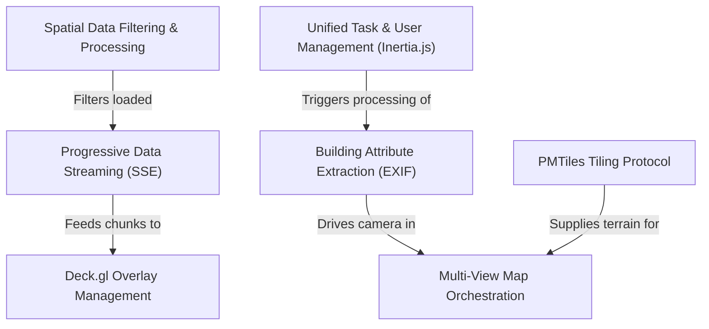

# PIC2BIM Specification Index

**PIC2BIM** is an advanced *geospatial visualization platform* designed to bridge the gap between **photographic evidence** and **3D building models**. The system allows users to manage large-scale urban datasets by streaming massive amounts of data in real-time, providing immersive *first-person perspectives* alongside technical engineering views.

**Source Repository:** [None](None)

## Specifications

1. [Unified Task & User Management (Inertia.js)
](01_unified_task___user_management__inertia_js__.md)
2. [Building Attribute Extraction (EXIF)
](02_building_attribute_extraction__exif__.md)
3. [Multi-View Map Orchestration
](03_multi_view_map_orchestration_.md)
4. [PMTiles Tiling Protocol
](04_pmtiles_tiling_protocol_.md)
5. [Deck.gl Overlay Management
](05_deck_gl_overlay_management_.md)
6. [Progressive Data Streaming (SSE)
](06_progressive_data_streaming__sse__.md)
7. [Spatial Data Filtering & Processing
](07_spatial_data_filtering___processing_.md)
