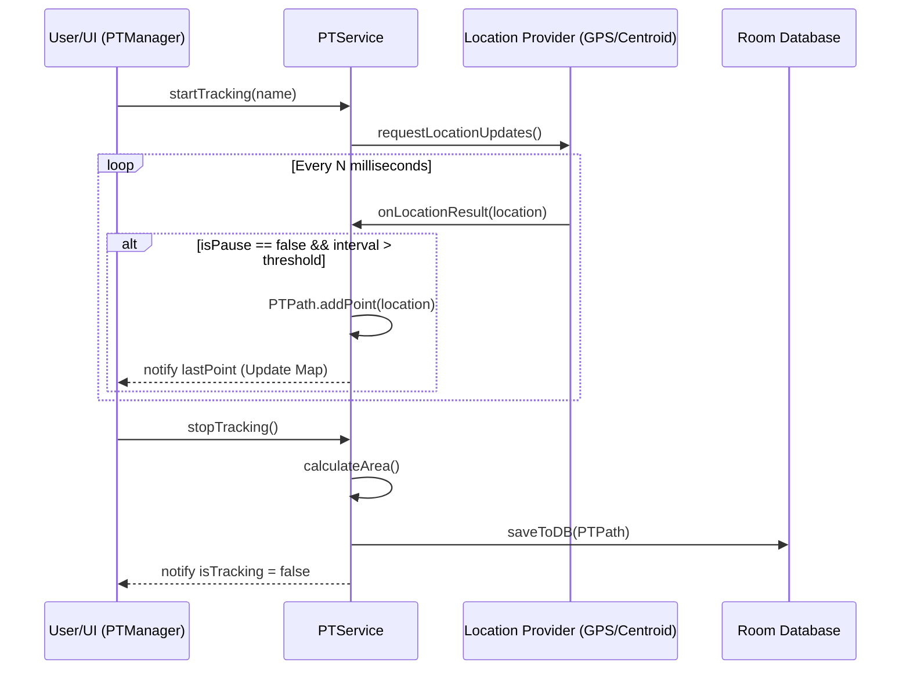

# Path Tracking System (PTService)

While the [Task-Centric Domain Model](01_task_centric_domain_model_.md) defines the operational context and lifecycle of a work order, the **Path Tracking System (PTService)** provides the spatial evidence required to validate that work. It acts as the "breadcrumb tracker," recording a continuous sequence of geographic coordinates to reconstruct a trajectory of movement during a field operation.

## Purpose and Responsibility

The `PTService` subsystem is responsible for:
1.  **Trajectory Recording**: Capturing and storing a sequential series of `PTPoint` objects (latitude, longitude, timestamp) that constitute a `PTPath`.
2.  **Session Lifecycle Management**: Managing the transition between `STARTING`, `TRACKING`, `PAUSED`, and `STOPPED` states.
3.  **Multi-Source Location Ingress**: Orchestrating location updates from different providers, specifically standard GPS via `FusedLocationProviderClient` or centroid-based coordinates from [CHService](04_ekf__extended_kalman_filter__engine_.md) (contextualized as part of the EKF engine ecosystem).
4.  **Spatial Data Integrity**: Enforcing temporal constraints on point collection to prevent redundant data points and ensuring that path metadata (area, device info, timestamps) is finalized upon session termination.

## Architecture and Data Flow

The system follows a Service-oriented architecture. `PTService` runs as a `LifecycleService`, allowing it to react to Android lifecycle events and maintain long-running background execution. `PTManager` acts as the controller/orchestrator, mediating between the background service and the UI (`PTMapActivity`).

### Data Flow Pattern
1.  **Ingress**: Location updates are received via a `LocationCallback` (for GPS) or an Observer (for Centroids).
2.  **Filtering**: The system applies two filters:
    *   **State Filter**: If `isPause` is true, incoming locations are ignored.
    *   **Temporal Filter**: A new point is only recorded if the interval since `lastPointReceived` exceeds a threshold defined by `PersistData.getCapturePointPeriod`.
3.  **Processing**: Validated points are added to the `PTPath` object.
4.  **Egress/Persistence**: Upon `stopTracking()`, the `PTPath` calculates its total area and persists itself to the [Persistence Layer (Room Database)](05_persistence_layer__room_database__.md).

### Dependencies and Interfaces
*   **Service Controller**: Uses `ServiceController` for managed initialization and binding of `PTService`.
*   **Location Providers**: Relies on Google Play Services (`FusedLocationProviderClient`) and the centroid-based logic from the EKF engine.
*   **UI Bridge**: `PTManager` implements the logic to bind service state (like `isTracking` or `lastPoint`) to `PTDrawer` for real-time map rendering.
*   **State Synchronization**: Employs a `Queue<IsTrackingDisposable>` mechanism to handle asynchronous callbacks that must only execute once a specific service state is reached.



## Implementation Details

### State Management and the Disposable Pattern
To prevent race conditions during service startup or shutdown (where a callback might arrive before the `PTPath` object is fully instantiated), `PTService` implements an internal queue of `IsTrackingDisposable` objects.

**File:** `app/src/main/java/com/erasmicoin/euspa/gsa/egnss4all/model/pathTrack/PTService.java`

```java
// Ensures callbacks are deferred until the service reaches a stable state
public void addIsTrackingDisposable(IsTrackingDisposable isTrackingDisposable) {
    isTrackingDisposableQueue.add(isTrackingDisposable);
    executeIsTrackingDisposable();
}

private void executeIsTrackingDisposable() {
    while (true) {
        if (!isDisposable()) return; // Stop if we are in the middle of starting/stopping
        IsTrackingDisposable disposable = isTrackingDisposableQueue.poll();
        if (disposable == null) return;
        disposable.onIsTrackingDisposable(isTracking.getValue());
    }
}
```

### Path Finalization Logic
When `stopTracking()` is invoked, the service performs a final computation of the trajectory's properties before committing to the database.

**File:** `app/src/imain/java/com/erasmicoin/euspa/gsa/egnss4all/model/pathTrack/PTService.java`

```java
private void stopTrackingComplete() {
    if (currentPath.getPoints().size() > 0) {
        currentPath.setEndT(DateTime.now());
        currentPath.setDeviceInfos(); // Capture hardware metadata
        currentPath.calculateArea();   // Compute polygon area
        currentPath.saveToDB(appDatabase);
    } else {
        noPointException.setValue(new IllegalStateException("No points in path."));
    }
    isTracking.setValue(false);
}
```

### Manual Point Manipulation
`PTManager` provides an interface for the UI to manually intervene in the trajectory, allowing for error correction (e.g., deleting a stray GPS point).

**File:** `app/src/main/java/com/erasmicoin/euspa/gsa/egnss4all/model/pathTrack/PTManager.java`

```java
public void deletePoint(PTPoint ptPoint) {
    if (ptService == null || ptService.currentPath == null) return;
    
    if (!ptService.deletePoint(ptPoint)) {
        // Handle error if point doesn't exist or path is empty
        if (ptService.currentPath.getPoints().size() == 0 && ptOnNoPointToDelete != null) {
            ptOnNoPointToDelete.ptOnNoPointToDelete();
        }
        return;
    }
    // Refresh the visual polyline on the map
    ptDrawer.removePath();
    ptDrawer.drawAllPathAsPolyline(ptService.currentPath);
}
```

## Current Behavior and Constraints

*   **Current Implementation**: Supports both standard Fused Location tracking and Centroid-based tracking (via `CHService`).
*   **Temporal Filtering**: The system enforces a minimum capture interval via `PersistData.getCapturePointPeriod` to optimize storage and performance.
*   **Constraints**: 
    *   The service requires `ACCESS_FINE_LOCATION` permissions; failure to acquire them triggers a `SecurityException` via `lastStartException`.
    *   Path calculation (Area) is only performed upon successful session termination.

## Known Gaps

*   **Centroid Integration**: The logic for `startTrackingWithCentroid` is currently partially gated by `PersistData` and contains commented-out legacy code (`P1` markers), indicating an incomplete transition to a fully automated centroid-driven mode.
*   **Error Recovery**: While the service logs exceptions via `FileLogger`, it does not implement an automatic retry mechanism for failed location updates; it relies on the UI/Manager to re-trigger tracking.

## Future Requirements

*   **Advanced Filtering**: Implementation of more sophisticated smoothing algorithms (potentially utilizing the [EKF Engine](04_ekf__extended_kalman_filter__engine_.md)) directly within the `receiveNewLocation` pipeline.
*   **Robust Centroid Switching**: Seamless,-uninterrupted switching between GPS and Centroid sources without requiring manual service restarts.

## Related Specifications

*   [Task-Centric Domain Model](01_task_centric_domain_model_.md)
*   [Tiered Location Sourcing](03_tiered_location_sourcing_.md)
*   [EKF (Extended Kalman Filter) Engine](04_ekf__extended_kalman_filter__engine_.md)
*   [Persistence Layer (Room Database)](05_persistence_layer__room_database__.md)
*   [SyncQueue Orchestrator](06_syncqueue_orchestrator_.md)
