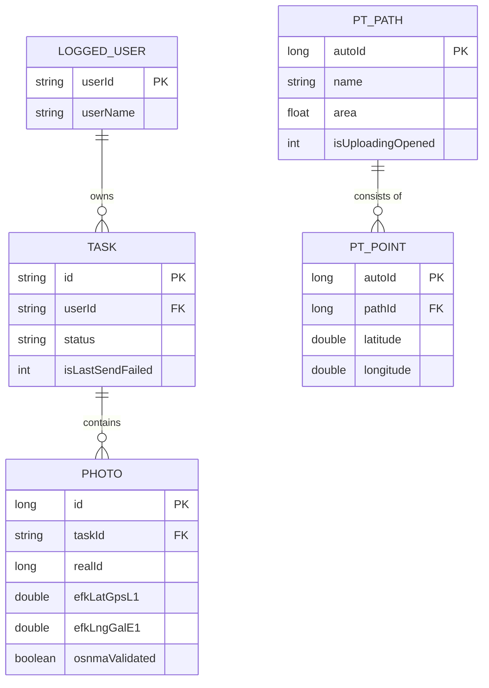

# Persistence Layer (Room Database)

While the [EKF (Extended Kalman Filter) Engine](04_ekf__extended_kalman_filter__engine_.md) performs the heavy computational lifting to derive precise coordinates, the **Persistence Layer (Room Database)** provides the application's "digital filing cabinet." It is responsible for the durable, structured storage and retrieval of all processed scientific data, ensuring that even in the event of application crashes or device power loss, the integrity of collected evidence remains intact.

## Purpose and Responsibility

The Persistence Layer subsystem is responsible for:
1.  **Data Durability**: Providing a reliable SQLite-backed storage mechanism for mission-critical data (Tasks, Photos, Paths).
2.  **Structured Object Mapping**: Using the Room persistence library to map complex domain objects (e.g., `Task`, `PTPath`) and their relationships into relational database tables.
3.  **Relational Integrity**: Managing foreign key constraints between entities, such as ensuring `PTPoint` records are strictly tied to a valid `PTPath`.
4.  **Schema Evolution**: Managing complex version migrations (from v42 up to the current v54) to accommodate evolving requirements like GNSS metadata and OSNMA validation.
5.  **Local State Management**: Maintaining the state of the currently `LoggedUser` and the synchronization status (`isSent`, `isLastSendFailed`) of tasks and photos.

## Architecture and Data Flow

The subsystem implements the **Data Access Object (DAO)** pattern, abstracting the underlying SQLite complexity from the rest of the application. The `AppDatabase` class serves as the central entry point for all database operations.

### Entity Relationship Diagram (ERD)
The following diagram illustrates the relational structure maintained by the Room database:



### Data Flow Patterns
*   **Ingress (Sensor/Network $\rightarrow$ DB)**: 
    *   The `PTService` [Path Tracking System (PTService)](02_path_tracking_system__ptservice__.md) writes `PTPath` and `PTPoint` objects upon session termination.
    *   The `Task` model updates its local state following successful or failed network responses from the server.
    *   The `Photo` entity is populated with high-precision GNSS metadata (lat/lng/alt for various constellations) derived from the [EKF Engine](04_ekf__extended_kalman_filter__engine_.md).
*   **Egress (DB $\rightarrow$ Network/UI)**: 
    *   The [SyncQueue Orchestrator](06_syncqueue_orchestrator_.md) queries the `PhotoDao` and `TaskDao` for records where `isSent = 0` to initiate uploads.
    *   The UI queries `PTDao` to reconstruct trajectories for map rendering.

## Implementation Details

### Database Configuration and Migrations
The `AppDatabase` class manages a highly evolved schema. The migration history (v42 through v54) reveals the increasing complexity of the data being captured, specifically regarding GNSS precision and security validation.

**File:** `app/src/main/java/com/erasmicoin/euspa/gsa/egnss4all/model/AppDatabase.java`

Notable migrations include:
*   **MIGRATION_42_43 & 43_44**: Added error tracking (`isLastSendFailed`) to `Photo` and `Task`.
*   **M/47_48**: A massive expansion of the `Photo` table to store high-precision EKF-derived coordinates for multiple constellations (GPS L1, L5, IF; Galileo E1, E5a, IF).
*   **M/51_52**: Integration of security features (`osnmaValidated`, `validatedSats`).

```java
// Example: Structural expansion of the Photo entity during migration
public static final Migration MIGRATION_47_48 = new Migration(47, 48) {
    @Override
    public void migrate(@NonNull SupportSQLiteDatabase database) {
        database.execSQL("alter table Photo add `efkLatGpsL1` REAL default null");
        database.execSQL("alter table Photo add `efkLngGalE1` REAL default null");
        // ... additional GNSS coordinate columns
    }
};
```

### Data Access Objects (DAOs)
The system uses specialized DAOs to encapsulate query logic, preventing the leakage of SQL into the business logic.

*   **`TaskDao`**: Handles task lifecycle queries, including filtering by `userId` and status. It implements `@Transaction` for atomic operations like `recreateTasks`.
*   **`PhotoDao`**: Manplements complex retrieval logic, specifically identifying "unowned" photos (those not yet assigned to a `Task`) and differentiating between sent and unsent evidence.
*   **`PTDao`**: Manages the hierarchical relationship between `PTPath` and `PTPoint`, ensuring that point retrieval is scoped by `pathId`.

**File:** `app/src/main/java/com/erasmicoin/euspa/gsa/egnss4all/model/PhotoDao.java`
```java
@Dao
public abstract class PhotoDao {
    // Retrieves photos belonging to a specific task that are pending upload
    @Query("select * from Photo where taskId = :taskId and isSent = 0")
    public abstract List<Photo> selectTaskPhotosNotSent(String taskId);

    // Identifies photos captured but not yet associated with a work order (Task)
    @Query("select * from Photo where taskId is null and userId = :userId order by created desc")
    public abstract List<Photo> selectUnownedPhotos(String userId);
}
```

## Current Behavior and Constraints

*   **Current Implementation**: The database supports multi-user environments (via `userId` filtering) and maintains a complex history of GNSS metadata for every captured photo.
*   **Constraints**: 
    *   **Thread Safety**: While Room handles much of the concurrency, heavy write operations (like inserting thousands of `PTPoint` objects) must be managed to avoid blocking the UI thread.
    *   **Schema Rigidity**: Migrations are manual and strictly sequential; any failure in the `MIGRATION_X_Y` chain results in a non-recoverable `SQLiteException`.
    *   **Data Volatility**: The system relies on `onConflict = OnConflictStrategy.REPLACE`, meaning newer incoming data from the server will overwrite local changes if IDs collide.

## Known Gaps

*   **Large Blob Storage**: While metadata is stored in Room, actual photo binary data is managed externally; the database only stores references (`digest`, `realId`), which requires careful synchronization with the file system.
*   **Migration Testing**: There is no explicit automated test suite documented for verifying the integrity of all 12+ migration paths (v42-v54) against schema corruption.

## Future Requirements

*   **Database Pruning Logic**: Implementation of an automated "cleanup" mechanism to delete old, successfully synchronized `PTPoint` and `Photo` records to prevent unbounded database growth.
*   **Encrypted Storage**: Implementation of SQLCipher to encrypt the database file, protecting sensitive user and location data at rest.

## Related Specifications

*   [Task-Centric Domain Model](01_task_centric_domain_model_.md)
*   [Path Tracking System (PTService)](02_path_tracking_system__ptservice__.md)
*   [Tiered Location Sourcing](03_tiered_location_sourcing_.md)
*   [EKF (Extended Kalman Filter) Engine](04_ekf__extended_kalman_filter__engine_.md)
*   [SyncQueue Orchestrator](06_syncqueue_orchestrator_.md)
