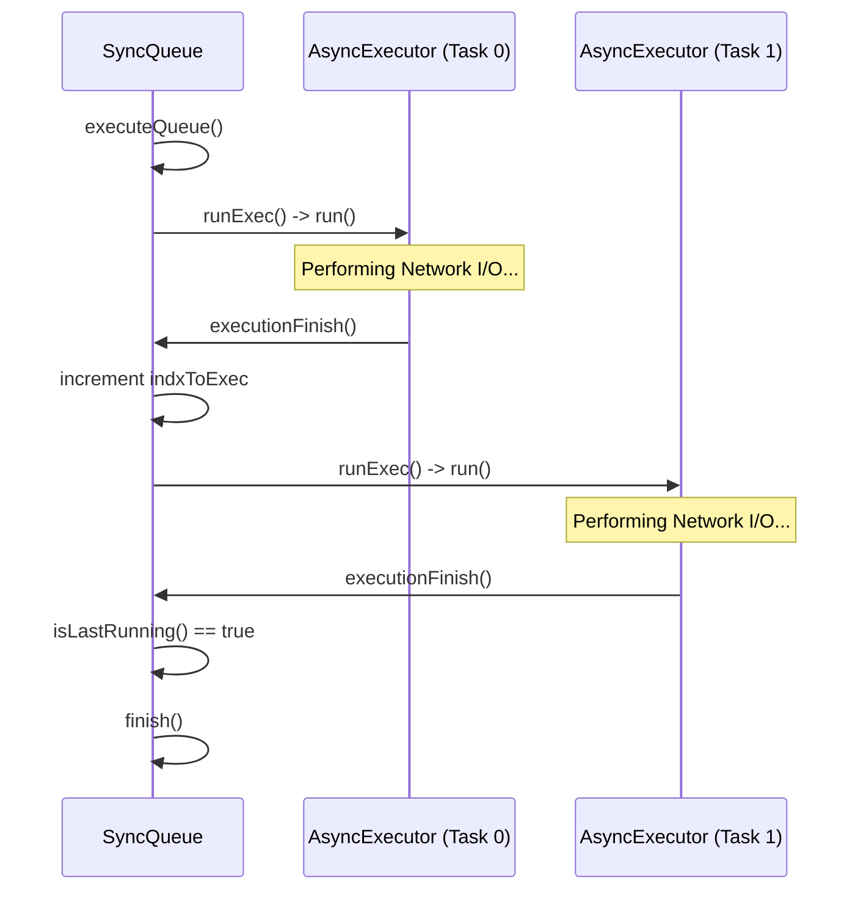

# SyncQueue Orchestrator

While the [Persistence Layer (Room Database)](05_persistence_layer__room_database__.md) provides the structured storage for all pending updates, the **SyncQueue Orchestrator** provides the execution logic required to process these updates without overwhelming system resources or network bandwidth. It acts as a sequential execution engine that manages a chain of asynchronous operations.

## Purpose and Responsibility

The `SyncQueue` subsystem is responsible for:
1.  **Sequential Execution Management**: Ensuring that a series of `AsyncExecutor` tasks are executed one after another, preventing the concurrent execution of multiple heavy network or I/O operations.
2.  **Task Chaining**: Implementing a "chain reaction" mechanism where the completion of one task (`executionFinish`) automatically triggers the commencement of the next task in the queue.
3.  **Execution Telemetry**: Providing detailed logging and debugging information, including start/end timestamps for each individual executor within the queue.
4.  / **Queue Manipulation**: Allowing for the dynamic insertion of tasks at the end of the queue or at specific offsets (e.g., behind the currently running task) to manage priority or urgent updates.

## Architecture and Data Flow

The `SyncQueue` implements a variation of the **Command Pattern**, where each unit of work is encapsulated within an `AsyncExecutor` object. The orchestrator maintains an internal registry of these executors in a `List<AsyncExecutor>`.

### Execution Flow
The lifecycle of a queue execution follows a deterministic, sequential pattern:
1.  **Initialization**: A `SyncQueue` instance is created (optionally with a specific name).
2.  **Ingress (Task Loading)**: Tasks are added to the `execs` list via `addAsyncExecutor` or `addAsyncExecutorBehindCurrent`.
3.  **Triggering**: The process begins when `executeQueue()` is called, which invokes the first task in the list.
4.  **Sequential Chaining**: 
    *   An `AsyncExecutor` performs its logic (e.g., a network request for a [Task](01_task_centric_domain_model_.md) or a photo).
    *   Upon completion, the executor calls `executionFinish()`.
    *   The orchestrator increments the internal index (`indxToExec`) and checks if more tasks remain.
    - If tasks remain, it triggers the next `AsyncExecutor`.
5.  **Termination**: Once the last task in the list completes, `finish()` is called, marking the queue as `isFinished`.



### Dependencies and Interfaces
*   **Abstract Unit of Work**: Relies on the `AsyncExecutor` inner class, which requires developers to implement the `run()` method.
*   **Time/Logging**: Uses `org.joda.time.DateTime` for high-precision execution telemetry in logs.
*   **Concurrency Model**: Operates on a single-thread sequential model (the thread that calls `run()` is the thread that executes the task).

## Implementation Details

### The Chaining Mechanism
The core logic resides in `executionFinish()`. This method is responsible for the "conveyor belt" behavior. It does not simply end the current process; it actively looks ahead to the next task in the list.

**File:** `app/src/main/java/com/erasmicoin/euspa/gsa/egnss4all/model/SyncQueue.java`

```java
public void executionFinish() {
    if (isFinished) {
        throw new RuntimeException("Call executionFinish on finished " + SyncQueue.class.getSimpleName());
    }
    // Log the end of the current task
    debugExecutorEnd(execs.get(indxToExec), indxToExec);
    
    ++indxToExec; // Move pointer to next task
    
    if (indxToExec == execs.size()) {
        finish(); // All tasks completed
        return;
    }
    
    // Trigger the next task in the chain
    debugExecutorStart(execs.get(indxToExec), indxToExec);
    execs.get(indxToExec).runExec();
}
```

### Task Insertion and Offsets
The orchestrator allows for "behind current" insertion, which is critical when a high-priority task (like a status update) needs to be injected into the queue immediately after the currently running heavy operation (like a large photo upload).

**File:** `app/src/main/java/com/erasmicoin/euspa/gsa/egnss4all/model/SyncQueue.java`

```java
/**
 * Inserts an executor at a specific offset relative to the current task index.
 * @param offset The number of positions ahead of the current index to insert.
 */
public void addAsyncExecutorBehindCurrent(AsyncExecutor asyncExecutor, int offset) {
    try {
        // Logic: Current Index + 1 (the next slot) + user defined offset
        execs.add(indxToEx + 1 + offset, asyncExecutor);
    } catch (IndexOutOfBoundsException e) {
        execs.add(asyncExecutor); // Fallback to end of queue
    }
}
```

## Current Behavior and Constraints

*   **Sequentiality**: The system is strictly sequential. It does not support parallel execution of tasks within a single `SyncQueue` instance.
*   **Error Handling**: Currently, the `AsyncExecutor` relies on the implementation of its `run()` method to handle internal errors. If an exception escapes `run()`, it may break the chain and prevent subsequent tasks from executing.
*   **Telemetry**: Detailed logs are produced via `debugStart`, `debugExecutorStart`, `debugExecutorEnd`, and `debugEnd`, allowing for precise auditing of synchronization durations.

## Known Gaps

*   **Lack of Automatic Retry**: While the [Task-Centric Domain Model](01_task_centric_domain_model_.md) flags `isLastSendFailed`, the `SyncQueue` does not currently implement an automated retry policy for failed `AsyncExecutor` units.
*   **No Error Propagation Interface**: There is no standardized way for a failing `AsyncExecutor` to notify the `SyncQueue` to either skip the current task or halt the entire queue.

## Future Requirements

*   **Retry Policy Integration**: Implementation of a "Retry-on-Failure" decorator for `AsyncExecutor` that can re-queue tasks with exponential backoff.
*   **Priority Queuing**: Refactoring the `execs` list into a `PriorityQueue` to allow tasks to be ranked by importance (e.g., Task Status updates > Photo uploads) rather than manual index manipulation.

## Related Specifications

*   [Task-Centric Domain Model](01_task_centric_domain_model_.md)
*   [Persistence Layer (Room Database)](05_persistence_layer__room_database_.md)
