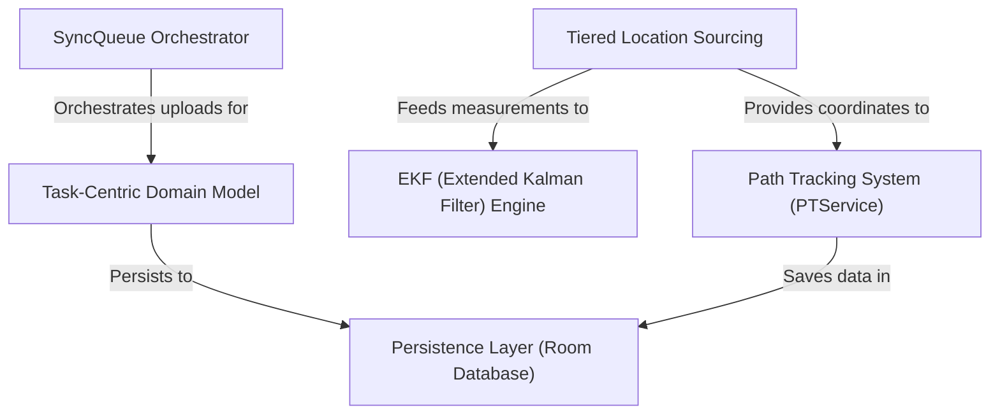

# PIC2BIMAndroid Specification Index

The **PIC2BIMAndroid** project is a specialized scientific application designed for high-precision *GNSS (Global Navigation Satellite System)* data collection and trajectory tracking. It allows users to manage digital **work orders (Tasks)**, capture detailed physical evidence like photos, and record precise **GPS paths**. The app utilizes an advanced *Extended Kalman Filter* to process noisy satellite signals and employs a multi-layered strategy to ensure accurate positioning, all while ensuring that collected data is safely stored in a local **database** and synchronized with a remote server.

**Source Repository:** [None](None)

## Specifications

1. [Task-Centric Domain Model
](01_task_centric_domain_model_.md)
2. [Path Tracking System (PTService)
](02_path_tracking_system__ptservice__.md)
3. [Tiered Location Sourcing
](03_tiered_location_sourcing_.md)
4. [EKF (Extended Kalman Filter) Engine
](04_ekf__extended_kalman_filter__engine_.md)
5. [Persistence Layer (Room Database)
](05_persistence_layer__room_database__.md)
6. [SyncQueue Orchestrator
](06_syncqueue_orchestrator_.md)
