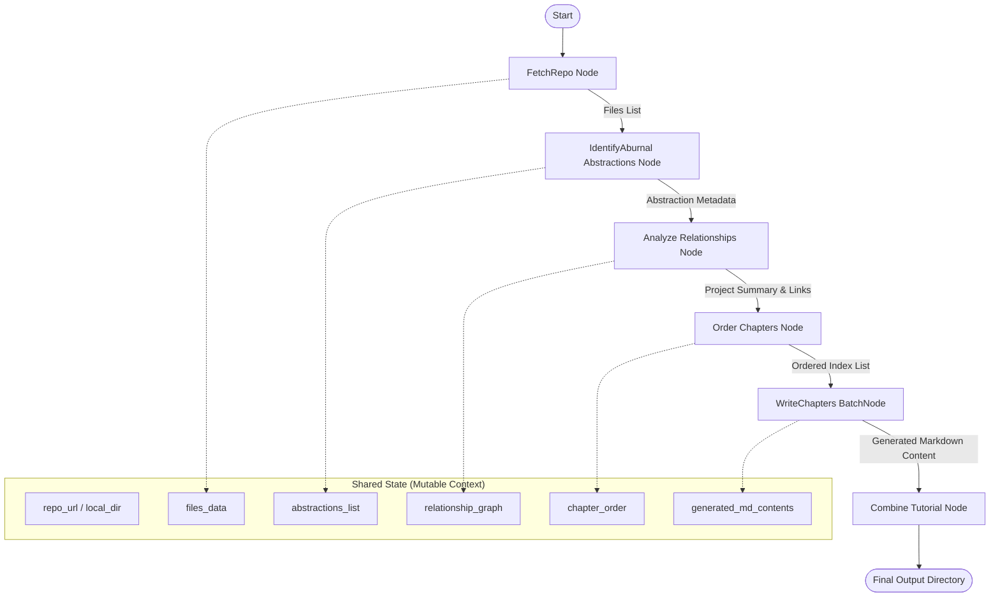

# PocketFlow LLM Orchestration

## Purpose and Responsibility
The `PocketFlow LLM Orchestration` subsystem provides a node-based framework for executing complex, high-level reasoning tasks using Large Language Models (LLMs). Its primary responsibility is to transform unstructured or semi-structured data (such as source code repositories) into highly structured, multi-chapter technical documentation by treating cognitive tasks as discrete, chainable units of work.

The subsystem implements an "intelligent assembly line" pattern where each station (Node) performs a specific transformation on a shared state object.

## Architecture and Data Flow

### Node-Based Execution Model
The core architecture is built upon the concept of **Nodes** and **Flows**. 
- **Nodes**: The fundamental unit of computation. Each node implements a three-stage lifecycle:
    - `prep()`: Prepares inputs by extracting necessary parameters from the shared state.
    - `exec()`: Performs the primary task (e.g., calling an LLM, crawling a filesystem).
    - `post()`: Persists the results back into the shared state for subsequent nodes.
- **Flows**: A directed graph of Nodes. The flow defines the execution order and the dependencies between tasks.

### Data Flow Pipeline
The data moves through the system via a `shared` dictionary, which acts as a centralized, mutable state container. The pipeline follows this sequence:



### Interfaces and Dependencies
- **Internal Interface**: The `pocketflow.Node` base class defines the contract for all processing units.
- **External Dependencies**:
    - **LLM Provider**: Relies on `utils.call_llm` for reasoning capabilities.
    - **FileSystem/GitHub**: Relies on `crawl_github_files` and `crawl_local_files` for data ingestion.
    - **Orchestration Library**: Uses the `pocketflow` library (the parent framework) to manage the execution graph and retry logic.

## Internal Implementation Details

### Node Logic (`pocketflow/nodes.py`)
The subsystem's intelligence is encapsulated within specific node implementations:

1.  **`FetchRepo`**: Handles data ingestion. It differentiates between remote GitHub repositories and local directories, applying `include_patterns` and `exclude_patterns` to filter the codebase.
2.  **`IdentifyAbstractions`**: An LLM-heavy node that analyzes file contents to identify core architectural concepts. It utilizes structured YAML output from the LLM to map abstractions to specific file indices.
3.  **`AnalyzeRelationships`**: Processes identified abstractions to define how they interact (e.g., "Component A *uses* Component B"). It generates a high-level project summary.
4.  **`OrderChapters`**: Uses reasoning to determine the most pedagogical sequence for presenting the identified abstractions, moving from foundational to complex concepts.
5.  **`WriteChapters` (BatchNode)**: This node leverages parallel/iterative execution. For every abstraction in the ordered list, it generates a standalone Markdown specification. It maintains a `chapters_written_so_far` buffer to provide context for subsequent chapters, ensuring narrative continuity.
6.  **`CombineTutorial`**: The final assembly node. It generates an `index.md` containing a Mermaid-based relationship diagram and aggregates all individual chapter files into a single cohesive output directory.

### State Management (`pocketflow/main.py`)
The `main.py` entry point initializes the `shared` dictionary. This object is passed by reference through every node in the flow, ensuring that `IdentifyAbstractions` can access the `files` produced by `FetchRepo`.

```python
# Example of shared state initialization in main.py
shared = {
    "repo_url": args.repo,
    "local_dir": args.dir,
    "include_patterns": set(args.include) if args.include else DEFAULT_INCLUDE_PATTERNS,
    "language": args.language,
    "use_cache": not args.no_cache,
    # ... placeholders for downstream nodes
    "files": [],
    "abstractions": [],
    "relationships": {},
}
```

## Current Behavior vs. Gaps and Future Requirements

### Current Behavior
- **Sequential Execution**: Nodes execute in a strict linear chain as defined in `flow.py`.
- **Multi-language Support**: The system can instruct the LLM to generate all documentation, summaries, and even code comments in a target language (e.g., Spanish, French) via the `language` parameter.
- **Robustness**: Implements `max_retries` and `wait` intervals for nodes prone to LLM rate-limiting or transient failures.
- **Caching**: Supports LLM response caching to reduce latency and cost during iterative development.

### Known Gaps
- **Single-Threaded Pipeline**: While `WriteChapters` is a `BatchNode`, the overall flow execution in `flow.py` remains sequential, limiting throughput for very large repositories.
- **Lack of Checkpointing**: If the process fails at the final `CombineTutorial` stage, there is no native mechanism to resume from the last successful node without re-running the entire pipeline.
- **Memory Constraints**: Since the `shared` state holds all file contents and generated text in memory, extremely large repositories may encounter memory exhaustion.

### Future Requirements
- **Asynchronous Node Execution**: Implementation of a task queue to allow non-dependent nodes to run in parallel.
- **Persistent State Store**: Integration with a database or filesystem-based checkpointing system to allow resumable flows.
- **Dynamic DAG Generation**: The ability for a node to inject new nodes into the `Flow` at runtime based on discovered dependencies (e.g., discovering a new sub-module during the `AnalyzeRelationships` stage).

## Related Specification Documents
- [SpecDoc Specification Pipeline](02_specdoc_specification_pipeline_.md)
- [CNL Parsing & Graph Transformation](03_cnl_parsing___graph_transformation_.md)
