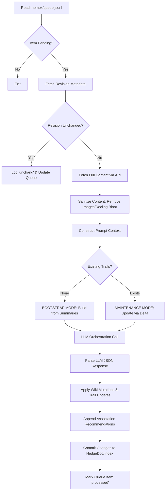

# Memex Knowledge Graph Construction

Building upon the structural foundations of [CNL Parsing & Graph Transformation](03_cnl_parsing___graph_transformation_.md), the **Memex Knowledge Graph Construction** subsystem (implemented as the Memex Processing Pipeline) serves as the execution engine for the entire ingestion lifecycle. It is responsible for transforming raw, unstructured documents—sourced from HedgeDoc 2 or Docling-generated JSON—into interconnected, semantically enriched nodes within a persistent knowledge graph.

The subsystem manages the transition of data from a pending state in `memex/queue.jsonl` to a fully indexed and linked component of the global topology.

## Architecture and Data Flow

The subsystem operates as a sequential, state-driven loop triggered by entries in the processing queue. The pipeline ensures that only new or modified information is processed, optimizing for token efficiency and computational cost.

### Interfaces and Dependencies

* **Input Interface**: Monitors `memex/queue.jsonl` for pending document aliases.
* **External Dependencies**:
    * **HedgeDoc 2 API**: Used for fetching raw Markdown content and retrieving revision UUIDs via the `revisions` endpoint.
    * **[LLM Orchestration & Chat Interface](01_llm_orcheally_chat_interface_.md)**: The primary engine used to execute the reasoning logic required for both Bootstrap and Maintenance modes.
    * **Docling**: Utilized as a source for structured JSON document ingestion.
* **Output Interfaces**:
    * **Wiki Mutations**: Updates to derived pages (entities, topics, etc.) in HedgeDoc 2.
    * **Trail Registry**: Updates to `memex-index.md` and the global `nodeBook`.
    * **Association Store**: Writing new potential links to `association-recommendations.jsonl`.

### Implementation Constraints

* **Revision Authority**: The system utilizes the HedgeDoc revision UUID as the primary cache key. If the `latest_revision` matches the `processed_revision` stored in the queue, all LLM processing is bypassed.
* **Context Window Management**: To prevent exceeding the LLM's `numCtx` limits, the pipeline implements a "Summary-Only" strategy for historical nodes. The full content of only the currently processed source is provided; all other documents are represented via compact summaries.
* **Sanitization Thresholds**: The pipeline enforces strict character limits on derived wiki page types (e.g., `source-summary`, `entity`) and maximum payload sizes to prevent downstream parsing failures in the [SpecDoc Specification Pipeline](02_specdoc_specification_pipeline_.md).

## Internal Implementation

The core logic is encapsulated within `memex/process_queue_once.py`.

### 1. Revision Validation
Before initiating heavy computation, the pipeline performs a lightweight check via an API call to `api_get(f"{queued_alias}/revisions")`. This ensures that the processing engine only consumes tokens when a legitimate change in the source document is detected.

### 2. Content Sanitization (`sanitize_llm_source`)
To maintain high semantic density and avoid context window overflow, the `sanitize_llm_source` function performs recursive cleaning of the input:
* **Markdown Cleaning**: Uses regular expressions to identify and replace `` patterns with a placeholder.
* **Docling JSON Pruning**: When processing `DoclingDocument` schemas, the function recursively traverses the JSON tree to remove keys or values containing base64-encoded images or internal `$ref` pointers to large image objects (e.g., `#/pictures/...`).

### 3. Prompt Construction and Mode Selection
The subsystem dynamically selects a prompting strategy based on the current state of the knowledge graph:

#### Bootstrap Mode
Triggered when `existing_trail_count == 0`. The prompt is constructed using `bootstrap_docs`, which consist of lightweight strings containing only the ID, Title, and Summary of all known documents. This allows the LLM to discover initial relationships within a sparse corpus.

#### Maintenance Mode
Triggered when trails already exist. The pipeline builds `prompt_docs` by:
1. Including the full content of the **new/revised** source.
2. Iterating through `index_sources` (historical documents) and appending their summaries.
3. Enforcing a `MAX_PROMPT_DOC_CHARS` limit to ensure the total payload remains within the LLM's physical context window.

### 4. Mutation Application
The pipeline parses the structured JSON response from [LLM Orchestration & Chat Interface](01_llm_orchestration___chat_interface_.md) and executes side effects:
* **Wiki Updates**: Pushes new or revised derived pages to the HedgeDoc API.
* **Trail Mutations**: Implements `upsert`/`delete` logic for the `memex-index.md`.
* **Association Discovery**: Appends potential links to `association-recommendations.jsonl` for later human review via the [Knowledge Graph Maintenance (Trails & Associations)](03_knowledge_graph_maintenance__trails___associations__.md) subsystem.

## Current Behavior vs. Known Gaps

### Current Behavior
* **Revision Awareness**: Skips processing if the document content hasn't changed.
* **Docling Support**: Specifically handles and shrinks large JSON document structures to preserve semantic context.
* **Contextual Summarization**: Automatically uses compact summaries for historical nodes to maximize context efficiency.
* **Atomic Commits**: Uses a "Lint-before-Commit" pattern (via `lint_memex.py`) to ensure that malformed LLM outputs do not corrupt the global index.

### Known Gaps
* **Single-Threaded Processing**: The pipeline processes one queue item at a time, which may create bottlenecks during large batch ingests of newly imported libraries or repositories.
* **Lack of Auto-Verification**: Association recommendations are written to a `.jsonl` file and rely entirely on human review; there is no secondary LLM pass to verify the validity of suggested links before they reach the user.

### Future Requirements
* **Parallel Ingestion**: Implementation of a multi-worker queue processor to handle multiple HedgeDoc updates simultaneously.
* **Automated Association Promotion**: A "Confidence Threshold" mechanism that automatically promotes high-confidence associations (e.g., $>0.95$) from the recommendation file to the canonical store without human intervention.

## Related Specification Documents
* [LLM Orchestration & Chat Interface](01_llm_orchestration___chat_interface_.md)
* [The Memex Trail System](02_the_memex_trail_system_.md)
* [Knowledge Graph Maintenance (Trails & Associations)](03_knowledge_graph_maintenance__trails___associations__.md)
* [Docling Content Sanitization](06_docling_content_sanitization_.md)
