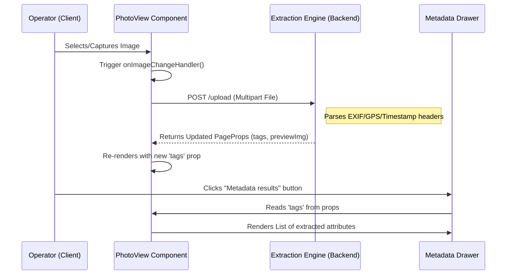

# Building Attribute Extraction (EXIF) Pipeline

Building upon the data ingestion and indexing capabilities established in [Memex Knowledge Graph Construction](04_memex_knowledge_graph_construction_.md), the **Building Attribute Extraction (EXIF) Pipeline** provides a specialized automated workflow for processing photographic evidence to extract embedded spatial and temporal metadata. 

## Purpose and Responsibility

The primary responsibility of this subsystem is to parse the binary headers of uploaded image files (specifically EXIF, IPTC, and XMP metadata) to retrieve "invisible" signatures. By extracting altitude, GPS coordinates, and timestamps, the pipeline enables the automatic placement of 3D models within their correct geographic context. 

The system serves as a digital forensic tool for construction site documentation, providing an automated, verifiable audit trail that eliminates manual data entry errors. Currently, the implementation provides:
1.  A user interface for triggering image uploads and direct mobile camera captures.
2.  An extraction engine (backend) for parsing binary headers.
3.  A visualization layer for displaying extracted metadata tags to the operator.

## Architecture and Data Flow

The subsystem implements a client-server pipeline where the frontend manages ingestion and previewing, while the backend handles the computational overhead of binary parsing.

### System Components
* **Ingestion Layer**: A React-based interface utilizing HTML5 `input` elements with `capture` attributes to facilitate mobile integration.
* **Metadata Parser (Backend)**: An extraction service that identifies and parses EXIF/IPTC/XMP headers from the uploaded binary stream.
* **Visualization Layer**: A Material UI (MUI) driven component tree that renders extracted metadata in a side drawer (`Drawer`) and provides real-time image previews.

### Data Flow Diagram: Metadata Extraction & Visualization
The following sequence diagram illustrates the lifecycle of an image from capture to metadata rendering.



### Interfaces and Dependencies
* **Core Dependencies**: `@mui/material`, `@mui/icons-material`, `react`.
* **Internal Data Structures**:
    * `PhotoViewProps`: Defines the structure for metadata rendering, specifically the `tags` object.
    * `Tag`: A structural type representing an individual extracted attribute description.
    * `tags: Record<string, Tag[] | Tag>`: A dictionary where keys represent EXIF tag names (e.g., "GPS Latitude") and values contain the extracted descriptions.

## Internal Implementation Details

The core logic is implemented within the React component layer, specifically in `resources/js/Pages/BuildingHeight/views/photo-view.tsx`.

### Image Ingestion Logic
The component manages file input via a visually hidden element to preserve UI aesthetics while enabling native hardware access.

* **Capture Mechanism**: The `VisuallyHiddenInput` utilizes the `type="file"` attribute with `accept="image/*"` and the `capture` property. This allows mobile browsers to bypass the standard file picker and invoke the device camera directly.
* **Event Handling**: The `onImageChangeHandler` function intercepts the `ChangeEvent`, extracts the `File` object from `e.target.files[0]`, and propagates the file data to the parent component via an `onImageChange` callback.

### Metadata Visualization Layer
To ensure high performance during large-scale inspections, the rendering of extracted attributes is optimized using React hooks.

* **Memoized Tag Rendering**: The `tagLists` constant is wrapped in a `useMemo` hook. This prevents expensive re-computations of the list structure during component re-renders unless the `tags` prop itself changes. It iterates over the `Record<string, Tag[] | Tag>` structure and transforms it into a series of `ListItem` components.
* **Dynamic Drawer Logic**: The visibility of the metadata results is controlled by the `extractedDrawerOpen` boolean property. The implementation uses MUI `List` and `ListItemText` to present the data in a standardized `primary` (value) and `secondary` (key) format.

```typescript
// Implementation snippet: Memoized tag list generation within photo-view.tsx
const tagLists = useMemo(() => {
  if (!tags) return null;
  return Object.keys(tags).map((keyName: any, i: any) => (
    <ListItem key={i}>
      <ListItemText
        primary={
          Array.isArray(tags[keyName])
            ? (tags[keyName] as Tag[])
                .map((item: any) => item.description)
                .join(", ")
            : (tags[keyName] as Tag)?.description || "-"
        }
        secondary={keyName}
      />
    </ListItem>
  ));
}, [tags]);
```

## Current Behavior
* **Multi-Modal Input**: Supports both manual file selection from local storage and direct camera capture on compatible mobile devices.
* **Real-time Previewing**: The `ImageSrc` component dynamically updates its `backgroundImage` property upon file selection, providing immediate visual confirmation of the asset.
* **Structured Metadata Display**: Extracted EXIF attributes are rendered in a structured list within a side drawer, accessible via a "Metadata results" trigger.

## Known Gaps
* **Lack of Client-side Validation**: There is currently no pre-upload validation for file size limits or MIME type integrity, which could lead to unnecessary backend processing of invalid files.
* **Absence of Parsing Feedback**: The UI lacks a dedicated loading state/spinner specifically for the asynchronous "parsing" phase; it relies on external props to signal completion.

## Future Requirements
* **Automated Verification**: Integration with [Unified Task & User Management (Inertia.js)](01_unified_task___user_management__inertia_js_.md) to automatically transition task statuses to "Verified" if the extracted GPS coordinates match the assigned task's spatial boundaries.
* **Error Boundary for Corrupted Data**: Implementation of a specialized error boundary to handle images with stripped, malformed, or corrupted EXIF headers without crashing the `PhotoView` component.

## Related Specification Documents
* [Unified Task & User Management (Inertia.js)](01_unified_task___user_management__inertia_js_.md)
* [Multi-View Map Orchestration](03_multi_view_map_orchestration_.md)
* [Spatial Data Filtering & Processing](07_spatial_data_filtering___processing_.md)
