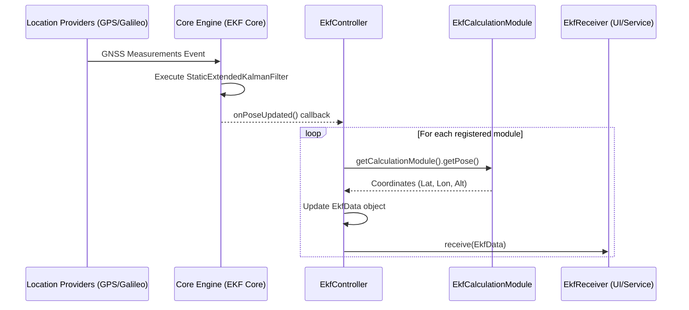

# EKF (Extended Kalman Filter) Positioning Engine

While [Tiered Location Sourcing](03_tiered_location_sourcing_.md) provides the raw GNSS measurements and navigation messages, the **EKF (Extended Kalman Filter) Positioning Engine** serves as the computational core that processes these signals to derive precise positioning. It implements a multi-module architecture where specialized filters are configured for different satellite constellations and frequency bands to produce highly accurate Position, Velocity, and Time (PVT) estimates.

## Purpose and Responsibility

The EKF Engine subsystem is responsible for:
1.  **Multi-Frequency/Multi-Constellation Processing**: Managing multiple independent Kalman filter instances, each optimized for specific signal characteristics (e.g., Galileo E1, GPS L5, etc.).
2.  **Physical Correction Application**: Orchestrating the application of atmospheric and relativistic corrections, including Shapiro (signal delay), Tropospheric, and Ionospheric delays, to raw GNSS observations.
3.  **PVT Estimation**: Utilizing the `StaticExtendedKalmanFilter` algorithm to process incoming GNSS updates and compute geodetic coordinates (Latitude, Longitude, Altitude).
4.  **Unified Pose Distribution**: Acting as a bridge between the low-level mathematical core and the Android application layers by providing an asynchronous notification mechanism (`EkfReceiver`) for updated poses.

## Architecture and Data Flow

The subsystem follows a Controller-Module pattern. The `EkfController` manages the lifecycle of several `EkfCalculationModule` instances, which wrap the underlying mathematical `CalculationModule`.

### Data Flow Pattern
1.  **Input Ingress**: The `EkfController` registers listeners for GNSS updates via `FusedLocationProviderClient` and `LocationManager`.
2.  **Core Processing**: The external `Core` engine receives raw measurements and executes the `StaticExtendedKalmanFilter` logic for all registered modules simultaneously.
3.  **Pose Update Trigger**: Upon a successful calculation, the `PoseUpdatedListener` inside `EkFController` is triggered.
4.  **Measurement Extraction**: The `updateMeasurement()` method iterates through all active `EkfCalculationModule` instances to extract the newly computed coordinates from their respective `CalculationModule`.
5.  **Data Normalization**: The extracted coordinates are mapped into a standardized `EkfData` object, including timestamping and altitude synchronization.
6.  **Egress**: The updated `EkfData` is passed to the registered `EkfReceiver`, which propagates the position to the [Path Tracking System (PTService)](02_path_tracking_system__ptservice__.md).



### Interfaces and Dependencies
* **Mathematical Core**: Relies on `eu.foxcom.gnss_compare_core` for the implementation of `Core`, `CalculationModule`, and `StaticExtendedKalmanFilter`.
* **Android Location Services**: Requires `LocationManager` and `FusedLocationProviderClient` for raw signal access.
* **Interface**: Uses `EkfReceiver` as the primary output interface for downstream consumers like [Path Tracking System (PT/Service)](02_path_tracking_system__ptservice__.md).

## Internal Implementation Details

### Module Configuration and Factory Pattern
The subsystem uses a factory pattern within `EkfCalculationModule` to instantiate pre-configured filtering chains. Each module defines its constellation, frequency, and required correction stack.

**File:** `app/src/main/java/com/erasmicoin/euspa/gsa/egnss4all/model/ekf/EkfCalculationModule.java`

```java
// Example of a factory method for GPS L5 configuration
public static EkfCalculationModule createDefaultGpsL5() throws ... {
    return new EkfCalculationModule(DEFAULT_MODULE.GPS_L5.name(), new CalculationModule(
            DEFAULT_MODULE.GPS_L5.name(),
            GpsL5Constellation.class, 
            new ArrayList<Class<? extends Correction>>() {{
                add(ShapiroCorrection.class);
                add(TropoCorrection.class);
                add(IonoCorrection.class); 
            }},
            StaticExtendedKalmanFilter.class, 
            SimpleFileLogger.class));
}
```

### Controller Orchestration
The `EkfController` manages the registration and simultaneous updating of all active modules. It handles the binding of modules to the central core engine during the `start()` sequence.

**File:** `app/src/cal/main/java/com/erasmicoin/euspa/gsa/egnss4all/model/ekf/EkfController.java`

```java
private void updateMeasurement() {
    for (String id : ekfCalculationModuleMap.keySet()) {
        EkfCalculationModule module = ekfCalculationModuleMap.get(id);
        EkfData ekfData = new EkfData();
        
        // Extract precise coordinates from the underlying math engine
        Coordinates coordinates = module.calculationModule.getPose();
        ekfData.latitude = coordinates.getGeodeticLatitude();
        ekfData.longitude = coordinates.getGeodeticLongitude();
        ekfData.altitude = coordinates.getGeodeticHeight();

        // Handle temporal synchronization
        if (coordinates.getRefTime() != null) {
            ekfData.referenceTime = new DateTime(coordinates.getRefTime().getMsec());
        }
        
        ekfData.computedTime = DateTime.now();
        module.ekfData = ekfData;
        
        // Notify the subscriber (e.g., PTService)
        module.callReceiver();
    }
}
```

## Current Behavior and Constraints

* **Multi-Module Support**: The system supports simultaneous tracking of multiple frequencies (L1, L5, E1, E5a) through independent `EkfCalculationModule` instances.
* **Correction Stack**: Each module is strictly configured with a specific set of `Correction` classes (Shapiro, Tropo, Iono) based on the frequency's susceptibility to atmospheric delays.
* **Constraints**:
    * **Registration Limits**: The system enforces a maximum number of simultaneous series via `NumberOfSeriesExceededLimitException`.
    * **Lifecycle Dependency**: Modules must be manually bound/unbound using `bind()` and `release()` to prevent memory leaks and stale calculation references.
    * **Threading**: The `onPoseUpdated` callback is driven by the GNSS update frequency, requiring efficient iteration over all modules to prevent processing lag.

## Known Gaps

* **Manual Module Management**: Currently, adding or removing modules (e.g., switching from GPS L1 to GPS L5) requires manual orchestration via `addModule` and `removeModule`, rather than an automated configuration-driven approach.
* **Error Propagation**: While the controller catches `EkfCreateException`, there is no unified error-handling strategy for individual module failures during runtime (e.g., if one constellation loses lock).

## Future Requirements

* **Dynamic Reconfiguration**: Implementation of a mechanism to dynamically add or remove modules based on real-time satellite visibility reported by [Tiered Location Sourcing](03_tiered_location_sourcing_.md).
* **Automated Error Recovery**: Implementing a "Self-Healing" logic where the `EkfController` can restart specific failed modules without interrupting the entire engine.

## Related Specifications

* [Path Tracking System (PTService)](02_path_tracking_system__ptservice_.md)
* [Tiered Location Sourcing](03_tiered_location_sourcing_.md)
* [Persistence Layer (Room Database)](05_persistence_layer__room_database_.md)
* [SyncQueue Orchestrator](06_syncqueue_orchestrator_.md)
