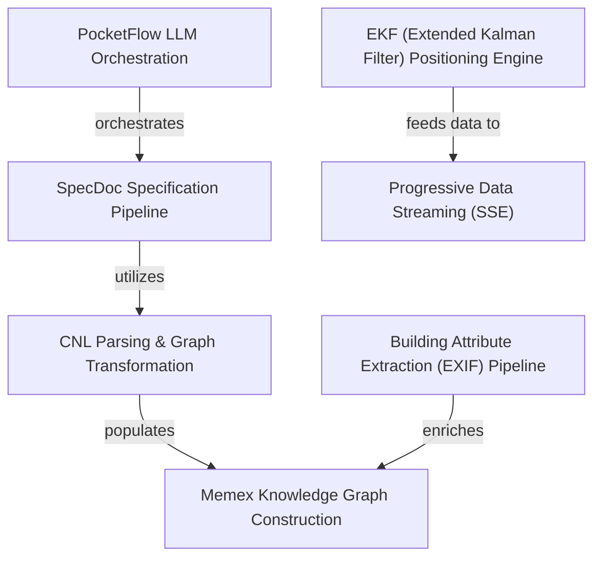

# specdoc Specification Index

The `specdoc` project is an **intelligent automation ecosystem** designed to transform *unstructured code and raw sensor data* into *structured, searchable knowledge*. By leveraging **PocketFlow orchestration**, the system automates technical documentation while integrating specialized streams—such as **GNSS positioning** and **geospatial metadata**—into a unified, navigable **knowledge graph**.

**Source Repository:** [None](None)

## Specifications

1. [PocketFlow LLM Orchestration
](01_pocketflow_llm_orchestration_.md)
2. [SpecDoc Specification Pipeline
](02_specdoc_specification_pipeline_.md)
3. [CNL Parsing & Graph Transformation
](03_cnl_parsing___graph_transformation_.md)
4. [Memex Knowledge Graph Construction
](04_memex_knowledge_graph_construction_.md)
5. [Building Attribute Extraction (EXIF) Pipeline
](05_building_attribute_extraction__exif__pipeline_.md)
6. [EKF (Extended Kalman Filter) Positioning Engine
](06_ekf__extended_kalman_filter__positioning_engine_.md)
7. [Progressive Data Streaming (SSE)
](07_progressive_data_streaming__sse__.md)
